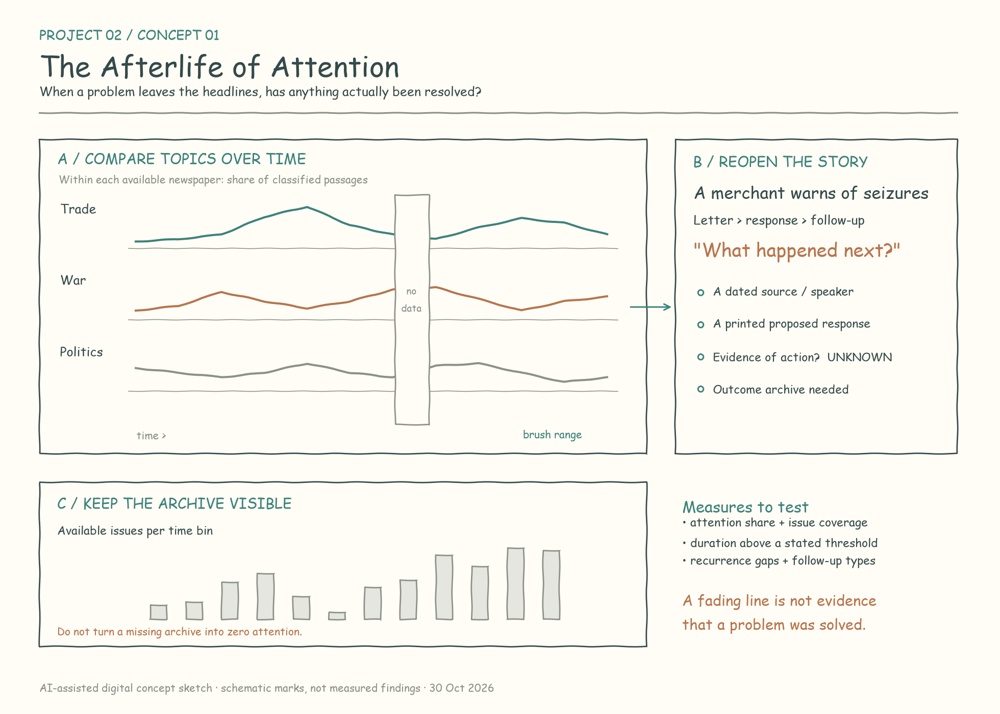
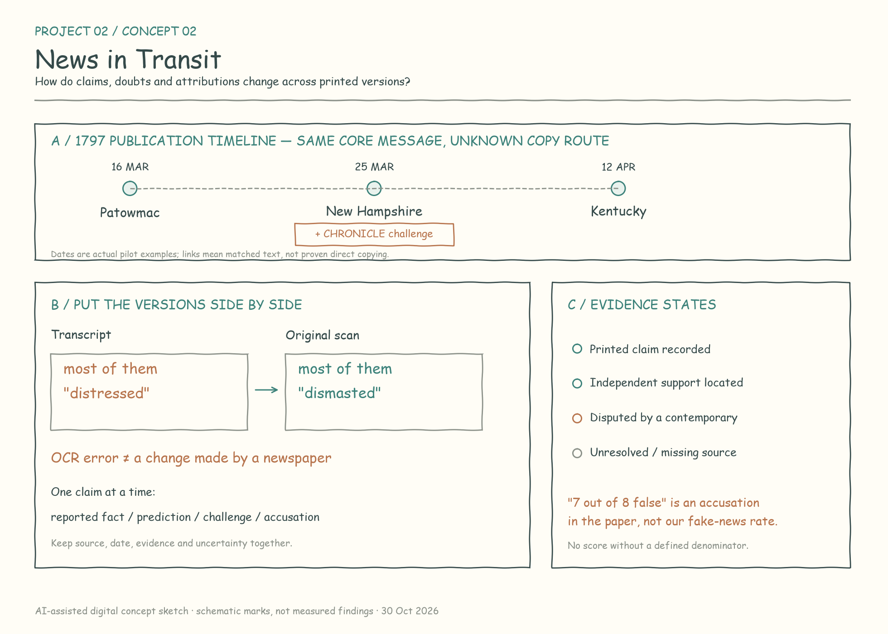
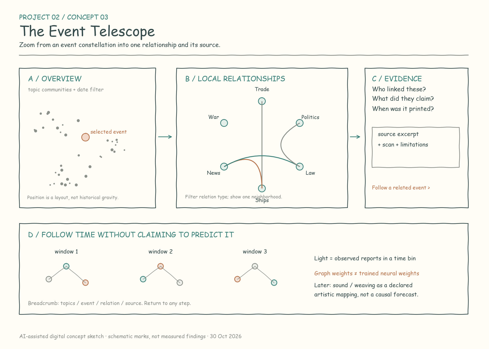

# Project 02 — Newspapers, Attention, and Connected Events

Three project concepts for **Major Studio 1**, using the Smithsonian Revolution Crossroads collection of [Chronicling America newspapers, 1770–1810](https://huggingface.co/datasets/RevolutionCrossroads/loc_chronicling_america_1770-1810).

**Sketch disclosure:** The images below are AI-assisted digital concept sketches, not scans of hand-drawn work. Their schematic charts and spatial layouts are design proposals, not measured results. The course asks for hand-drawn sketches; acceptance of these digital drafts still needs instructor confirmation, or replacement with student-made drawings.

## 01 · The Afterlife of Attention

When a problem disappears from the headlines, has it been resolved, or has attention simply moved elsewhere? This project follows recurring newspaper topics and asks whether later coverage remembers earlier demands, proposed responses, and outcomes. The starting hypothesis is that sustained attention may matter for social change; the project tests what the archive can reveal about persistence rather than assuming that attention causes resolution. Readers compare topic histories, open a recurring episode, and follow a merchant's complaint or a proposed public response into the subsequent record. Gaps in newspaper coverage remain visible, so an absent issue is not mistaken for public indifference.

- **Story:** The difference between a fading headline, a recurring problem, and a documented resolution.
- **Data:** Dated OCR passages, newspaper titles and identifiers, publication locations, issue/page records, proposed responses, and follow-up reports. Start with shipping and seizure coverage in 1793–1800; use the longer 1770–1810 corpus for coverage context.
- **Quantifiable:** Within-paper topic share per time bin; number of available issues; consecutive bins above a declared attention threshold; gaps between recurrences; counts of new reports, reprints, demands, responses, and outcome follow-ups. Compute a paper's share as its topic-assigned passages divided by all eligible classified passages in that bin, then compare both pooled and equal-paper summaries. Report denominators and sensitivity to missing issues.
- **Qualitative / personal accounts:** A letter dated February 18 and printed in *The Mirror* on June 24, 1799 warns merchants about seizures in the Bay of Honduras. Its attributed viewpoint offers a human entry into commercial insecurity; it is a mediated account, not a verified diary. [Original source](https://huggingface.co/datasets/RevolutionCrossroads/loc_chronicling_america_1770-1810/resolve/0b97906ad32e269376872934820357fc333151d8/media/sn83025525/1799-06-24_1_2.pdf?download=true).
- **Traditional charts:** Small-multiple line charts, a newspaper-by-time coverage heatmap, and a timeline distinguishing demands, actions, and outcomes.
- **Expressive visualization:** An “attention afterimage”: a topic trace can dim while unresolved questions remain outlined. Unknown outcomes must remain visibly unknown; the graphic must not imply that darkness means resolution.

**First test:** Annotate one bounded episode and the available follow-up issues. If outcome evidence is missing, present persistence and memory, not a claim about successful reform. The present full-corpus audit contains 77,793 page records, but its changing newspaper coverage prevents a simple equation between newspaper volume and society's total attention.

## 02 · News in Transit

A printed claim can travel across newspapers while acquiring commentary, losing context, or remaining remarkably stable. This project reconstructs small message families and lets readers compare versions beside the original scans. A pilot example follows a report attributed to Captain Boyd about a French fleet at Bantry Bay: three newspapers print a corresponding core passage, one adds a challenge, and a later report describes another outcome. The central story is how readers encountered certainty and doubt. “Fake news” becomes a set of explicit questions about evidence, attribution, and corrections, rather than a single automatic score.

- **Story:** How a message's wording and evidential status change between surviving versions.
- **Data:** Matched passages in both OCR fields, scans, publication dates, named sources, quoted letters, uncertainty expressions, editorial notes, and explicit corrections. The bounded pilot searches three date windows in 1794 and 1797.
- **Quantifiable:** Versions and distinct newspapers per message family; first-to-last observed publication interval; claim-level agreement and differences; presence of qualifiers and challenges. Measure qualifier loss only with a defensible parent–child copy link. Estimate a verified-false proportion only after defining an eligible factual-claim denominator and independent adjudication, with unresolved cases reported separately. Measure correction coverage only where follow-up observation is sufficient.
- **Qualitative / personal accounts:** Captain Boyd's attributed report and the appended **CHRONICLE** note expose competing interpretations of timing, routes, and credibility. A separate report attributed to Captain Whitney describes the seizure of Captain Samuel Allen's brig *Peace*. These voices are reported through editors; repetition does not create independent witnesses. [Boyd report and challenge](https://huggingface.co/datasets/RevolutionCrossroads/loc_chronicling_america_1770-1810/resolve/0b97906ad32e269376872934820357fc333151d8/media/sn83025588/1797-03-25_1_2.pdf?download=true).
- **Traditional charts:** A publication timeline, a claim-by-version comparison matrix, and counts by evidence status with unknowns visible.
- **Expressive visualization:** A “message microscope” aligns passages and scans. Doubt, attribution, and added commentary appear as separate annotation layers, while missing source documents appear as gaps.

**Pilot result:** Two search passes produced 24 candidate pages; nine pages received targeted scan review, supporting three matched message groups and a 15-claim ledger. An apparent change from *dismasted* to *distressed* proved to be a transcription error in one OCR field. Another printed commentary alleges that seven of eight cited reports were false; this is an accusation, not our measured falsehood rate. Direct copying routes, intent to deceive, and an overall fake-news rate remain unestablished. [Pilot evidence and limits](research/field-notes.md).

## 03 · The Event Telescope

Historical events rarely appear in isolation: a seizure may become a commercial warning, a diplomatic demand, or an argument for naval protection. This project lets readers enter through a constellation of events, focus on one, and examine its documented relationships through a restrained circular view. Each connection leads to its speaker, publication date, quoted passage, and scan. Readers can move from one event to another while keeping a trail of their exploration. The astronomical metaphor supplies a way to navigate scales, but the relationships remain historically situated claims rather than gravitational forces.

- **Story:** How different actors connect trade, diplomacy, war, political arguments, and institutions.
- **Data:** The existing 15-record relation pilot from 1793–1800, spanning ten newspaper series; event/topic labels; relation types; speakers; publication and source dates; citations and scans. Expand only after confirming article boundaries and reusable event identifiers.
- **Quantifiable:** Counts of distinct relation statements by type and time; observed reports versus deduplicated message families; documented connections per event; available source coverage. Any network degree describes this sampled evidence graph, not objective historical importance. Avoid treating a category-level edge as evidence that every event in the two categories is related.
- **Qualitative / personal accounts:** Editorial arguments and attributed testimony explain why a connection was made. For example, a December 1800 account of Rutledge's remarks connects French military success with a proposal for permanent American military institutions; it records an argument, not proof of causation. [Original source](https://huggingface.co/datasets/RevolutionCrossroads/loc_chronicling_america_1770-1810/resolve/0b97906ad32e269376872934820357fc333151d8/media/sn84024710/1800-12-26_1_2.pdf?download=true).
- **Traditional charts:** A relation matrix, a dated event timeline, and linked small multiples by newspaper or relation type.
- **Expressive visualization:** An event constellation with semantic or curated grouping, a Circos-inspired local neighborhood, breadcrumbs, and a source drawer. Encode position, size, brightness, and line style explicitly. A time slider can highlight observed publications; it must not imply recovered neural activity or a validated propagation process.

**First test:** Ask whether a reader can explain one connection, identify who asserted it, and return to the original page. Keep the circular view local and filtered. Neural prediction would require a defined outcome, learned parameters, held-out time periods and message families, and comparison with simple baselines. Counterfactual history requires additional causal evidence. Sound or weaving could later use this graph through a declared artistic mapping without claiming predictive validity.

## How the concepts differ

| Concept | Main unit | Main question | Feasible first output |
| --- | --- | --- | --- |
| Attention | Topic over time | Does coverage persist, return, or follow through? | Coverage-aware topic histories + one documented episode |
| Transit | Claim across versions | What changed, and what evidence supports it? | A small, scan-checked message family |
| Telescope | Event and asserted relationship | Who connects this event to another, and why? | A navigable local graph with traceable sources |

**Current recommendation:** Develop **News in Transit** as the most bounded empirical study, and use the **Event Telescope** as its exploration interface. Keep the attention hypothesis as a longer-term research question until coverage and outcome tracking are stronger. The concepts remain alternatives for critique, not three simultaneous full builds.

## Data, provenance, and limits

- Fixed dataset revision: `0b97906ad32e269376872934820357fc333151d8`.
- The full audit counts 77,793 page records and 110 LCCN series identifiers; these are not 77,793 independent articles or 110 fully harmonized newspapers. Newspaper survival and digitization are uneven.
- The earlier topic pilot sampled 100 pages per year (4,100 total) and produced 24 provisional topics. It is an exploratory model, not a complete census of themes.
- OCR quality, article boundaries, reprints, missing issues, and editorial mediation affect all three concepts. Critical passages need scans. No independent second-reader review has yet been completed.
- [Research field notes](research/field-notes.md) · [Selected claim/version ledger](research/chain-pilot.json) · [Relation ledger](research/relations.json) · [Chinese overview](README.zh-CN.md).
- Sketches are provided as PNG previews and editable SVG files in [`sketches/`](sketches/).

## References and visual precedents

- [Revolution Crossroads newspaper dataset](https://huggingface.co/datasets/RevolutionCrossroads/loc_chronicling_america_1770-1810): source data and page scans.
- [United States Statutes at Large, vol. 1, p. 401, Resolution V](https://tile.loc.gov/storage-services/service/ll/llsl/llsl-c3/llsl-c3.pdf#page=61): external check on the May 7, 1794 clearance resolution, not its implementation.
- [Viral Texts](https://viraltexts.org/): a methodological precedent for newspaper reprint research.
- [Histography](https://histography.io/): historical-event overview and time navigation.
- [Circos](https://www.circos.ca/): circular relationship displays.
- [Embedding Atlas](https://apple.github.io/embedding-atlas/): searchable, linked exploration of semantic spaces; proximity does not establish causation.
- [A Gentle Introduction to Graph Neural Networks](https://distill.pub/2021/gnn-intro/): the distinction between graph data and trained predictive models.

## Submission

Project repository: **https://github.com/Major-Studio-1/Project-02-newspapers**

The student will submit this link in Canvas. The hand-drawing requirement remains subject to instructor confirmation or replacement of the disclosed digital drafts.

