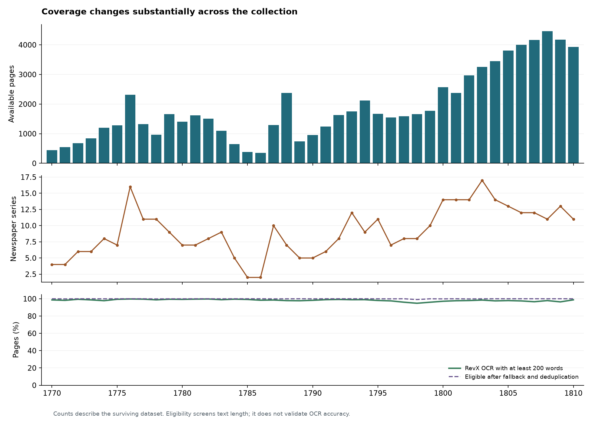

# Earlier English analysis report

## How newspaper attention rises, persists, and returns

**Coverage audit and exploratory topic discovery for Chronicling America, 1770–1810.** Original report dated October 27, 2026.

- **[Read the complete report on GitHub](attention_pilot_report.md)** — all findings, topic descriptions, tables, figures, and source-linked examples.
- **[Download the original HTML](https://raw.githubusercontent.com/Major-Studio-1/Project-02-newspapers/main/reports/attention_pilot_report.html)** — save the page as an HTML file and open it in a browser for the original layout and topic filter. Alternatively, download the repository ZIP and open `reports/attention_pilot_report.html`. The figures are embedded, so they display offline; external source links require internet access.
- [Coverage audit data](coverage_audit.json) · [Topic pilot data](topic_pilot.json) · [Original validation results](analysis_validation.json).

The report audits **77,793 page records**, then explores **4,100 sampled pages**, **49,585 passages**, and **24 provisional topics**. It covers collection gaps, model-based topic trajectories, a candidate topic hierarchy, supporting OCR passages, methods, limitations, and next research steps. All 96 original evidence passages remain in the readable edition.

The figures and estimates are exploratory model results, not measurements of total societal attention, causal effects, or resolved historical problems. The original report is preserved without changing its analytical content. This is the earlier English report, separate from the later relation and message-chain pilots.

