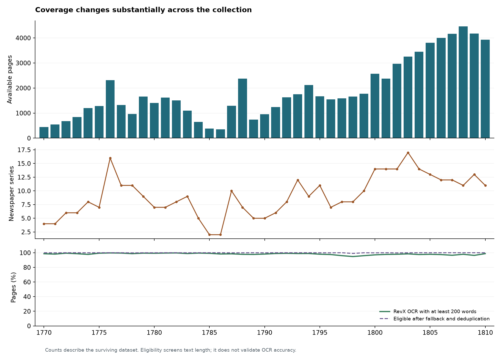
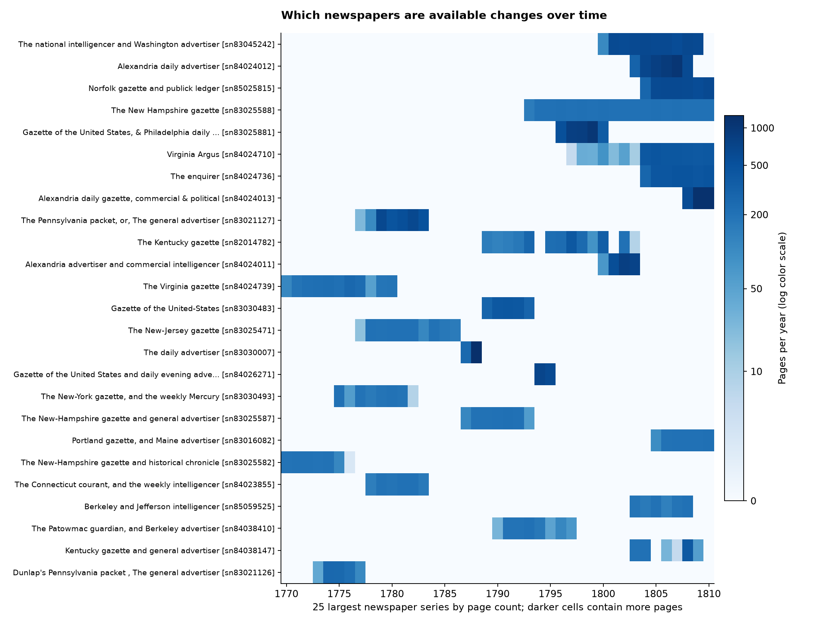
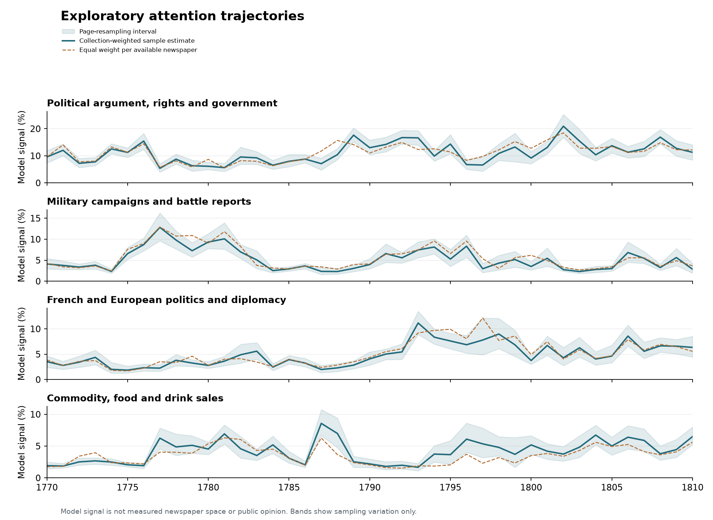

Research pilot · 1770–1810 · 27 October 2026

# How newspaper attention rises, persists, and returns

*Original English analysis report · 27 October 2026.*

[Download the original standalone HTML](https://raw.githubusercontent.com/Major-Studio-1/Project-02-newspapers/main/reports/attention_pilot_report.html) and open the saved file in a browser to use its topic filter. This GitHub-readable edition retains all 24 topic entries, 96 supporting OCR passages, 26 tables, and three figures. Expand the details panels to inspect estimates and examples.

Coverage audit and exploratory topic discovery for Chronicling America. Working question: which recurring issues sustain attention, and how could those trajectories be connected to independently documented historical change?

**77,793** Pages audited

**110** Newspaper series

**4,100** Pilot pages

**49,585** Pilot passages

**Exploratory results.** The topic groups below are analyst interpretations of a statistical pilot. Shares represent model signal in sampled OCR text. They do not measure public opinion, establish causal competition, or identify historical resolution.

## What the first pass establishes

- Coverage is strongly uneven: 356 pages in 1786 versus 4,466 in 1808. Only two newspaper series are represented in both 1785 and 1786. No single LCCN newspaper series spans the full 41-year period; the longest covers 18 observed years.
- The baseline finds interpretable subject-and-format groups, including political argument, military campaigns, maritime activity, European affairs, land transactions and several kinds of legal notices. Three components are reserved for formats or unresolved clusters rather than presented as substantive topics.
- Military reporting has repeated broad surges in this sample: estimated model signal is 3.2% in 1770–1774, 8.7% in 1775–1779, 2.5% in 1785–1789 and 6.7% in 1790–1794. This is evidence to investigate distinct attention episodes, not proof that the same historical problem repeated.
- The French/European affairs component rises from 3.1% in 1770–1774 to 7.6% in 1795–1799, then remains visible at 6.4% in 1805–1810. These are collection-weighted model estimates, not measured newspaper space.
- Several persistent groups are commercial or legally required notice formats. Their recurrence must be distinguished from sustained public engagement with a social problem.
- Median agreement between the two model runs is high (0.99), but the escape/reward notices component (0.04), royal-authority component (0.20), and letter-format component (0.50) are much less stable. A high median does not validate every group.
- Spot checks confirm that some RevX passages summarize statutes or describe tables rather than transcribing all their text. Across 76,130 pages with at least 200 words in both OCR fields, the median RevX/original-OCR word-count ratio is 0.951; 2,651 ratios fall below 0.5. Differences can have multiple causes and are not a count of summarization errors. OCR word volume should not be equated with printed attention.

## Coverage comes before interpretation

The audit covers all 77,793 source records, representing 19,445 issue/edition combinations, 110 newspaper series and 48 publication-location labels. The dates run from 1770-01-05 through 1810-12-31.

RevX OCR is nonempty for 76,311 pages (98.1%); 76,250 meet the 200-word screen. Original CA OCR supplies 1,499 fallback pages before deduplication. After the screen and duplicate exclusions, 77,749 pages remain eligible for sampling. Duplicate page keys: 0; repeated identical text for the same issue/page: 0. These diagnostics may overlap.

Annual coverage table

| Year | Pages | Series | RevX nonempty | Eligible pages | Largest series share |
| --- | --- | --- | --- | --- | --- |
| 1770 | 448 | 4 | 98.7% | 448 | 43.8% |
| 1771 | 546 | 4 | 98.4% | 545 | 36.6% |
| 1772 | 675 | 6 | 99.4% | 675 | 31.4% |
| 1773 | 846 | 6 | 98.7% | 846 | 26.2% |
| 1774 | 1,205 | 8 | 97.9% | 1,204 | 22.3% |
| 1775 | 1,286 | 7 | 99.4% | 1,286 | 23.0% |
| 1776 | 2,319 | 16 | 99.7% | 2,319 | 24.6% |
| 1777 | 1,320 | 11 | 99.5% | 1,320 | 19.8% |
| 1778 | 970 | 11 | 99.0% | 968 | 21.1% |
| 1779 | 1,660 | 9 | 99.5% | 1,659 | 38.0% |
| 1780 | 1,406 | 7 | 99.3% | 1,405 | 33.5% |
| 1781 | 1,623 | 7 | 99.6% | 1,623 | 33.1% |
| 1782 | 1,509 | 8 | 99.8% | 1,509 | 41.7% |
| 1783 | 1,100 | 9 | 99.0% | 1,099 | 45.1% |
| 1784 | 644 | 5 | 99.8% | 644 | 47.2% |
| 1785 | 380 | 2 | 99.2% | 380 | 54.7% |
| 1786 | 356 | 2 | 98.3% | 356 | 56.2% |
| 1787 | 1,297 | 10 | 98.6% | 1,295 | 31.8% |
| 1788 | 2,379 | 7 | 98.0% | 2,377 | 52.8% |
| 1789 | 742 | 5 | 97.7% | 742 | 39.4% |
| 1790 | 950 | 5 | 98.2% | 949 | 43.8% |
| 1791 | 1,242 | 6 | 99.0% | 1,242 | 34.5% |
| 1792 | 1,629 | 8 | 99.2% | 1,629 | 25.4% |
| 1793 | 1,751 | 12 | 98.9% | 1,751 | 19.4% |
| 1794 | 2,119 | 9 | 99.0% | 2,119 | 32.2% |
| 1795 | 1,668 | 11 | 98.1% | 1,667 | 36.0% |
| 1796 | 1,552 | 7 | 97.8% | 1,550 | 33.3% |
| 1797 | 1,587 | 8 | 96.0% | 1,587 | 50.9% |
| 1798 | 1,656 | 8 | 96.0% | 1,641 | 50.0% |
| 1799 | 1,772 | 10 | 96.0% | 1,771 | 57.8% |
| 1800 | 2,575 | 14 | 97.3% | 2,571 | 20.7% |
| 1801 | 2,372 | 14 | 97.8% | 2,372 | 25.0% |
| 1802 | 2,968 | 14 | 98.0% | 2,962 | 27.6% |
| 1803 | 3,250 | 17 | 98.6% | 3,248 | 22.5% |
| 1804 | 3,444 | 14 | 97.6% | 3,444 | 19.5% |
| 1805 | 3,806 | 13 | 97.9% | 3,806 | 21.3% |
| 1806 | 4,003 | 12 | 97.6% | 4,003 | 22.7% |
| 1807 | 4,167 | 12 | 96.6% | 4,167 | 25.1% |
| 1808 | 4,466 | 11 | 97.9% | 4,465 | 14.1% |
| 1809 | 4,172 | 13 | 96.4% | 4,172 | 28.2% |
| 1810 | 3,933 | 11 | 98.9% | 3,933 | 30.0% |

## Working figures for attention trajectories

Solid lines estimate the topic's share of model signal using the collection's newspaper-series/year composition. Dashed lines give each available newspaper series equal weight. Differences show sensitivity to weighting; agreement does not remove archive-selection bias. The bands reflect page resampling only. No smoothing or historical event annotations have been added.

## Candidate topic hierarchy

The 24 statistical components have been given provisional labels and broad groupings after reviewing leading terms and representative OCR passages. The model discovered components before these category names were assigned. These seven organizational groups are a first review structure, not a validated historical taxonomy. List, location and correspondence components remain separate from substantive issue candidates. Component count and category boundaries remain open to revision.

| ID | Provisional category | Candidate topic | Leading terms | Restart agreement | Review note |
| --- | --- | --- | --- | --- | --- |
| [T01](#T01) | Politics and public institutions | Political argument, rights and government | people, government, power, constitution, country, public, principles | 0.99 | Broad political language; split into specific issues before testing persistence or resolution. |
| [T02](#T02) | Politics and public institutions | Published statutes and legal authority | act, court, enacted, person, persons, law, county | 0.99 | Statutory format spans many issues. A checked RevX example abbreviates substantial provisions with ellipses. |
| [T03](#T03) | War, diplomacy and shipping | Shipping, ports and naval encounters | ship, capt, arrived, board, brig, captain, port | 0.93 | Combines commercial shipping with naval conflict; refine those branches before interpretation. |
| [T04](#T04) | Commerce, property and everyday transactions | Textiles, clothing and dry-goods sales | silk, black, white, cotton, handkerchiefs, plain, cloths | 1.00 | Commercial advertising attention should be distinguished from editorial attention. |
| [T05](#T05) | Commerce, property and everyday transactions | Stray horses and recovery notices | years old, horse, old, mare, high, branded, years | 0.88 | Some restart sensitivity (0.88); descriptions overlap with other reward notices. |
| [T06](#T06) | Politics and public institutions | Federal institutions and official announcements | states, united states, united, president, congress, president united, states america | 0.98 | Changing institutional names affect comparability across 1770–1810; this is not one stable underlying issue. |
| [T07](#T07) | Commerce, property and everyday transactions | Land, farms and property sales | acres, land, tract, containing, good, containing acres, county | 1.00 | Property transactions can include confiscation or other political contexts; inspect the individual notices. |
| [T08](#T08) | Law, debt and taxation | Court orders and chancery notices | court, copy, complainant, defendant, defendants, copy order, ordered | 1.00 | Formulaic notice wording can recur without representing the same dispute. |
| [T09](#T09) | War, diplomacy and shipping | Military campaigns and battle reports | enemy, army, troops, men, killed, wounded, general | 0.99 | Recurring vocabulary joins distinct conflicts. Separate places and events before claiming the same problem returns. |
| [T10](#T10) | Law, debt and taxation | Estate administration and debt settlement | indebted, estate, persons, payment, demands, make, deceased | 1.00 | Separate routine estate administration from broader claims about debt distress. |
| [T11](#T11) | War, diplomacy and shipping | French and European politics and diplomacy | french, france, war, paris, emperor, peace, republic | 0.97 | A broad foreign-affairs group; distinguish specific wars, regimes and diplomatic questions. |
| [T12](#T12) | Politics and public institutions | Legislative proceedings and committee reports | committee, house, report, motion, read, resolution, referred | 0.98 | Measures procedural reporting, spanning multiple substantive questions. |
| [T13](#T13) | Formats and unresolved clusters | Place names, routes and mixed local material | york, new york, new, city, state, jersey, state new | 0.99 | Not accepted as a substantive topic. Geography is a feature here, not an established issue category. |
| [T14](#T14) | Literature and reflection | Poetry and moral or religious reflection | man, life, thy, like, world, let, time | 0.99 | A broad genre and rhetorical register, not one coherent social problem. |
| [T15](#T15) | Commerce, property and everyday transactions | Lotteries and monetary amounts | dollars, paid, tickets, money, sum, lottery, prizes | 1.00 | Split lottery advertising from banking and other finance; shared currency words are not one issue. |
| [T16](#T16) | Coercion and escape | Escape and capture-reward notices | reward, away, feet, inches, inches high, feet inches, named | 0.04 | Very weak restart agreement (0.04). Do not interpret this component as a validated measure of slavery, resistance or emancipation. |
| [T17](#T17) | Commerce, property and everyday transactions | Commodity, food and drink sales | rum, sugar, coffee, boxes, wine, sale, casks | 1.00 | Commodity lists are not evidence of a public debate; retain as a separate advertising stream. |
| [T18](#T18) | Formats and unresolved clusters | Personal-name lists | john, william, james, thomas, samuel, joseph, george | 1.00 | Not accepted as a substantive topic. Remove or tag the list format before rediscovering issues. |
| [T19](#T19) | Formats and unresolved clusters | Letter extracts and correspondent reports | letter, extract, extract letter, dated, gentleman, letter gentleman, received | 0.50 | A news format, not a substantive issue; restart agreement is modest (0.50). |
| [T20](#T20) | Politics and public institutions | Crown, Parliament and royal authority | majesty, lord, king, council, excellency, sir, parliament | 0.20 | Weak restart agreement (0.20); identity and estimated decline require further model review. |
| [T21](#T21) | War, diplomacy and shipping | Britain–America relations and trade | britain, great britain, great, america, british, trade, colonies | 0.82 | Some restart sensitivity (0.82); useful candidate for finer issue discovery, not a finalized recurring problem. |
| [T22](#T22) | Commerce, property and everyday transactions | Business, shops and premises notices | street, house, sale, store, terms, public, business | 1.00 | Broad advertising language; further splitting is needed to recover substantive subtopics. |
| [T23](#T23) | Law, debt and taxation | Delinquent land taxes and tax sales | proprietors, taxes, new hampshire, hampshire, pay, tax, owners | 1.00 | Strong regional and notice-format concentration. A checked RevX example describes tax tables instead of fully transcribing them. |
| [T24](#T24) | Law, debt and taxation | Insolvent estates and probate claims | creditors, estate, commissioners, claims, probate, creditors estate, insolvent | 1.00 | Overlaps estate and debt settlement; merge or retain as a narrow subtype after review. |

## Politics and public institutions

### T01 · Political argument, rights and government

Debate about government power, constitutional principles, liberty, rights and the conduct of public officials.

Genre: Political essays and commentary · Classification role: candidate\_subject

Leading terms: people, government, power, constitution, country, public, principles, laws, citizens, liberty, rights, ought, state, right

Restart agreement: 0.99 cosine similarity. Broad political language; split into specific issues before testing persistence or resolution.

Coarse period estimates

| Period | Estimated model share |
| --- | --- |
| 1770-1774 | 10.2% |
| 1775-1779 | 10.2% |
| 1780-1784 | 7.4% |
| 1785-1789 | 10.1% |
| 1790-1794 | 13.9% |
| 1795-1799 | 10.4% |
| 1800-1804 | 13.8% |
| 1805-1810 | 13.2% |

#### Supporting OCR passages

1801-12-29 · Republican ledger, and Portsmouth price current · page 2 · held-out page

Portsmouth, N.H. · OCR: RevX · passage 5

> liberties of a people entire, and always will be—there are no men so superlatively virtuous, to whom a few hints from a public paper will not some time or other be, if not absolutely necessary, at least useful; and more especially if these men are entrusted with the administration of the affairs of a free people.
>
> But the manner in which the present administration and all its measures have been handled by some federal editors, sufficiently proves that their intention is not to correct the procedure, not to have measures which they term ruinous and subversive of the constitution, altered—neither can their conduct proceed from a dread lest improper measures might be adopted if they did not openly attack the administration;—no, the object of some of the federal prims can be nothing else than to bring the principle of a republican government into disrepute, by lavishing indiscriminate abuse on the men entrusted with the administration thereof.
>
> If the federal prints seriously thought that there was any danger to be apprehended from the persons at present administering the government, either from their ambition, their extravagance, or from their former conduct, they would be justified in their endeavours to bring about a change in the public sentiments, with regard to the public servants—but what are we to think

[Page scan (PDF)](https://tile.loc.gov/storage-services/service/ndnp/nhd/batch_nhd_eider_ver01/data/sn84023379/00541315792/1801122901/0022.pdf) · [Library of Congress issue](https://www.loc.gov/item/sn84023379/1801-12-29/ed-1/)

1788-11-06 · The New-York journal, and weekly register · page 3 · held-out page

New-York \[N.Y.\] · OCR: RevX · passage 5

> and important which society can boast of, and ought to pervade and animate the citizens of every free government; for if these sacred rights are treated with indifference and inattention, we may have to lament that we ever became free and independent. It is from a just and upright legislature that this country can expect to be relieved from her present embarrassments, and establish her future prosperity; and it is from that truly patriotic spirit which dignifies and adorns every friend of liberty, that we can preserve the blessings of peace and happiness. Let us then with a becoming firmness investigate the characters of those candidates for power and pre-eminence, that may offer to represent us under the new constitution. To scrutinize those who may exhibit themselves to the public as the political guides of a whole community, is a duty we owe to mankind
>
> and to our country: and if we should be so happy as to place our confidence in men of liberality, integrity, and virtue, we may expect to transmit our independence to future generations—but if wicked men should step into authority, they will encourage animosities in every department of society, impede the progress of government, obstruct all moral improvement, retard the operation of the most salutary laws, and promote the establishment of a government that

[Page scan (PDF)](https://tile.loc.gov/storage-services/service/ndnp/dlc/batch_dlc_bureau_ver02/data/sn83030567/print/1788110601/0003.pdf) · [Library of Congress issue](https://www.loc.gov/item/sn83030567/1788-11-06/ed-1/)

1801-02-12 · Republican gazette · page 4

Concord, N.H. · OCR: RevX · passage 6

> legislature to enact such laws as, in their opinion, will promote the public good, not repugnant to the Constitution, which they have solemnly sworn to support; so it is also a privilege reserved to the people by that constitution annually to elect such of their fellow citizens as they may judge best qualified to discharge this important trust;—if, therefore, it shall appear that at any time their rulers have exercised arbitrary powers, unreasonably deprived their fellow citizens of their property and their rights, in violation of justice and the constitution; and to the injury of the community at large; being their duty, it will undoubtedly be the inclination of the free electors of this state to withhold their suffrages from such characters in future, and bestow them on those in whose abilities and integrity they have greater confidence.
>
> Some further observations and enquiries on this head, will be attended to as opportunity may permit, by A STOCKHOLDER in the late N. H. Union Bank.
>
> Republican Gazette.
>
> The EDITOR to the PUBLIC.
>
> THE REPUBLICAN GAZETTE is established upon REPUBLICAN principles—It shall be devoted, not exclusively to a party, but to the general interests of all our citizens:—The Editor knows no foreign influence—He will endeavor to give publicity to TRUTH; to such principles as shall tend to the

[Page scan (PDF)](https://tile.loc.gov/storage-services/service/ndnp/nhd/batch_nhd_eider_ver01/data/sn84022876/00541315780/1801021201/0004.pdf) · [Library of Congress issue](https://www.loc.gov/item/sn84022876/1801-02-12/ed-1/)

1805-08-10 · Virginia Argus · page 2

Richmond, Va. · OCR: RevX · passage 2

> people. Under those happy political institutions which by this joyful occurrence have fallen to the lot of Louisiana; I sincerely hope, and confidently believe that the people will always have reason to rejoice, and I have no doubt but that by a wise and judicious exercise, and by a prudent and careful application of those glorious privileges, for which the constitution and the laws of the U. States are so justly celebrated, they will experience all that happiness and freedom, safety and prosperity which their brethren in the U. States so eminently enjoy. I am confident that the citizens of Louisiana will not be found less impressed with the importance of supporting and preserving the spirit of our government, or less devoted to the principles of the federal constitution, the rock of our national salvation, than any other of their fellow citizens in the union; that they will cultivate and promote by every expedient in their power, the constitution and laws laid down for their government, as the best means of securing to themselves and posterity all the principles of rational and practical liberty. A constitution, which has arisen out of society or out of the social compact in conformity with the natural dignity of human nature, and not from superiority or conquest; and administered upon the humane and benevolent

[Page scan (PDF)](https://tile.loc.gov/storage-services/service/ndnp/vi/batch_vi_otters_ver02/data/sn84024710/00414184182/1805081001/0290.pdf) · [Library of Congress issue](https://www.loc.gov/item/sn84024710/1805-08-10/ed-1/)

### T02 · Published statutes and legal authority

Printed acts, legal provisions, legislative authority and rules governing persons or public offices.

Genre: Statutes and official texts · Classification role: subject\_and\_format

Leading terms: act, court, enacted, person, persons, law, county, state, entitled, assembly, passed, entitled act, general, time

Restart agreement: 0.99 cosine similarity. Statutory format spans many issues. A checked RevX example abbreviates substantial provisions with ellipses.

Coarse period estimates

| Period | Estimated model share |
| --- | --- |
| 1770-1774 | 4.7% |
| 1775-1779 | 5.8% |
| 1780-1784 | 5.1% |
| 1785-1789 | 6.5% |
| 1790-1794 | 4.4% |
| 1795-1799 | 5.0% |
| 1800-1804 | 5.4% |
| 1805-1810 | 4.8% |

#### Supporting OCR passages

1776-10-02 · The Pennsylvania gazette · page 3 · held-out page

Philadelphia, Pa. · OCR: RevX · passage 7

> incapable of executing such their offices; in which case some other fit person or persons shall, pursuant to law, be appointed or elected as the case may require.
>
> 2. And whereas it is necessary that fit persons be duly empowered to qualify the Magistrates and other officers who have been or shall be elected, appointed or commissioned throughout this State; be it enacted by the authority aforesaid, that his Excellency the Governor, or the Commander in Chief for the time being, shall be, and he is hereby authorized to issue commissions of dedimus protestatem, or other commissions, from time to time, as occasion may require, for the purposes aforesaid.
>
> 3. And be it enacted by the authority aforesaid, That the act passed the 5th of May 1772, intitled, "An act for the security of his Majesty's government of New-Jersey," and so much of the act passed the 10th of February, 1727-8, intitled, "An act prescribing the forms of declaration of fidelity, the effect of the abjuration oath and affirmation, instead of the form heretofore required in such cases; and for repealing the former acts in the like cases made and provided," as relates to taking affirmations to the King of Great-Britain, and the acts thereby repealed, shall be, and the same are hereby repealed.
>
> Passed at Princeton the 19th of September, 1776.
>
> Pursuant to the

[Page scan (PDF)](https://tile.loc.gov/storage-services/service/ndnp/dlc/batch_dlc_bowden_ver04/data/sn84026371/print/1776100201/0003.pdf) · [Library of Congress issue](https://www.loc.gov/item/sn84026371/1776-10-02/ed-1/)

1785-03-14 · The New-Jersey gazette · page 2 · held-out page

Burlington \[N.J.\] · OCR: RevX · passage 1

> STATE OF NEW-JERSEY.
>
> An Act for the relief of persons who have purchased property for the use of the publick.
>
> WHEREAS divers persons have heretofore purchased provision, forage and other articles, necessary for the supply of the army...
>
> Sect. 1. Be it Enacted by the Council and General Assembly of this State, and it is hereby Enacted by the Authority of the same...
>
> 2. And be it further Enacted, That this act shall be and continue in force for one year, and no longer. Passed at Trenton, December 24, 1784.
>
> STATE OF NEW-JERSEY.
>
> A supplement to the Act, intitled, An Act for the regulating, training and arraying of the militia...
>
> WHEREAS the fines inflicted for neglect of duty by the act, intitled, 'An act for the regulating, training and arraying of the militia...
>
> Sect. 1. Be it Enacted by the Council and General Assembly of this State, and it is hereby Enacted by the Authority of the same...
>
> 2. And be it further Enacted, That each and every justice of the peace within this state shall, within thirty days after issuing such warrant...
>
> 3. And be it further Enacted, That in case of prosecution of any private for recovery of any fine or forfeiture...
>
> Passed at Trenton, December 24, 1784.
>
> Foreign Intelligence.
>
> CHARLESTON, Feb. 7.
>
> Saturday afternoon arrived the ship Castle-douglas, Captain Douglas, in five weeks from London, by whom

[Page scan (PDF)](https://tile.loc.gov/storage-services/service/ndnp/dlc/batch_dlc_annegreen_ver02/data/sn83025471/print/1785031401/0002.pdf) · [Library of Congress issue](https://www.loc.gov/item/sn83025471/1785-03-14/ed-1/)

1804-01-31 · Kentucky gazette and general advertiser · page 3

Lexington \[Ky.\] · OCR: RevX · passage 5

> has expired; and that there are a number of said certificates unsurveyed. For remedy whereof,
>
> Sec. 1. Be it enacted by the general assembly , That the further time of two years be and is hereby allowed the owners of such certificates to return plats and certificates therefore into the register's office and the register of the said office is hereby directed to receive all such plats and certificates and register the same as has heretofore been customary in similar cases.
>
> Sec. 2. All surveys which have been made since the expiration of the time heretofore given for making surveys under the sanction of the aforesaid certificates are hereby declared to be legal, any law or laws to the contrary notwithstanding.
>
> Sec. 3. All acts or parts of acts which come within the purview of this act are hereby repealed.
>
> This act shall be in force from its passage.
>
> An act authorizing the surveyors to enter and survey on the country court certificates, and for other purposes.
>
> APPROVED December 23d, 1833.
>
> Sec. 1. Be it enacted by the General Assembly , That any person who have heretofore obtained, or shall hereafter receive a certificate for land, by virtue of an act, entitled "an act for settling and improving the vacant lands of this commonwealth;" it shall and may be lawful for any such person to enter and

[Page scan (PDF)](https://tile.loc.gov/storage-services/service/ndnp/kyu/batch_kyu_dachshund_ver04/data/sn84038147/print/1804013101/0223.pdf) · [Library of Congress issue](https://www.loc.gov/item/sn84038147/1804-01-31/ed-1/)

1805-04-08 · Portland gazette · page 1

Portland, Me. · OCR: RevX · passage 3

> the Court of Common Pleas, which was to be holden at York, aforesaid, on the third Tuesday of April next, or on the third Monday of April next, shall be returnable to, entered, proceeded upon, and tried before the said courts, to be holden by virtue of this act, at York, on the fourth Monday of April next.
>
> SEC. 3. Be it further enacted, That all the Jaws heretofore made, and now in force, determining the times for holding the several courts aforesaid, be, and the same hereby are repealed.
>
> Approved, March 15, 1805.
>
> AN ACT In addition to an act, entitled, "an act for the relief of poor Prisoners who are committed on execution for debt."
>
> BE it enacted by the Senate and House of Representatives, in General Court assembled, and by the authority of the same, That whenever any person shall have been convicted for any offence against government, and shall have suffered the penalties of the law therefor, and cannot therefore be admitted as a witness in any civil or criminal action, and shall afterwards be committed for debt, and being poor and indigent shall be unable to pay prison charges, the same person may be admitted to the oath as prescribed by the act to which this is in addition, he or she conforming to all the requisitions which

[Page scan (PDF)](https://tile.loc.gov/storage-services/service/ndnp/me/batch_me_bangor_ver02/data/sn83045636/00332895060/1805040801/0603.pdf) · [Library of Congress issue](https://www.loc.gov/item/sn83045636/1805-04-08/ed-1/)

### T06 · Federal institutions and official announcements

References to the United States, its president, Congress, Senate and national administration.

Genre: Official announcements and records · Classification role: subject\_and\_format

Leading terms: states, united states, united, president, congress, president united, states america, senate, house representatives, representatives, secretary, state, citizens, congress assembled

Restart agreement: 0.98 cosine similarity. Changing institutional names affect comparability across 1770–1810; this is not one stable underlying issue.

Coarse period estimates

| Period | Estimated model share |
| --- | --- |
| 1770-1774 | 0.2% |
| 1775-1779 | 0.9% |
| 1780-1784 | 1.9% |
| 1785-1789 | 2.6% |
| 1790-1794 | 4.8% |
| 1795-1799 | 4.1% |
| 1800-1804 | 4.0% |
| 1805-1810 | 3.4% |

#### Supporting OCR passages

1790-09-02 · The New-Hampshire gazette and general advertiser · page 1 · held-out page

Portsmouth \[N.H.\] · OCR: RevX · passage 9

> of the House of Representatives. JOHN ADAMS, Vice-President of the United States, & President of the Senate. Approved, April the 30th, 1790.
>
> GEORGE WASHINGTON, President of the United States. (True copy) THO'S JEFFERSON, Secretary of State.
>
> CONGRESS of the UNITED STATES:
>
> AT THE SECOND SESSION, Begun and held at the City of New-York, on Monday the 4th of January, 1790.
>
> An ACT to prescribe the mode in which the public Acts, Records, and judicial Proceedings in each State shall be authenticated, so as to take effect in every other State.
>
> Be it enacted by the Senate and House of Representatives of the United States of America, in Congress assembled, That the Acts of the Legislatures of the several States shall be authenticated by having the seal of their respective States affixed thereto; that the Records and Judicial Proceedings of the Courts of any State shall be proved or admitted into any other Court within the United States by the attestation of the Clerk, and the seal of the Court annexed, if there be a seal, together with a certificate of the Judge, Chief Justice or presiding Magistrate, as the case may be, that the said attestation is in due form; and the said Records and Judicial Proceedings authenticated as aforesaid, shall have such faith and credit given to them in every Court within

[Page scan (PDF)](https://tile.loc.gov/storage-services/service/ndnp/nhd/batch_nhd_bondcliff_ver01/data/sn83025587/00517015131/1790090201/0653.pdf) · [Library of Congress issue](https://www.loc.gov/item/sn83025587/1790-09-02/ed-1/)

1796-05-07 · Gazette of the United States. · page 2 · held-out page

Philadelphia \[Pa.\] · OCR: RevX · passage 15

> to day,) was in the following words:
>
> "Resolved, That by the authenticated documents accompanying the message from the President of the United States to this house, on the 18th day of the present month, and by the ordinance of Congress bearing date the 13th of July 1787, and by the law of the United States passed on the 26th of May 1790, it appears that the citizens of that part
>
> of the United States which has been called the territory of the United States south of the river Ohio, and which is now formed into a state, under a republican form of government, by the name of Tennessee are entitled to all the rights and privileges to which the citizens of other states in the Union, are entitled under the constitution of the United States, and that the state of Tennessee is hereby declared to be one of the sixteen United States of America."
>
> It appears by the ordinance of Congress passed in July, 1787, and by a law passed on the 26th of May, 1790, that the people of this territory were entitled to be become one of the states of the union when they should amount to 60,000 free male inhabitants; and the temporary Government conceiving that number, were there at present, had passed an act for taking a census, by which it

[Page scan (PDF)](https://tile.loc.gov/storage-services/service/ndnp/dlc/batch_dlc_jungle_ver01/data/sn84026273/print/1796050701/0002.pdf) · [Library of Congress issue](https://www.loc.gov/item/sn84026273/1796-05-07/ed-1/)

1804-05-17 · Rhode-Island Republican · page 1

Newport, R.I. · OCR: RevX · passage 7

> have been vested by the President of the United States, and also for defraying the other civil expences of the said territories, from the time when possession of the same was obtained by the United States, to the time when a form of government shall, under the authority of Congress, be established therein, a sum not exceeding twenty thousand dollars, to be expended under the direction of the President of the United States, and to be accounted for as other public monies, shall be, and the same hereby is appropriated, to be paid

[Page scan (PDF)](https://tile.loc.gov/storage-services/service/ndnp/rp/batch_rp_beholder_ver02/data/sn83021188/00514153140/1804051701/0488.pdf) · [Library of Congress issue](https://www.loc.gov/item/sn83021188/1804-05-17/ed-1/)

1789-12-26 · The Newhampshire gazetteer · page 3

Exeter, N.H. · OCR: RevX · passage 3

> Specie Orders.
>
> ANY person who wish to purchase SPECIE ORDERS, may hear of them to good advantage either for CASH, INDENTS, NEW EMISSION MONEY or FINAL SETTLEMENTS, by immediately applying to the Printer hereof. Exeter, December 26, 1789.
>
> Laws and Resolves of the UNITED STATES.
>
> CONGRESS of the UNITED STATES. Begun and held at the city of Newyork, on Wednesday the 4th day of March, 1789.
>
> RESOLVED, by the SENATE and HOUSE of REPRESENTATIVES of the UNITED STATES of AMERICA in CONGRESS assembled, That it shall be the duty of the Secretary of State, to procure from time to time such of the statutes of the several states as may not be in his office.
>
> FREDERICK A. MUHLENBURG, Speaker of the House of Representatives. JOHN ADAMS, Vice-President of the United States, and President of the Senate. Approved—Sept. 23, 1789. GEO. WASHINGTON, President of the United States.
>
> RESOLVED, by the SENATE & HOUSE of REPRESENTATIVES of the UNITED STATES of America in Congress assembled, That John White, late a commissioner to settle the accounts between the United States and the states of Pennsylvania, Delaware and Maryland, and his clerks, John Wright and Joshua Dawson, be considered as in office until the fourth day of February, one thousand seven hundred & ninety.
>
> FREDERICK A. MUHLENBURG, Speaker of the House of Representatives. JOHN ADAMS, Vice-President of the United States

[Page scan (PDF)](https://tile.loc.gov/storage-services/service/ndnp/nhd/batch_nhd_avocet_ver01/data/sn84023133/00517015891/1789122601/0060.pdf) · [Library of Congress issue](https://www.loc.gov/item/sn84023133/1789-12-26/ed-1/)

### T12 · Legislative proceedings and committee reports

Motions, committees, resolutions, recorded votes and the progress of bills.

Genre: Legislative proceedings · Classification role: subject\_and\_format

Leading terms: committee, house, report, motion, read, resolution, referred, moved, senate, reported, resolved, question, appointed, agreed

Restart agreement: 0.98 cosine similarity. Measures procedural reporting, spanning multiple substantive questions.

Coarse period estimates

| Period | Estimated model share |
| --- | --- |
| 1770-1774 | 2.7% |
| 1775-1779 | 2.8% |
| 1780-1784 | 1.8% |
| 1785-1789 | 3.3% |
| 1790-1794 | 4.8% |
| 1795-1799 | 3.0% |
| 1800-1804 | 4.2% |
| 1805-1810 | 3.8% |

#### Supporting OCR passages

1803-02-15 · The New Hampshire gazette · page 2 · held-out page

Portsmouth \[N.H.\] · OCR: RevX · passage 13

> Mr. Hill, from the committee on the memorial from certain inhabitants of Wilmington, (N. C.) made a report, with an accompanying bill.
>
> The report concludes with a resolution that the memorial be referred to the secretary of state, to be laid before the President.
>
> The report was agreed to, and the bill referred to a committee of the whole.
>
> The house resolved itself into a committee of the whole, on the bill for the importation of ordnance, arms, &c.
>
> Mr. Varnum in the chair.
>
> Mr. Rutledge proposed an amendment, for extending the right of importation duty free to individuals as well as states.
>
> Messrs. Bacon and S. Smith said a few words against, and Messrs. Macon and Rutledge in favor of the amendment; when on the question being taken it was lost.
>
> Ayes 36—Noes 45.
>
> The committee then rose and reported the bill without amendment.
>
> On taking the question on ordering the bill to be engrossed for a third reading, the Yeas and Nays were required, and were Yeas 46—Nays 49.
>
> The refusal to engross is equivalent to a rejection of the bill.
>
> The house went into a committee of the whole.
>
> Mr. Dawson in the chair—on the bill for laying out a new road in the County of Washington.
>
> Mr. Varnum moved to strike out the last Section. He thought

[Page scan (PDF)](https://tile.loc.gov/storage-services/service/ndnp/nhd/batch_nhd_avalon_ver02/data/sn83025588/00517010789/1803021501/0232.pdf) · [Library of Congress issue](https://www.loc.gov/item/sn83025588/1803-02-15/ed-1/)

1795-01-09 · The Mirrour · page 1 · held-out page

Concord, N.H. · OCR: RevX · passage 9

> resolution was restricted to these words—“Resolved, as the opinion of this committee, that the pay of militia officers, ought to be reduced.”
>
> After some remarks from different gentlemen, the committee disagreed to the resolution. The chairman reported that they had come to no resolution; and the question was then taken on the report of the committee, to which the House agreed. The Yeas and Nays were taken, and were, Yeas, (that is, against the resolution) 50, Nays 29.
>
> It was moved that the House do resolve itself into a committee, on that part of the act of appropriation, which relates to the pay of the militia. It was accordingly done—Mr. Cobb in the chair.
>
> That part of the bill was then read, and Mr. Fitzsimons moved, that a sum not exceeding one million, one hundred and twenty two thousand, nine hundred and sixty nine dollars, should be allowed for the expenses of the militia of the United States, in the western expedition.
>
> After some further conversation, it was proposed by Mr. Fitzsimons, and agreed to, that the sum should be left blank. The committee then rose, the chairman reported, and the House agreed to the resolution.
>
> Mr. W. Smith next read a long report from the committee appointed to enquire into the means of accelerating the discharge of the public

[Page scan (PDF)](https://tile.loc.gov/storage-services/service/ndnp/nhd/batch_nhd_eider_ver01/data/sn83025523/00541315834/1795010901/0396.pdf) · [Library of Congress issue](https://www.loc.gov/item/sn83025523/1795-01-09/ed-1/)

1804-04-03 · The New Hampshire gazette · page 2

Portsmouth \[N.H.\] · OCR: RevX · passage 5

> without a division, to the second resolution, relating to Richard Peters.
>
> The committee rose and reported their agreement to the report of the select committee.
>
> The House immediately took the report into consideration.
>
> The first resolution respecting Mr. Chase having been read, occasioned a short debate.
>
> The question was then taken, by Yeas and Nays, on concurring in the report of the committee, agreeing to the first resolution and carried—Yeas 73—Nays 32.
>
> The report of the committee, in relation to the second resolution, was agreed to unanimously.
>
> Mr. J. Randolph moved that a committee be appointed to appear at the bar of the Senate, to impeach, in the name of the House of Representatives, Samuel Chase of high crimes and misdemeanors.
>
> The motion was adopted, & Messrs. J. Randolph and Early appointed the committee.
>
> Mr. Nicholson moved the postponement, until the first Monday of November, of the bill for the settlement of claims for Georgia lands.
>
> Messrs. Eustis and Jackson opposed the postponement; which was carried—Yeas 59—Nays 49.
>
> TUESDAY, MARCH 13.
>
> A message was received from the Senate, stating their agreement to the resolution of the House for an adjournment of Congress, with an amendment extending the period of adjournment to Monday the 26th inst. The House concurred in the amendment.
>
> The House went into committee of the whole—Mr. Varnum in

[Page scan (PDF)](https://tile.loc.gov/storage-services/service/ndnp/nhd/batch_nhd_avalon_ver02/data/sn83025588/00517010789/1804040301/0468.pdf) · [Library of Congress issue](https://www.loc.gov/item/sn83025588/1804-04-03/ed-1/)

1797-03-01 · Gazette of the United States, & Philadelphia daily advertiser. · page 3

Philadelphia \[Pa.\] · OCR: RevX · passage 1

> tleman might read it, he would not have the power of acting upon it. He hoped it would not be printed.
>
> The question for printing was put and carried. A report was received from the attorney general on the memorial of John Hobby, marshal of the district of Maine, which was in his favour. It was referred to a committee of the whole to-morrow.
>
> Mr. Dwight Foster reported a bill which had been re-committed to the committee of claims, for placing certain persons on the pension list. It was referred to a committee of the whole to-morrow.
>
> Mr. W. Smith offered the following resolution to the house.
>
> "Resolved that a committee be appointed to bring in a bill for extending the time for receiving on loan the domestic debt of the United States."
>
> It was agreed to; a committee was appointed, and afterwards a bill was reported, and referred to a committee of the whole to-morrow.
>
> On motion of Mr. W. Smith, the house resolved itself into a committee of the whole on the military appropriation bill, Mr. Dent in the chair; and, after having gone through the greater part of it, the hour of adjournment being arrived, the committee rose, and had leave to sit again. Adjourned. Tuesday, Feb. 28.
>
> Mr. Livingston, from the committee appointed to enquire whether any

[Page scan (PDF)](https://tile.loc.gov/storage-services/service/ndnp/dlc/batch_dlc_mainecoon_ver01/data/sn83025881/print/1797030101/0003.pdf) · [Library of Congress issue](https://www.loc.gov/item/sn83025881/1797-03-01/ed-1/)

### T20 · Crown, Parliament and royal authority

Royal addresses, Parliament, governors and the language of imperial authority.

Genre: Royal addresses and political reporting · Classification role: candidate\_subject

Leading terms: majesty, lord, king, council, excellency, sir, parliament, lordship, governor, royal, general, commons, subjects, province

Restart agreement: 0.20 cosine similarity. Weak restart agreement (0.20); identity and estimated decline require further model review.

Coarse period estimates

| Period | Estimated model share |
| --- | --- |
| 1770-1774 | 9.4% |
| 1775-1779 | 7.3% |
| 1780-1784 | 5.7% |
| 1785-1789 | 2.4% |
| 1790-1794 | 2.5% |
| 1795-1799 | 1.9% |
| 1800-1804 | 1.9% |
| 1805-1810 | 2.7% |

#### Supporting OCR passages

1782-09-12 · The Royal South-Carolina gazette · page 1 · held-out page

Charles-Town, S.C. · OCR: RevX · passage 7

> or condition whatever. The good faith, the generosity, the honour of this nation afford them the surest pledge of a corresponding disposition on your part to promote and perpetuate the harmony, the stability, and the glory of the empire.
>
> On my own part, I entertain not the least doubt, but that the same spirit which urged you to share the freedom of Great-Britain, will confirm you in your determination to share her fate also—standing and falling with the British nation.
>
> LONDON, JUNE 6.
>
> Yesterday the Right Hon. the Lord-Mayor, attended by the Aldermen, Sheriffs, City Officers, and a great number of the Common Council, set off from Guildhall about one o'clock, and proceeded to St. James's with the Address agreed to at the last Court of Common Council, a copy of which is as follows:
>
> To the KING's Most Excellent Majesty.
>
> The humble Address of the Lord-Mayor, Aldermen and Commons of the city of London, in Common Council assembled:
>
> Most gracious Sovereign,
>
> WE, your Majesty's most dutiful and loyal subjects, the Lord Mayor, Aldermen and Commons of the City of London, in Common Council assembled, impressed with sentiments of the warmest attachment to your Majesty's royal person and government, and zeal for the honour of your crown, and prosperity of all your Majesty's dominions, beg leave humbly to approach your throne with the most hearty congratulations for the late glorious successes with which it has pleased Divine Providence to bless your Majesty's arms in different quarters of the world.
>
> We trust that under the Blessing of the same Providence, the valour of your Majesty's fleets and armies, directed by the wisdom of your Councils

[Page scan (PDF)](https://tile.loc.gov/storage-services/service/ndnp/dlc/batch_dlc_bowden_ver04/data/sn83025791/print/1782091201/0001.pdf) · [Library of Congress issue](https://www.loc.gov/item/sn83025791/1782-09-12/ed-1/)

1775-12-23 · The Virginia gazette · page 1 · held-out page

Williamsburg \[Va.\] · OCR: RevX · passage 11

> till the day of that general confusion.
>
> From the LONDON GAZETTE.
>
> WHITEHALL, August 5.
>
> THE following address to the King, from the Council and General Assembly of Antigua, having been delivered to the Earl of Dartmouth, one of his Majesty's principal Secretaries of State, by Mr. Salmond, agent for that island, hath been presented to his Majesty; and was very graciously received.
>
> TO THE KING'S MOST EXCELLENT MAJESTY.
>
> Most Gracious Sovereign,
>
> WE, your Majesty's most dutiful and loyal subjects, the Council and General Assembly of this your island of Antigua, impressed with the most unalterable sentiments of loyalty, humbly beg leave, at this time, to convey our assurances of them to your Majesty, joined with our most unfeigned and grateful thanks, for the many instances of your paternal care extended to us, although remotely placed from your throne and royal presence.
>
> Your Majesty's wisdom and attention to the interest and welfare of all your people, we must in common with our fellow subjects participate in the due acknowledgments of; but it is with hearts full of peculiar duty and gratitude we acknowledge that regard and attention to us, which is strongly expressed by your Majesty in the choice of that Governor, whom you have been pleased to appoint over us; whose unwearied zeal to your Majesty's service, and regard to the

[Page scan (PDF)](https://tile.loc.gov/storage-services/service/ndnp/vi/batch_vi_invicta_ver01/data/sn84024739/print/1775122301/0209.pdf) · [Library of Congress issue](https://www.loc.gov/item/sn84024739/1775-12-23/ed-1/)

1775-06-26 · Dunlap's Pennsylvania packet , The general advertiser · page 2

Philadelphia, Pa. · OCR: RevX · passage 13

> so long permitted by divine vengeance to be a scourge both to us and our brethren. The true friends of Liberty I am sure will not be remiss in their duty. I doubt not, my Lord, from that love of your country, and zeal for his Majesty's glory, which have equally distinguished your Lordship, that the Livery of London will have your hearty concurrence with them, as well as your powerful intercession with the King for the revocation of the late order. Such a conduct will secure to your Lordship the esteem and affection of all good men, and add to the unfeigned respect, with which I have the honour to be, My Lord, Your Lordship's most obedient humble Servant,
>
> JOHN WILKES. The Right Hon. the Earl of Hertford, Lord Chamberlain of the King's Household.
>
> W I L L I A M S B U R G. To his Excellency JOHN Earl of DUNMORE, his Majesty's Lieutenant and Governor General of the Colony and Dominion of Virginia, and Vice-Admiral of the same.
>
> The ADDRESS of the House of Burgesses.
>
> WE his Majesty's dutiful and loyal subjects, the Burgesses of Virginia, now met in General Assembly, have taken into our consideration the joint address of the two Houses of parliament, his Majesty's answer, and the resolution of the Commons, which your

[Page scan (PDF)](https://tile.loc.gov/storage-services/service/ndnp/dlc/batch_dlc_annegreen_ver02/data/sn83021126/print/1775062601/0002.pdf) · [Library of Congress issue](https://www.loc.gov/item/sn83021126/1775-06-26/ed-1/)

1792-08-08 · Gazette of the United-States. · page 2

New-York \[N.Y.\] · OCR: RevX · passage 8

> most experienced soldiers."
>
> "I have reinforced the detachment of M. Gouvion—The enemy have not appeared again."
>
> "I have the honor to be, &c. (Signed) "LA FAYETTE."
>
> "P. S. We had 24 killed, of whom three are officers; and 93 wounded, of whom five are officers."
>
> May 28.
>
> The sitting of this morning commenced with another account of the action at Florennes, agreeing in all its circumstances, and equally honorable to the soldiers with that given by M. de la Fayette.
>
> L O N D O N, June 2.
>
> At the Court of St. James's the 1st of June, 1792.
>
> Present, the King's most Excellent Majesty in Council.
>
> This day the Right Honorable the Lord Mayor, the Aldermen, Sheriffs, and Common Council of the city of London, waited upon his Majesty (being introduced by the Marquis of Salisbury, Lord Chamberlain of his Majesty's household) with the following address, which was read by Sir John William Rose, the Recorder.
>
> To the King's most Excellent Majesty. The humble Address of the Lord Mayor, Aldermen, and Commons of the city of London, in common Council assembled.
>
> Most Gracious Sovereign, We, your Majesty's most dutiful and loyal subjects, the Lord Mayor, Aldermen, and Commons of the City of London, in Common Council assembled, most humbly beseech your Majesty to accept our grateful thanks for the wisdom and benevolence evinced

[Page scan (PDF)](https://tile.loc.gov/storage-services/service/ndnp/dlc/batch_dlc_himalayan_ver02/data/sn83030483/print/1792080801/0002.pdf) · [Library of Congress issue](https://www.loc.gov/item/sn83030483/1792-08-08/ed-1/)

## War, diplomacy and shipping

### T03 · Shipping, ports and naval encounters

Arrivals, departures, vessels, ports, privateers, captures and other encounters at sea.

Genre: Shipping reports and maritime news · Classification role: candidate\_subject

Leading terms: ship, capt, arrived, board, brig, captain, port, vessel, sail, ships, schooner, guns, fleet, sloop

Restart agreement: 0.93 cosine similarity. Combines commercial shipping with naval conflict; refine those branches before interpretation.

Coarse period estimates

| Period | Estimated model share |
| --- | --- |
| 1770-1774 | 4.0% |
| 1775-1779 | 5.4% |
| 1780-1784 | 6.6% |
| 1785-1789 | 3.2% |
| 1790-1794 | 4.0% |
| 1795-1799 | 5.3% |
| 1800-1804 | 3.8% |
| 1805-1810 | 4.4% |

#### Supporting OCR passages

1798-05-14 · The gazette · page 3 · held-out page

Portland, Me. · OCR: RevX · passage 7

> town, who died in five days after leaving port, with one of his crew) from Berbice, 66 days, via St. Thomas 22 days. Left at the former place, Capt. Jones in a brig; and Schooner Dolphin, Harding, both of this port — Sloop Packet, Worth of Kennebec, failed in company, for Carolina. March 16, was boarded by an English privateer, who robbed him of a cask of rum, 40 pair of shoes, 14 dollars in cash, and a watch belonging to the Captain, with several other articles; could not find out her name, or from whence she came. Lucretia, Young, of Portland, is at Port Rico, prize. The Susannah of Portland, is condemned at Port de Paix. Arrived at Newburyport, May 5, Schooner William, Capt. George Norwell, from Tobago. — At Tobago saw letters from Barbadoes, mentioning that an English frigate had captured 36 privateers in 8 weeks, had 900 prisoners in Barbadoes, and 700 at Martinique; and orders were received to send all the prisoners to England, 700 of which had failed. Brig America, of Kennebec, J. Hato, was at Tobago, awaiting for convoy, expecting to sail 5th of May. Arrived at Boston, May 5, Schooner Betsy, Finly, from Carracoa, 19 days. Left there 20 Eastern vessels. Ship Enterprise, St. Barbe, of Wiscasset, was left at Hamburg, March 5. April 10, in lat. 44, long. 32, W. was spoke with, ship Six Sisters, Quaker, from Liverpool, bound to Wiscasset

[Page scan (PDF)](https://tile.loc.gov/storage-services/service/ndnp/me/batch_me_bangor_ver02/data/sn83045634/00332895059/1798051401/0014.pdf) · [Library of Congress issue](https://www.loc.gov/item/sn83045634/1798-05-14/ed-1/)

1793-08-20 · The New Hampshire gazette · page 3 · held-out page

Portsmouth \[N.H.\] · OCR: RevX · passage 10

> the master workman in building the Stone Gaol at Amherst) was unfortunately wounded by a large stone's falling on the end of a pry, which struck him on the head and stomach, and occasioned his death on Thursday following.
>
> Yesterday a French privateer sloop of about 30 tons burthen, with three guns, captured off Boon Island, 7 leagues from this harbour, a topsail Schooner, bound from Newfoundland to Boston, laden with fish—It is also said she has captured another vessel, laden with West-India goods, bound from Halifax for Boston, and sent the same into Boston.
>
> SHIP-NEWS.
>
> Arrived at New-York, Capt. Sheffield, in the brig Two Sisters, from Cadiz; informs—on the 4th May, WAR was declared by the FRENCH against PORTUGAL. In June, a Portugueze Schooner was taken by the French, but retaken by the English, and carried to Madeira, where she was delivered up to the owners, salvage being paid; in consequence, the Portugueze have seized in port, and sent a French Indiaman to Madeira, valued at 70,000 sterl. A privateer from Madeira, says the spoke off Cape Finister, 10 ships of war, 11 frigates 6 sloops of war, and 2 cutters, on their way to join the combined fleet in the Mediterranean.
>
> The Brig Lydia Capt. Rinker, is arrived at Philadelphia, from the Cape, with 59 passengers. These were also plundered by Capt. Frith, of

[Page scan (PDF)](https://tile.loc.gov/storage-services/service/ndnp/nhd/batch_nhd_avalon_ver02/data/sn83025588/00517010753/1793082001/0075.pdf) · [Library of Congress issue](https://www.loc.gov/item/sn83025588/1793-08-20/ed-1/)

1800-03-01 · The United States oracle of the day · page 3

Portsmouth, N.H. · OCR: RevX · passage 16

> condition, the ship Martha, of Boston, capt. Moore, after a passage of five months from Calcutta. The Martha, is loaded with salt petre, on account of government.
>
> By this arrival we learn, that there had been a dreadful hurricane at the Cape of Good Hope on the 5th November last, in which the British ship Sceptre of 64 guns, a Danish 64 gun ship, and a number of merchantmen were lost; the brig Hannah, Wymen, belonging to Boston, was one of the number. All the crews were saved, except the Sceptre's, in which vessel upwards of 300 souls perished.
>
> PORTLAND, FEB. 24.
>
> Wednesday last, arrived here ship Butler, Capt. Elliot Deering, who failed from St. Kitts Jan. 22d, and from St. Thomas, on the 25th of said month, where the convoy made up, consisting of 50 sail of American vessels, under the U. S. brig Pickering. - In lat. 24, spoke schooner Farmer of Portland.
>
> Came passengers in the Butler, Capt. Brazier, of the ship Rebecca, and Mr. Stephenfon, supercargo of the same - which on her outward bound passage, in lat. 19, long. 61, was captured by a French privateer of 14 guns, and carried into Guadalupe - vessel and cargo condemned. - Mr. Stephenfon has furnished the following minutes of marine news: Spoke lat. 37, 33, long. 71, 30, west, a French corvette from Cape Francois bound to Boston, a prize to the U. S

[Page scan (PDF)](https://tile.loc.gov/storage-services/service/ndnp/nhd/batch_nhd_eider_ver01/data/sn83025544/00541315871/1800030101/0035.pdf) · [Library of Congress issue](https://www.loc.gov/item/sn83025544/1800-03-01/ed-1/)

1805-08-10 · Herald of the United States · page 3

Warren, R.I. · OCR: RevX · passage 7

> Saturday, the 11th inst."
>
> Capt. Stellwagen, arrived here yesterday from Malaga, informs, that on the 23d of June, in lat. 34, 40, long. 62, 10, he saw a fleet of French men of war, consisting of 23 sail, chiefly ships of the line, standing to the
>
> north, the wind from the eastward. He was brought to by the Achilles of 84 guns, one of the fleet, who sent a boat on board, for Capt. S. and the ship's papers: and treated him politely. They were from the West-Indies; but Capt. Stellwagen did not learn where they were destined. He was informed by the lieutenant, that every ship had a great number of troops on board—and they were obliged to be on two-thirds allowance through the fleet.
>
> Capt. O'Brien, whose arrival was mentioned yesterday from Point-Petre, informs, that about 30 pilots were taken at that place out of their beds at night, and put into small boats, and carried on board the Toulon fleet. The pilots had not returned when Capt. O'Brien sailed. On the 22d of June, Capt. O'Brien was close under the lee of Antigua, he saw four ships of the line under British colours, standing to the southward on a wind.
>
> Capt. Baskirk, from St. Croix, informs, that the brig Volunteer, from New-York for Cape-Francois, upset in a squall. The Captain, mate, and all

[Page scan (PDF)](https://tile.loc.gov/storage-services/service/ndnp/rp/batch_rp_invisiblestalker_ver01/data/sn83021527/00516992001/1805081001/0024.pdf) · [Library of Congress issue](https://www.loc.gov/item/sn83021527/1805-08-10/ed-1/)

### T09 · Military campaigns and battle reports

Armies, troop movements, battles, casualties, prisoners and military operations.

Genre: Military news · Classification role: candidate\_subject

Leading terms: enemy, army, troops, men, killed, wounded, general, prisoners, gen, officers, attack, loss, artillery, corps

Restart agreement: 0.99 cosine similarity. Recurring vocabulary joins distinct conflicts. Separate places and events before claiming the same problem returns.

Coarse period estimates

| Period | Estimated model share |
| --- | --- |
| 1770-1774 | 3.2% |
| 1775-1779 | 8.7% |
| 1780-1784 | 7.6% |
| 1785-1789 | 2.5% |
| 1790-1794 | 6.7% |
| 1795-1799 | 5.1% |
| 1800-1804 | 3.2% |
| 1805-1810 | 4.5% |

#### Supporting OCR passages

1800-01-16 · The Dover herald · page 2 · held-out page

Dover, Del. · OCR: RevX · passage 3

> united three armies against you—their plan was to gain possession of Helvetia, and thereby to penetrate into France.
>
> You have destroyed their plan. You have secured the Limath; and in two days you have annihilated the army of Korfakoff—You have taken all his cannon, all his baggage, and have obtained Zurich by force of arms. The enemy has lost 6000 prisoners, and three generals wounded.
>
> You have secured the Linth; you have completely beat the Austrian Army; you have made 5000 prisoners, and taken 20 pieces of cannon. Its general in chief has been killed on the field of battle.
>
> The army commanded by Suarrow had advanced to Altorf. You marched against it; you vanquished it in the valley of Muttin; you have taken one standard, two pieces of cannon, and the enemy, forced to make a precipitate retreat, has abandoned 600 wounded among whom are a general and several officers.
>
> Though repulsed from Glarus, you have still been conquerors. You have made 1500 prisoners, taken a standard, and killed a general. Finding their safety only in flight, the enemy fled towards the Grisons, leaving you 1,500 wounded; they lost besides a great part of their artillery, and all their baggage.
>
> Upon the Rhine the wreck of the vanquished regiments, reinforced by Bavarian troops and by those of Conde, attempted a fresh attack. You

[Page scan (PDF)](https://tile.loc.gov/storage-services/service/ndnp/deu/batch_deu_kedavra_ver01/data/sn88053159/00271741285/1800011601/0019.pdf) · [Library of Congress issue](https://www.loc.gov/item/sn88053159/1800-01-16/ed-1/)

1794-01-25 · The New Hampshire gazette · page 2 · held-out page

Portsmouth \[N.H.\] · OCR: RevX · passage 4

> from the village after they had carried it; but being enabled by great superiority of numbers, to bring continually fresh troops to the point of attack, they at last succeeded in maintaining the possession of that post.
>
> The communication between Gen. Clairfait's corps, and that of Gen. La Tour, which observed the entrenched camp near Maubeuge, being by this means cut off, it was judged necessary by the Prince of Cobourg to abandon the position which had been taken for the purpose of investing Maubeuge, the army passed the Sambre in the night without the smallest loss. Lieut. General Benzowsky, who commanded a detached corps upon the left of the army, defeated a corps which was opposed to him, killed a great number of the enemy, took 400 prisoners and 11 pieces of cannon. Count Haddick, who was detached by Gen. La Tour, likewise gained a considerable advantage, penetrated to Sorbe Chateau, and took three pieces of cannon.
>
> In the two engagements, the Austrians took 24 pieces of cannon and two howitzers, without the loss of one on their part. They have had about two thousand men killed and wounded. There can be no doubt that the loss of the enemy has been much more considerable. The Austrians now occupy the left bank of the Sambre. No certain accounts have been yet received

[Page scan (PDF)](https://tile.loc.gov/storage-services/service/ndnp/nhd/batch_nhd_avalon_ver02/data/sn83025588/00517010753/1794012501/0166.pdf) · [Library of Congress issue](https://www.loc.gov/item/sn83025588/1794-01-25/ed-1/)

1801-03-03 · The Republican ledger · page 2

Portsmouth, N.H. · OCR: RevX · passage 4

> from the lower Inn, endeavored to fall out by Burkrain upon Hohenlinden; as we expected the enemy would make an effort upon the left, they having the evening before stationed troops in the valley of Isen, Gen. Grenier left in position the divisions of Legrand, Bastout, and the reserve of cavalry; who, in the moment when they were going to take the offensive, were themselves attacked. We sent to their support, some troops of Gen. Ney, and other divisions, which were at hand.
>
> Gen. Legrand and Bastout after having repulsed this attack; and having themselves pushed the enemy with such vigor;—in
>
> short, after several efforts, overthrew them with loss of part of their artillery. Gen. Bastout was wounded in this attack.
>
> The action was so general, that there was not a single corps of the French army which did not partake of it—which was the case with that of the Austrians. The snow fell in large flakes during the whole action.
>
> We have taken 80 pieces of cannon, 200 ammunition waggons, and 10,000 prisoners, a great number of officers, amongst whom are three generals. We pursued the enemy until night. I calculate our loss at a thousand men killed, wounded and prisoners.—That of the enemy is incalculable. Every part of the army exerted itself.
>
> The corps of Gen. Lecourbe who

[Page scan (PDF)](https://tile.loc.gov/storage-services/service/ndnp/nhd/batch_nhd_eider_ver01/data/sn84023378/00541315858/1801030301/0273.pdf) · [Library of Congress issue](https://www.loc.gov/item/sn84023378/1801-03-03/ed-1/)

1801-06-02 · The Republican ledger · page 2

Portsmouth, N.H. · OCR: RevX · passage 17

> by the sea, and their right by the
>
> lake Madie. The enemy remain in their position upon the
>
> heights of Aboukir. We lost in this affair about 300 men in killed and wounded, while the loss of the enemy amounts to 2000.
>
> On the 9th, 10th, 11th and 12th March, the armies continued in their respective positions. On the 12th indeed a pretty
>
> strong reconnoitring party of our army attacked the advanced
>
> posts of the enemy, and killed, wounded or took prisoners from
>
> 17 to 20 men including two officers. We lost on our part five
>
> men in killed and wounded.
>
> 22 Ventose—March 13.
>
> At day break the alarm gun was fired, the Generale beating
>
> to arms in the city, and every one repired to his post; the enemy advanced in good order, forming a close and very extended
>
> line. We waited with impatience to receive them. At 7 o'clock
>
> in the morning the action began along the whole line. The force
>
> of the enemy seemed to amount to 12,000 men, the garrison,
>
> reinforced with troops from the neighborhood, might amount
>
> to 4,000 men, of whom 600 were cavalry. The shock was brisk
>
> on both sides; our cavalry twice made a charge; the second time
>
> they penetrated to the centre of the enemy's line, and compelled five or six hundred men to lay down their arms. A strong
>
> column

[Page scan (PDF)](https://tile.loc.gov/storage-services/service/ndnp/nhd/batch_nhd_eider_ver01/data/sn84023378/00541315858/1801060201/0325.pdf) · [Library of Congress issue](https://www.loc.gov/item/sn84023378/1801-06-02/ed-1/)

### T11 · French and European politics and diplomacy

French affairs and continental European war, diplomacy, rulers and peace negotiations.

Genre: Foreign news · Classification role: candidate\_subject

Leading terms: french, france, war, paris, emperor, peace, republic, spain, minister, english, king, army, received, england

Restart agreement: 0.97 cosine similarity. A broad foreign-affairs group; distinguish specific wars, regimes and diplomatic questions.

Coarse period estimates

| Period | Estimated model share |
| --- | --- |
| 1770-1774 | 3.1% |
| 1775-1779 | 2.6% |
| 1780-1784 | 4.0% |
| 1785-1789 | 2.4% |
| 1790-1794 | 7.4% |
| 1795-1799 | 7.6% |
| 1800-1804 | 4.9% |
| 1805-1810 | 6.4% |

#### Supporting OCR passages

1797-07-04 · The New Hampshire gazette · page 2 · held-out page

Portsmouth \[N.H.\] · OCR: RevX · passage 12

> Plenipo. The Archduke Charles has also left his army, and has arrived on the Rhine. General Clark is to go French Ambassador to Vienna, where a splendid hotel is fitting up for his residence.—The French troops which passed the Rhine in Suabia, have repassed that River, into France: But none of the armies were disbanded at the latest dates.
>
> The Emperor will insist on the British King's sending a Minister to the Congress of Berne—where the details of the Peace will be discussed. The French newspapers say, that England will not be required to give up ALL the acquisitions she has made—as the French have nothing equivalent belonging to them to give in return.
>
> The Prince of Orange, late Stadtholder of Holland, will assist at the Congress at Berne; though it is much doubted if ever "the Prince shall have his own again."
>
> LONDON, May 9.
>
> Extract of a letter from Paris, May 1, received via Bourdeaux.
>
> "This day the news of Peace with the Emperor was confirmed, in consequence of which the town of Bourdeaux was illuminated. The preliminary conditions of the Peace, are:— 1st. The independence of the Republic of Lombardy, is acknowledged by the Emperor.
>
> 2d. Belgium, and the country of Leige to remain a part of the French Republic.
>
> 3d. The north limits of the

[Page scan (PDF)](https://tile.loc.gov/storage-services/service/ndnp/nhd/batch_nhd_avalon_ver02/data/sn83025588/00517010765/1797070401/0316.pdf) · [Library of Congress issue](https://www.loc.gov/item/sn83025588/1797-07-04/ed-1/)

1798-03-21 · The Kentucky gazette · page 2 · held-out page

Lexington \[Ky.\] · OCR: RevX · passage 9

> European news.
>
> That general Buonaparte and Joubert had arrived on the 6th of Dec. at Paris; that a great part of the army of Italy had returned into France—that a new conspiracy has taken place in Paris; and that a number of the conspirators were committed to the temple prison; that the Pope refuses to acknowledge the independence of the Cisalpine republic, in consequence of which 10,000 republicans are marching towards Rimini, to support the demand of the Cisalpine ambassador; that every exertion is making in France to organize the army which is to act against England.—It is also said at Paris, that the Pope has entered into a secret treaty with the emperor of Russia; that the king of Prussia is dead—and that in consequence of the ratification of the treaty between Portugal and France, the English troops at Lisbon are reduced to extreme want—Earl St. Vincent still continues off the harbour of Lisbon.
>
> Of our commissioners, we have no other account, than what we received by a vessel from Havre, which had put into Guernsey, in distress, prior to captain Colley's sailing which informed that there were three commissioners appointed on the part of the French republic to treat with ours—and that matters would be amicably adjusted.
>
> NOTICE.
>
> ON the eleventh of April next

[Page scan (PDF)](https://tile.loc.gov/storage-services/service/ndnp/kyu/batch_kyu_dachshund_ver04/data/sn82014782/print/1798032101/0287.pdf) · [Library of Congress issue](https://www.loc.gov/item/sn82014782/1798-03-21/ed-1/)

1800-12-29 · The national intelligencer and Washington advertiser. · page 2

Washington City \[D.C.\] · OCR: RevX · passage 14

> removed more for the purpose of conciliating the Emperor Paul than of smoothing the way to peace. The private letters from Vienna assert that the conditions proposed by the French are inadmissible, and that other powers have resolved to interfere to preserve the integrity of the German empire.
>
> By the recent decree of the French Consuls, 140,000 emigrants are, it is stated, permitted to return to their country. All persons are to be erased, except persons coming under the following description: 1. Those who have borne arms against France. 2. Those who, since the departure of the French Princes, have continued to form part of the civil and military establishment of the Princes. 3. Those who have accepted from the French Princes, or from the powers at war with France, the offices of ministers, ambassadors, negotiators, and agents. 4. Those who have been maintained on the list in consequence of the report of the commission established on the 7th Nivose, (27th December last.)
>
> NOVEMBER 5.
>
> We this day received the Paris Journal to the 1st inst. inclusive. The only article in the official Journal respecting the negotiation, is a short statement of the arrival of the count Cobentzel, the Austrian plenipotentiary, and the marquis Lucchellini, from Prussia, in Paris. Some of the non-official papers mention also the arrival of a Bavarian minister, and state, that it is probable that the negotiations for peace will be carried on in that city

[Page scan (PDF)](https://tile.loc.gov/storage-services/service/ndnp/dlc/batch_dlc_abyssinian_ver01/data/sn83045242/print/1800122901/0002.pdf) · [Library of Congress issue](https://www.loc.gov/item/sn83045242/1800-12-29/ed-1/)

1803-07-11 · Jenks' Portland gazette. and Maine advertiser · page 3

Portland, Me. · OCR: RevX · passage 2

> France is sending to Italy. The Emperor of Russia has promised his influence to preserve the neutrality of the north. Prussia has given assurances of neutrality, and that she will preserve the free navigation of the Weier and Elbe, and will maintain the neutrality and independence of Hanover. Joseph Bonaparte, and Talleyrand are said to have voted for peace in the French Council of State, when the question of Peace or War was decided. The French are about to take possession of Leghorn, Genoa, and all the Neapolitan harbors. May 21.—Lord Whitworth's Secretary still remains at Paris, and the French minister's in London. The former was left to receive any answer the French government felt disposed to give to the British ultimatum; Shaw has been dispatched by our minister to the Secretary. The arrival of a courier at Paris from Russia, has given rise to a report that the Emperor has made proposals of mediation to avert a war. Humanity will not readily yield the hopes of peace.
>
> ST. JOHN'S (ANTIGUA) JUNE 14. We have authority to state to the public, that part of the squadron under the command of Commodore Hood, have lately stopped two French ships with troops, one of them with 332 bound to Martinique from Rochelle, and the other with 100 bound to Tobago; and that on their refusal

[Page scan (PDF)](https://tile.loc.gov/storage-services/service/ndnp/me/batch_me_bangor_ver02/data/sn83021505/00332895060/1803071101/0238.pdf) · [Library of Congress issue](https://www.loc.gov/item/sn83021505/1803-07-11/ed-1/)

### T21 · Britain–America relations and trade

Relations between Britain and America, colonial and postcolonial commerce, treaties and trade.

Genre: Political and commercial commentary · Classification role: candidate\_subject

Leading terms: britain, great britain, great, america, british, trade, colonies, commerce, american, war, country, treaty, france, england

Restart agreement: 0.82 cosine similarity. Some restart sensitivity (0.82); useful candidate for finer issue discovery, not a finalized recurring problem.

Coarse period estimates

| Period | Estimated model share |
| --- | --- |
| 1770-1774 | 5.6% |
| 1775-1779 | 5.6% |
| 1780-1784 | 4.1% |
| 1785-1789 | 2.8% |
| 1790-1794 | 3.4% |
| 1795-1799 | 2.9% |
| 1800-1804 | 3.2% |
| 1805-1810 | 4.7% |

#### Supporting OCR passages

1786-05-29 · The New-Jersey gazette · page 3 · held-out page

Burlington \[N.J.\] · OCR: RevX · passage 9

> from an apprehension that an insurrection would be the consequence.
>
> A correspondent observes, that as nothing cements mankind together firmly so much as mutual interest; that it would be proper, in case Great-Britain should enter into a commercial treaty with the United States of America, to let each vessel that may be employed in transporting merchandise from one country to the other, be one half owned by the British, and the other half by the Americans. This would tend to unite the two countries together in a firmer bond of friendship, than they ever were; for then, the power that injured one country would injure the other, which would make it the mutual interest of both countries to punish any nation or people that dared to molest them in their trade; and would, in all human probability, keep them united in the bonds of friendship to the
>
> end of time.—A contract of this kind might also induce Great-Britain to permit the United States to trade to her West-India islands, in vessels in which her own subjects were half concerned.—The interest of the inhabitants of both countries would then be exerted on both sides the Atlantic; &c. to get such vessels fully loaded, by which there would be the greatest probability of their making money.
>
> RICHMOND, May 10.
>
> A gold

[Page scan (PDF)](https://tile.loc.gov/storage-services/service/ndnp/dlc/batch_dlc_bowden_ver04/data/sn83025471/print/1786052901/0003.pdf) · [Library of Congress issue](https://www.loc.gov/item/sn83025471/1786-05-29/ed-1/)

1785-08-19 · Fowle's New-Hampshire gazette and general advertiser · page 2 · held-out page

\[Portsmouth, N.H.\] · OCR: RevX · passage 1

> produce, which were afterwards conveyed (whether legally or not) into the ports of North-America, there is no reason to doubt. It is therefore more than probable, that the whole, or the greatest part of the balance due and received from the planters in our own islands, was remitted by the Americans to Great-Britain, in reduction of their debts to the British merchants. And such were once the happy effects of colonial navigation and commerce! Though spreading through a variety of distant channels, their profits all returned to, and ultimately centred in Great-Britain, like rivers to the ocean, which, as philosophers tell us, supplies by unobserved operations, and through a thousand secret recesses, the springs and fountains of the earth:—but these, after giving fertility and life to the remotest corners of the globe, return back with collective and augmented force, and freighted with golden treasures, to the bosom of their general parent.
>
> In the preceding enumerations of the exports from the British West-Indies to North America, I am not clear that my statement conforms to official documents. The Custom House books in the West Indies, out of which those documents are formed, afford no certainty of information; for many of the bays, creeks, and shipping places in the islands (particularly in Jamaica) being remote from the ports of entry, it

[Page scan (PDF)](https://tile.loc.gov/storage-services/service/ndnp/nhd/batch_nhd_bondcliff_ver01/data/sn83025586/0051701512A/1785081901/0138.pdf) · [Library of Congress issue](https://www.loc.gov/item/sn83025586/1785-08-19/ed-1/)

1785-08-26 · Fowle's New-Hampshire gazette and general advertiser · page 1

\[Portsmouth, N.H.\] · OCR: RevX · passage 11

> to the revenues of Great-Britain!
>
> I come now to the loudest of all the objections that have been urged against the establishment of a liberal intercourse with the Americans; namely, the supposed danger of their engrossing the navigation and carrying-trade of this kingdom; on which, however, it is sufficient to observe, with respect to our sugar colonies, that the argument whereon this objection is founded (if I rightly comprehend its meaning) takes for granted what yet remains to be proved; since it implies, that the admission of American vessels into our West-India ports allows them also a free trade from thence to Great-Britain. But assuredly this does not necessarily follow. Whether it may be prudent in Great-Britain to consent to so liberal an extension of her navigation laws, is a question of general policy, whereon it would be presumptuous in the West-India planters to offer their opinion. Impressed with the dread of impending evils, they confined themselves, to their own particular situation, requesting only, that America may be permitted, as formerly to bring them food, and such other necessaries as Great-Britain herself cannot furnish. They are told that "Canada and Nova Scotia shall satisfy their wants." We have demonstrated the folly of this expectation. "But Great-Britain claims the monopoly of their produce." It has been shown that she will still possess it to every beneficial purpose. Obstacles,
>
> \* Lord Alvingdon's Speech, July 15, 1783.
>
> \* The price is now 18s

[Page scan (PDF)](https://tile.loc.gov/storage-services/service/ndnp/nhd/batch_nhd_bondcliff_ver01/data/sn83025586/0051701512A/1785082601/0141.pdf) · [Library of Congress issue](https://www.loc.gov/item/sn83025586/1785-08-26/ed-1/)

1809-12-13 · The Delaware gazette · page 2

Wilmington \[Del.\] · OCR: RevX · passage 8

> of January and November 1807, to withdraw contemporaneously on its part, the interdiction of its harbors to ships of war, and all non-intercourse and non-importation acts, so far as it respects Great Britain, leaving them in force with France and the powers which adopt or act under her decrees."
>
> "2d. That America is willing to renounce, during the present war, the pretensions of carrying on in time of war all trade with the enemy's colonies, from which she was excluded during peace."
>
> "3d. Great Britain, for the purpose of securing the operation of the embargo, and the bona fide intention of America, to prevent her citizens from trading with France, and the powers adopting and acting under the French decrees, is to be considered as being at liberty to capture all such American vessels, as may be found attempting to trade with the ports of any of these powers; without which security for the observance of the embargo, the raising it nominally with respect to Great Britain alone, would in fact, raise it with respect to all the world."
>
> I have the honor to request you to favor me with such explanations, as your candor will at once suggest, in relation to these imputed conversations.
>
> I forbear to state to you, sir, the surprise that is felt at the extraordinary pretensions

[Page scan (PDF)](https://tile.loc.gov/storage-services/service/ndnp/deu/batch_deu_kedavra_ver01/data/sn82014385/00271740232/1809121301/0159.pdf) · [Library of Congress issue](https://www.loc.gov/item/sn82014385/1809-12-13/ed-1/)

## Commerce, property and everyday transactions

### T04 · Textiles, clothing and dry-goods sales

Sales of cloth, silk, cotton, linens, clothing accessories and assorted dry goods.

Genre: Commercial advertisements · Classification role: subject\_and\_format

Leading terms: silk, black, white, cotton, handkerchiefs, plain, cloths, assortment, gloves, linens, worsted, blue, variety, goods

Restart agreement: 1.00 cosine similarity. Commercial advertising attention should be distinguished from editorial attention.

Coarse period estimates

| Period | Estimated model share |
| --- | --- |
| 1770-1774 | 2.6% |
| 1775-1779 | 2.3% |
| 1780-1784 | 4.4% |
| 1785-1789 | 4.0% |
| 1790-1794 | 1.3% |
| 1795-1799 | 2.0% |
| 1800-1804 | 2.9% |
| 1805-1810 | 2.4% |

#### Supporting OCR passages

1808-06-20 · Portland gazette, and Maine advertiser · page 4 · held-out page

Portland, Me. · OCR: RevX · passage 8

> of Fancy Muffins. On hand—A large assortment of Fine and Superfine Broad Cloths, Kerfeymeres, Stuffs, Baizes, Flannels, Colrain Linens—new Brown Linens, British Cottons, Prints, Hosiery, Shawls—a few 6-4 fine twill'd Cambric, Cotton Bandannas, Madrass and other Handkerchiefs, India Cottons, Pins, Sewings, Silk and Cotton Twists, Laces, Gloves, Suspenders, Bindings, Plain and fine Parlinet Gauzes, Cales Windsor Soap &c. They expect further supplies from London. May 2.
>
> E. Stevens, FISH-STREET , HAS just received a fresh supply of Fancy & Staple Goods ; Among which are the following, viz.
>
> LINENS, English Cotton, India do. Linen Cambrics, Cotton do. black, purple and white do.; black Florence and India Lustings, white do.; purple, white, and ash-coloured do., black Crapes; pink, white, buff and green do. Sarfnetts; black Gauze Handkfs.; red, yellow and brown bandanna do.; blk. silk do.; India Calico; blue Nankin, yellow do.; black Satin, black Mode, green Gauze, Grecian robes, Mullins, Ginghams, Furnitures, white lace Sleeves, black do.; Ladies' and Gentlemen's silk Gloves, leather do.; silk, cotton, and worsted Hdkfs.; silk Umbrellas, cotton do. Parafils, marking Canvass, gown Trimmings; brown-coloured twill'd Cambric, Cotton Check, Linen do.; Diapers, Table Cloths, black lace Scarfs, black and white Veils; silk, thread and cotton Laces, cambric and common Dimity, corded Muffin, Indispensables, broad and narrow Ribbons, Fans, silk Cord, cotton do. bed-lace, black glass Buttons, silk do

[Page scan (PDF)](https://tile.loc.gov/storage-services/service/ndnp/me/batch_me_bangor_ver02/data/sn83016082/00332895072/1808062001/0419.pdf) · [Library of Congress issue](https://www.loc.gov/item/sn83016082/1808-06-20/ed-1/)

1801-12-05 · United States oracle and Portsmouth advertiser · page 1 · held-out page

Portsmouth, N.H. · OCR: RevX · passage 11

> brown colored Muffins; black and colored Campbell hair Shawls; cambric and muslin ditto, of the latest fashion. A large assortment of
>
> London made Hats for Ladies,
>
> some full trimmed; Men's Hats & youth's ditto; Men's & women's silk lac'd clock Stockings; cotton and worsted ditto.
>
> Irish Linens & India Cottons.
>
> A large assortment of
>
> Wild Bores & other Stuff Goods.
>
> With a general assortment of
>
> Other GOODS as usual.
>
> Portsmouth, Nov. 7, 1801.
>
> NEW GOODS.
>
> James Henderson,
>
> Has just received a general assortment of
>
> FALL & WINTER
>
> GOODS,
>
> Which are now opened for sale, at his Store, in Market Street.—Consisting of
>
> SUPERFINE, Middling and low pric'd Broad Cloths & Cassimeres;
>
> fine beavers Coating; Kerseys; Kerseys; forest Cloths; Serges; Swandowns; Flannels; Baizes; Blankets; Velvets; Velvets; Corduroys; Thickfets; silk and worsted Shags; worsted Hosiery.
>
> Ruffs; Callimancoes; Shalloons; Moreens; Taboreens; Wildbores; Camblets; Durants; Tammlies; Satiets; Florentines.
>
> A handsome assortment of
>
> Calicoes & Chintzes; Dimities;
>
> Mullinets; jaconet and book Muffins & muslin Handkerchiefs, strip'd, check and tambor'd Muffins; black and white cotton Cambric; black Muffins; Mens' tambor'd and plain Cambrics for neck-erchiefs; chinz and purple Shawls; pocket Handkerchiefs; Bandannoes; black silk Shawls; blue and white and red and white Romals; Linens; brown Hollands; Cotton and cotton & linen Checks; INDIA COTTONS.
>
> A large assortment of
>
> Men's & youths' worsted, cotton,
>
> and silk Hosiery; women's cotton Hosiery; women's silk, cotton and worsted Gloves and Mitts; white

[Page scan (PDF)](https://tile.loc.gov/storage-services/service/ndnp/nhd/batch_nhd_eider_ver01/data/sn83025545/00541315883/1801120501/0030.pdf) · [Library of Congress issue](https://www.loc.gov/item/sn83025545/1801-12-05/ed-1/)

1800-10-07 · The Republican ledger · page 4

Portsmouth, N.H. · OCR: RevX · passage 5

> cash or short approved credit—consisting of
>
> Superfine, middling and low pric'd Broad Cloths; Cassimeres, Kerseys, Plains, Serges, Flannels, Baizes, Wildbores, Cam-blets, Shalloous, Ruffs, Calamancoes, Du- rants, Tammies, Velveteens, Velvets, Cor- duroys, Thicksets, Queen's Cord, Jeans, Fustains.
>
> A large assortment of
>
> Mens' worsted, cotton & worsted, silk and worsted, cotton and silk and cotton Hosiery; youth's random cotton & worsted do. ladies' white cotton do. black worsted ditto; mens' white silk, drab silk, brown cotton, brown thread, worsted and beaver Gloves.
>
> A large assortment of
>
> 1/2 & 4-4 Irish Linens; brown Hollands; Plateles; Dowlas; book, jaconet, lappet, lappet & lace, sprig'd & cambric Muslins; muslin Shawls and Handkerchiefs; camels hair Shawls with netting and fringe very cheap; chintz and purple Shawls; Pocket Handkerchiefs; gentlemen's Neck Cloths; black silk Handkerchiefs; Bandanno do.
>
> A handsome assortment of
>
> London Chintzes; Paich Furniture; Mus- linets & Dimities; Gingham; long Lawns; Cambricks; Marfelles Quilting.
>
> A large assortment of
>
> Plain, changeable, (trip'd and plaid Italian silks, at a reduced price; a great variety of Florence and English Lustrings; black and color'd India do. black Satins for cloaks; strip'd and plain black satins, extra quality, for mens' wear; black silk Velvet; black Laces; black Fans; common & best Pins; Tapes; Threads; Sewing Silks; Knives & Forks; fashionable coat and vest Buttons; Ribbons; Galloon Bindings; Edgings.
>
> A large assortment of
>
> Mens' Hats from 7s6 to 36s; Ladies black

[Page scan (PDF)](https://tile.loc.gov/storage-services/service/ndnp/nhd/batch_nhd_eider_ver01/data/sn84023378/00541315858/1800100701/0201.pdf) · [Library of Congress issue](https://www.loc.gov/item/sn84023378/1800-10-07/ed-1/)

1806-08-12 · The New Hampshire gazette · page 4

Portsmouth \[N.H.\] · OCR: RevX · passage 13

> linen, cotton and blk. silk Handkerchiefs; Mullin do.
>
> Lustrings; Italian and Florence Silks; pink, blue, white and yellow Sarfnetts; Modes; Sattins; Tiffanies; black and white Crapes; blk. and white Parfnet; Gauzes; Black Cypresses.
>
> White lace Veils; blk. lace Cloaks; wide blk. Lace, for Cloaks & Shawls; a large assortment of Thread Laces and Edgings; a variety of Ribbons.
>
> Willow and straw Bonnets; Chip Flats; fancy straw and chip Flowers; a variety of Fans; cotton and silk Umbrellas; mens and youths cotton and silk Hose; womens white, black and color'd cotton Hose; womens silk do. womens plain pic nic silk Gloves and Mitts; cotton Gloves and Mitts; kid Gloves; mens beaver, thread and cotton Gloves; cotton Braces.
>
> Superfine black, blue and corbeau Broad Cloths; Cassimeres and Serges; Velvets; tabby do. Silk do. fashionable Waistcoating; Jeans; cotton Cassimeres; Nankins; black and colored Nankinets; pink plaid Ginghams.
>
> Linens; brown Hollands; check Linens; sewing Silks; bed Lace; Cord and Tassels; Binding; Mould coat Buttons; vest do. pearl do. breast Pins; watch Keys; Seals and Chains. Velvet Ribbons; Gallooms; Tapes; boot Cords and Tassels; Beads.
>
> Mens and boys beaver Hats; felt do. India Cottons; India Checks; cheap India Chintzes; Durants; Rufsels and Calimancoes; with almost every other article usually kept in a piece Goods store.
>
> All of which it is presumed may be sold as low

[Page scan (PDF)](https://tile.loc.gov/storage-services/service/ndnp/nhd/batch_nhd_avalon_ver02/data/sn83025588/00517010790/1806081201/0340.pdf) · [Library of Congress issue](https://www.loc.gov/item/sn83025588/1806-08-12/ed-1/)

### T05 · Stray horses and recovery notices

Descriptions, brands, appraisals and recovery notices concerning horses and mares.

Genre: Estray and recovery notices · Classification role: subject\_and\_format

Leading terms: years old, horse, old, mare, high, branded, years, hands, hands high, bay, appraised, near, white, branded near

Restart agreement: 0.88 cosine similarity. Some restart sensitivity (0.88); descriptions overlap with other reward notices.

Coarse period estimates

| Period | Estimated model share |
| --- | --- |
| 1770-1774 | 2.7% |
| 1775-1779 | 3.6% |
| 1780-1784 | 2.6% |
| 1785-1789 | 1.2% |
| 1790-1794 | 1.9% |
| 1795-1799 | 2.0% |
| 1800-1804 | 1.4% |
| 1805-1810 | 1.2% |

#### Supporting OCR passages

1772-04-23 · The Virginia gazette · page 3 · held-out page

Williamsburg, Va. · OCR: RevX · passage 7

> in Sussex, near Freeman's bridge, a small bay mare, with a short mane and switch tail, branded on the near buttock WH in a piece. Posted, and appraised to 30s. GEORGE RIVES.
>
> TAKEN up at the Great Lick, in Botetourt, a bay mare, 4 feet 6 inches high, about 4 years old, has a star in her forehead, branded on the near shoulder I, on the near buttock R. Posted, and appraised to 61. WILLIAM CAMPBELL.
>
> TAKEN up on Lee's branch, in Botetourt, a black horse, about 7 or 8 years old, 13 hands and a half high, branded on the near shoulder and buttock N, two feet white, a small star in his forehead, and some saddle spots on his back. Posted, and appraised to 71. THOMAS WOOLSON.
>
> TAKEN up in Chesterfield, on Swift creek, a black horse, he appears to be old, has a large star in his forehead, no perceivable brand, a long bob tail, and paces flow. Posted, and appraised to 41. THOMAS WOOLDRIDGE.
>
> TAKEN up on Stockhoe creek, in Puttysvania, a dark bay mare, about 9 years old last spring, has a star in her forehead, and snip on her nose, two feet white, trots and paces, branded on the near buttock B. Also a mare foal, which the said mare brought since. Posted, and appraised to 31. WILLIAM WRIGHT.
>
> TAKEN up a large ox, about

[Page scan (PDF)](https://tile.loc.gov/storage-services/service/ndnp/vi/batch_vi_jaeger_ver01/data/sn84024741/print/1772042301/0011.pdf) · [Library of Congress issue](https://www.loc.gov/item/sn84024741/1772-04-23/ed-1/)

1772-10-01 · The Virginia gazette · page 4 · held-out page

Williamsburg \[Va.\] · OCR: RevX · passage 3

> seven or eight Inches high, trots, and branded on the near Shoulder R.
>
> TAKEN up, in Westmoreland, a likely blooded bay MARE with a dark Mane and Tail, about fourteen Hands high, and judged to be seven Years old; she is neither docked nor branded, has a Scar on each Hip Bone, the one on the off Side the largest, a Scar on each Thigh, and some Saddle Spots.
>
> TAKEN up, in King William, a dark bay HORSE about four Feet seven Inches high, has a long roached Mane and Bob Tail, and branded on the off Buttock A.
>
> TAKEN up, in Chesterfield, a sorrel MARE about six Years old, four Feet six or seven Inches high, with a Switch Tail and hanging Mane, a Star in her Forehead, and branded on the near Buttock A.
>
> TAKEN up, in Berkeley, a small bay MARE about four Years old, twelve Hands high, trots, and is branded on the near Buttock O.
>
> TAKEN up, in Henrico, a yellow bay HORSE about seven Years old, four Feet seven Inches high, with a Star in his Forehead, a Bob Tail and bushy Mane, branded on the near Shoulder G.L. and on the off Buttock G.
>
> TAKEN up, in Amelia, the following Cattle, namely: A brindled STEER, marked with a Crop and Overkeel in

[Page scan (PDF)](https://tile.loc.gov/storage-services/service/ndnp/vi/batch_vi_invicta_ver01/data/sn84024739/print/1772100101/0158.pdf) · [Library of Congress issue](https://www.loc.gov/item/sn84024739/1772-10-01/ed-1/)

1796-11-05 · The Kentucky gazette · page 1

Lexington \[Ky.\] · OCR: RevX · passage 1

> KENTUCKY GAZETTE
>
> NUMBER 8.\]
>
> Saturday, November 5, 1796.
>
> \[VOLUME X.\]
>
> EXINGTON:—PRINTED BY J. BRADFORD, ON MAIN STREET, WHERE SUBSCRIPTIONS ARE RECEIVED AT 15/ PER ANNUM
>
> TAKEN up by the subscriber, living six miles from Lexington, on the road leading to Henry's mill, a sorrel Mare, three years old last spring, fourteen hands high, a star in her forehead: she has the foot dif-temper in one hind foot; branded on the near shoulder D, appraised to 10/
>
> EZEKIEL PATTERSON
>
> Taken up by the subscriber, living in Washington county, three miles from Doorn's mill, a bay Mare, about fourteen hands high, with a small blaze, two hind feet white, the off foot spotted up to the hock, branded on the near shoulder G. B. five years old, appraised to 12/
>
> Alexander Hunter.
>
> May 14, 1796.
>
> Taken up by the subscriber, living in Mercer county, three miles from Buchanan's mill, a bay Horse, four years old, thirteen hands and a half high, branded on the near shoulder and buttock and off buttock thus TS a few white hairs in his forehead, a natural trotter, appraised to 7/
>
> Henry Thompson.
>
> June 9, 1796.
>
> Taken up by the subscriber, living in Lincoln county, about nine years old, fourteen hands high, branded on the near shoulder F. appraised to 7/ Also a dark brown Mare, six years old, thirteen and a half hands high, branded on the

[Page scan (PDF)](https://tile.loc.gov/storage-services/service/ndnp/kyu/batch_kyu_dachshund_ver04/data/sn82014782/print/1796110501/0559.pdf) · [Library of Congress issue](https://www.loc.gov/item/sn82014782/1796-11-05/ed-1/)

1790-04-26 · The Kentucky gazette · page 2

Lexington \[Ky.\] · OCR: RevX · passage 9

> slit in the same, 4 years old this spring; Appraised to £2 8. FREDERICK REPERTON. March 15, 1790.
>
> TAKEN up by the subscriber living in Bourbon County, on the waters of Stoners fork of Licking, a dark bay mare, 10 years old, about 14 hands high, a natural trotter, a large star and strip, branded on the near shoulder A. Also a last spring's colt, both appraised to £10. DAVID HUGHS. February 15, 1790.
>
> TAKEN up by the subscriber living on the head of sinking creek, a sorrel mare, with a star in her forehead, one eye out, 5 years old, 14 hands high, branded on the near shoulder 3P. Appraised to £7 10. NATHANIEL DUNN Dec. 1788.
>
> TAKEN up by the subscriber, near Col. Russels in Fayette County, a red and white steer 3 years old, marked with a crop in the left ear, with the point of the of the left horn broke off, appears to be branded on the near cushion but not plain. Appraised to £2. JOHN McFALL. March 9, 1790.
>
> TAKEN up by the subscriber in Fayette County a sorrel horse colt one year old last spring, a star in his forehead, the near hind foot white neither docked nor branded. Appraised to £5. JAMES BENTLY January

[Page scan (PDF)](https://tile.loc.gov/storage-services/service/ndnp/kyu/batch_kyu_frenchie_ver02/data/sn82014782/00516997254/1790042602/0273.pdf) · [Library of Congress issue](https://www.loc.gov/item/sn82014782/1790-04-26/ed-2/)

### T07 · Land, farms and property sales

Farm and land descriptions, acreage, improvements, tracts and terms of sale.

Genre: Property advertisements · Classification role: subject\_and\_format

Leading terms: acres, land, tract, containing, good, containing acres, county, sold, miles, river, sale, premises, tract land, lying

Restart agreement: 1.00 cosine similarity. Property transactions can include confiscation or other political contexts; inspect the individual notices.

Coarse period estimates

| Period | Estimated model share |
| --- | --- |
| 1770-1774 | 6.1% |
| 1775-1779 | 4.6% |
| 1780-1784 | 5.4% |
| 1785-1789 | 5.1% |
| 1790-1794 | 2.8% |
| 1795-1799 | 4.4% |
| 1800-1804 | 4.7% |
| 1805-1810 | 5.2% |

#### Supporting OCR passages

1783-04-09 · The New-Jersey journal · page 4 · held-out page

Chatham, N.J. · OCR: RevX · passage 5

> at the subscriber's.
>
> JOHN VAN DYK.
>
> Second-River, April 1, 1783.
>
> To be sold,
>
> A FARM, pleasantly situated, lying on Mine Brook, on the main road to Philadelphia, within two miles of Veal Town, and three and a half of Baskenridge meeting house, containing 90 acres of good land, 30 whereof may be made excellent meadow; 13 acres are already clear and in good order, and yields a plentiful crop of the best of grass, and near 40 acres of the best timber land, the rest good plough land, of which there are 8 acres in wheat and 5 in rye; there are on the premises a good house, barn, and barracks; a young thriving orchard of 100 apple trees, 100 peach trees, and a variety of other fruit; the whole in good fence almost new; it is very well watered, a lively brook running through every field, and the Mine brook through the meadow. An indisputable title will be given by the subscriber on the premises.
>
> WILLIAM M'KINLY.
>
> N. B. One half the purchase money being paid down, the other half may run on interest: The flock, farming utensils, and crop, if it will suit the purchaser will be sold with the place. March 25, 1783. 3 w
>
> To be Sold,
>
> T HE farm whereon the subscriber now lives, situated in Hanover township, (on the bounds of Parsippany) containing 40 acres of good land

[Page scan (PDF)](https://tile.loc.gov/storage-services/service/ndnp/dlc/batch_dlc_bowden_ver04/data/sn84026485/print/1783040901/0004.pdf) · [Library of Congress issue](https://www.loc.gov/item/sn84026485/1783-04-09/ed-1/)

1784-07-26 · The New-Jersey gazette · page 4 · held-out page

Burlington \[N.J.\] · OCR: RevX · passage 2

> survey's, situate in Wantage, near a meadow called the Round meadow; also near another tract surveyed for said Delancy and Cuyler. 55. 82. A tract of land containing 84 acres and forty-six hundredths, situate in Wantage, on the east side of Papecotting, about half a mile, adjoining a tract of 130, surveyed for said Delancy and Cuyler. Also all those several valuable tracts or lots of land herein after described, being part of the forfeited estate of Colonel Joseph Barton, viz. 1. 83. A lot of land containing 11 acres and twenty-five hundredths, situate in Wantage, near Westbrook's mill. 2. 84. A tract of land containing 22 acres and eighty hundredths, situate in Wantage, on the west side of the Drowned Lands, between Samuel Crowel and Benjamin Wilton's. 3. 85. A tract of land containing 45 acres and twenty-three hundredths, situate in Wantage, on the east side of Minisink mountain, at a place called the White rock and Washburn meadow. 4. 86. A tract of land containing 12 acres, situate in Newtown, between Hugh Hagerty's and Ellis M'Quin's. 5. 87. A tract of land containing 20 acres, situate in Wantage, on the west side of the Walkill, joining land surveyed and returned to the devisees of Mary Alexander. 6. 88. A tract of land containing 38 acres and fifty-six hundredths, situate on Wicker's meadow brook, in the township of Newtown. 7. 89. A tract of land containing 50 acres and fifty hundredths, situate in Newtown

[Page scan (PDF)](https://tile.loc.gov/storage-services/service/ndnp/dlc/batch_dlc_bowden_ver04/data/sn83025471/print/1784072601/0004.pdf) · [Library of Congress issue](https://www.loc.gov/item/sn83025471/1784-07-26/ed-1/)

1805-05-31 · Berkeley and Jefferson intelligencer · page 4

Martinsburg, Va. · OCR: RevX · passage 5

> Trustee. May 17, 1805.
>
> Forman's Ferry.
>
> THE subscriber informs the public that he has rented Forman's Ferry, at the mouth of Opeckon, where he has a new Boat in good order for the conveyance of passengers across the river with safety. The roads are in good order on both sides for waggons or carriages of any kind. Due attendance will be given by JOHN BARBER. May 17, 1805.
>
> LANDS FOR SALE.
>
> THE subscriber wishes to sell the Plantation whereon he now lives, situate on Back Creek, Berkeley County, 7 miles from Martinsburg and 15 from Bath, containing 333 acres of good strong Lime-stone Land, well watered, with at least 7 springs—150 acres are cleared and well enclosed, 8 acres of Meadow are made, and more Meadow land; the remainder of the tract is well covered with fine timber.—On the premises are a convenient Dwelling House, newly finished, Kitchen, a large Barn, Distillery, Fulling Mill, and some out houses, with a number of Fruit trees.—There is a good mill-seat, with a sufficiency of water, on this tract. He will also sell one other tract of Land, situate on the river Potomak, near Richardson's Ferry, containing 102 acres, 40 of which are cleared, the greater part river bottom, the remainder of the Land is well timbered, and has a large sugar-camp on it—a small House is now built, and logs

[Page scan (PDF)](https://tile.loc.gov/storage-services/service/ndnp/wvu/batch_wvu_hogan_ver01/data/sn85059525/00514157443/1805053101/0441.pdf) · [Library of Congress issue](https://www.loc.gov/item/sn85059525/1805-05-31/ed-1/)

1804-02-24 · Berkeley and Jefferson intelligencer · page 4

Martinsburg, Va. · OCR: RevX · passage 7

> purchase, may have immediate possession.
>
> WILLIAM BURNS, jun. Berkeley County, February 3, 1804.
>
> A Valuable Tract of LAND For Sale.
>
> TO be sold the plantation whereon I now live, containing 462 acres, lying and being in the County of Jefferson, State of Virginia, within 3 miles of Shepherd's-Town, 1 from Potomack River, 75 from Baltimore, 60 from the Federal City, and 70 from Alexandria, (produce may be taken down by water to either of the latter places.) There are on the premises 3 good Dwelling Houses and a very large square log Barn, 2 never failing Springs, with a good stone Spring House. Near one half of this Land is cleared, the other half clothed with very valuable Timber; there are 3 valuable Apple Orchards, 12 acres of Timothy Meadow, and more may easily be made; the soil is equal if not preferable to any in Jefferson County.
>
> Also another Tract of first-rate Land, containing 176 1-2 acres, adjoining the aforesaid tract; on this tract are a good House and Barn, a never failing Well near the house and a good young Apple Orchard; about one half of this tract is cleared, the other half clothed with excellent Timber; the whole can be easily divided into 3 or 4 Tenements. The Terms will be made known by the proprietor living on the Land.
>
> JOHN STIPP, sen. Jefferson County, December 16, 1803.
>
> FOR SALE.
>
> WILL be offered for sale

[Page scan (PDF)](https://tile.loc.gov/storage-services/service/ndnp/wvu/batch_wvu_hogan_ver01/data/sn85059525/00514157443/1804022401/0226.pdf) · [Library of Congress issue](https://www.loc.gov/item/sn85059525/1804-02-24/ed-1/)

### T15 · Lotteries and monetary amounts

Lottery schemes, tickets and prizes, alongside general monetary vocabulary.

Genre: Lottery advertisements and financial text · Classification role: mixed\_subject

Leading terms: dollars, paid, tickets, money, sum, lottery, prizes, cents, drawing, cent, thousand, bank, year, price

Restart agreement: 1.00 cosine similarity. Split lottery advertising from banking and other finance; shared currency words are not one issue.

Coarse period estimates

| Period | Estimated model share |
| --- | --- |
| 1770-1774 | 2.6% |
| 1775-1779 | 2.8% |
| 1780-1784 | 3.3% |
| 1785-1789 | 3.4% |
| 1790-1794 | 6.3% |
| 1795-1799 | 5.6% |
| 1800-1804 | 6.3% |
| 1805-1810 | 5.4% |

#### Supporting OCR passages

1774-03-01 · The Connecticut courant · page 4 · held-out page

Hartford, Conn. · OCR: RevX · passage 6

> Joseph Church, jun. are appointed Managers, and will be accordingly sworn to the faithful discharge of their Trust.
>
> SCHEME.
>
> Said Lottery consists of 3000 Tickets at Fifteen Shillings each, of which 1004 are prizes of the following Value, viz.
>
> Number of Prizes. Dollars Total. 1 Prize of 600 is £. 180 1 Do. of 400 is 120 2 Do. of 200 is 120 4 Do. of 100 is 120 6 Do. of 50 is 90 10 Do. of 20 is 60 20 Do. of 10 is 60 40 Do. of 6 is 72 920 Do. of 4 is 1104 First Drawn, 40 is 12 Last Drawn, 40 is 12
>
> 1004 Prizes, £. 1950 1996 Blanks,
>
> 3000 Tickets, at 15s. each, is £. 2250 1950
>
> To be paid in Prizes.
>
> The Sum to be raised. Remains, £. 300
>
> Proper Notice will be given of the Time and Place of drawing.— A List of the Prizes will be published in Hartford, New Haven and New-London News-Papers, and the Benefit Tickets paid off upon Demand, if demanded within twelve months after the drawing is finished— if not, they will be deemed as generously given for the purpose of securing said Bank.— Gold, Silver, or Connecticut Bills will be taken for Tickets, and Prizes paid off in like Manner.
>
> As the Scheme is favourable for the adventurers, there being not two Blanks to a Prize, and the Prizes subject to no Deduction, it is expected that the Lottery will be drawn by the middle of April next.
>
> Tickets to be had of the Managers in Hartford.
>
> Hartford, October

[Page scan (PDF)](https://tile.loc.gov/storage-services/service/ndnp/dlc/batch_dlc_dinahnuthead_ver02/data/sn82016376/print/1774030101/0004.pdf) · [Library of Congress issue](https://www.loc.gov/item/sn82016376/1774-03-01/ed-1/)

1791-01-22 · The New-Hampshire gazette and general advertiser · page 1 · held-out page

Portsmouth \[N.H.\] · OCR: RevX · passage 10

> Chamber, in Boston, on the seventeenth of March next, or sooner, if the Tickets shall be disposed of.
>
> NOT TWO BLANKS TO A PRIZE.
>
> 25,000 Tickets, at FIVE DOLLARS each, are 125,000 Dollars, to be paid in the following prizes, subject to a deduction of twelve and an half per cent. for the use of the Commonwealth.
>
> Prizes. Dollars. Dollars. 1 of 10000 10000 2 of 3000 6000 3 of 2000 6000 6 of 1000 6000 10 of 500 5000 30 of 200 6000 80 of 100 8000 90 of 50 4500 100 of 40 4000 120 of 30 3600 161 of 20 3220 200 of 10 2000 7585 of 8 60680
>
> 8388 Prizes. 125000 16612 Blanks.
>
> 25,000 \*\*\* TICKETS may be had of the several Managers, who will pay the Prizes on demand—of the TREASURER of the Commonwealth—of JAMES WHITE, at his Book-store, Franklin's Head, Court-Street, and at other places, as usual.
>
> BENJAMIN AUSTIN, jr. DAVID COBB, SAMUEL COOPER, GEORGE R. MINOT, JOHN KNEELAND, Boston, July 28, 1790.
>
> TICKETS in the above Lottery, and in the Fifth Class of the Massachusetts Monthly State Lottery, either whole, in halves, or quarters may be had of B. DEARBORN, at his shop in Portsmouth. Tickets may likewise be had at the Post-Office

[Page scan (PDF)](https://tile.loc.gov/storage-services/service/ndnp/nhd/batch_nhd_bondcliff_ver01/data/sn83025587/00517015131/1791012201/0735.pdf) · [Library of Congress issue](https://www.loc.gov/item/sn83025587/1791-01-22/ed-1/)

1796-12-09 · Gazette of the United States, & Philadelphia daily advertiser. · page 4

Philadelphia \[Pa.\] · OCR: RevX · passage 17

> registering are kept. October 7. zawtf
>
> Paterion Lottery. FOR raising six thousand six hundred and sixty-seven dollars and fifty cents, by a deduction of fifteen per cent from the prizes, and not two blanks to a prize, viz. 1 Prize of 5000 dollars 5000 1 do. 1000 1000 4 do. 500 2000 5 do. 200 1000 20 do. 100 2000 99 do. 50 4950 200 do. 25 5000 2000 do. 10 20,000 5 Last drawn numbers of 1000 dollars each, 5000 2332 Prizes, 44,450 4018 Blanks. 6350 Tickets at Seven Dollars each, 44,450 By order of the Directors of the Society for establishing Useful Manufactures, the superintendents of the Paterion Lottery have requested the Managers to offer the foregoing Scheme to the public, and have directed them to refund the money to those persons who have purchased in the former Lottery, or exchange the tickets for tickets in this Lottery. The Lottery has actually commenced drawing, and will continue until finished. A list of the Blanks and Prizes may be seen at the office of William Blackburn, No. 64 South Second-street, who will give information where tickets may be procured. Dated this 17th day of June, 1796. J. N. GUMMING, JACOB R. HARDENBERG, } Managers. JONATHAN RHEA, STATE OF THE WHEEL.
>
> Washington Canal Lottery, No. I. WHEREAS the State of Maryland has authorised the underwritten, to raise twenty-six thousand, two hundred, and fifty dollars, for the purpose of cutting a Canal through the City of Washington, from the Potomac to the Eastern Branch Harcourt. The following

[Page scan (PDF)](https://tile.loc.gov/storage-services/service/ndnp/dlc/batch_dlc_mainecoon_ver01/data/sn83025881/print/1796120901/0004.pdf) · [Library of Congress issue](https://www.loc.gov/item/sn83025881/1796-12-09/ed-1/)

1810-01-16 · Alexandria daily gazette, commercial & political · page 4

Alexandria \[Va.\] · OCR: RevX · passage 10

> of the Bank of Alexandria, that a dividend of three and a half per cent. on the capital stock of said Bank for the half year ending this day is declared, and will be ready to be paid to them on Thursday the 6th inst. By order of the President and Directors, Gurden Chapin, Cashier.
>
> January 2. co8w
>
> GRAND LOTTERY, Three Prizes of 25,000 Dollars each.
>
> STATE OF NEW-YORK, Union College Lottery, No. I. MANAGERS. William W. Gilbert, Isaac Dennison, Re. John Dewitt, AND George Merchant, Stephen Thorne.
>
> S C H E M E. Prizes of $25,000 is 875,000 1 10,000 10,000 2 5,000 5,000 3 2,000 2,000 4 1,000 1,000 5 500 500 10 200 200 20 100 100 50 50 50 100 20 20 200 10 10 10,500 105,000 10,924 Prizes, 24,076 Blanks, 35,000 Tickets, at 7 dollars, is 245,000
>
> Less than 2 1-4 blanks to a prize; subject to a deduction of 15 per cent. Prizes payable 30 days after the conclusion of the drawing.
>
> OF THE ANNEXED PRIZES. 1st drawn No. 10th day of drawing, entitled to $1,000. 1st do. 15th do. 250 Tickets from No. 1 to No. 250, inclusive. 1st do. 20th do. 250 do. from No. 251 to 500, inclusive. 1st do. 25th do. 250 do. from No. 501 to 750, inclusive. 1st do. 30th do. 250 do. from No. 751 to 1,000, inclusive. 1st do. 35th do. Cash, 25,000 dollars. 1st do. 40th do. 1000 1st do. 45th do. 25,000
>
> First 4000 Blanks drawn to be entitled to a Ten Dollar prize each. The drawing will commence in the City of New York on the third Tuesday in April next, and will continue

[Page scan (PDF)](https://tile.loc.gov/storage-services/service/ndnp/vi/batch_vi_flyingsquirrels_ver03/data/sn84024013/00414216110/1810011601/0094.pdf) · [Library of Congress issue](https://www.loc.gov/item/sn84024013/1810-01-16/ed-1/)

### T17 · Commodity, food and drink sales

Sales of sugar, rum, tea, coffee, wine, salt, foodstuffs and other commodities.

Genre: Commercial advertisements · Classification role: subject\_and\_format

Leading terms: rum, sugar, coffee, boxes, wine, sale, casks, barrels, pipes, brandy, tea, hyson, salt, quality

Restart agreement: 1.00 cosine similarity. Commodity lists are not evidence of a public debate; retain as a separate advertising stream.

Coarse period estimates

| Period | Estimated model share |
| --- | --- |
| 1770-1774 | 2.4% |
| 1775-1779 | 3.7% |
| 1780-1784 | 5.1% |
| 1785-1789 | 6.4% |
| 1790-1794 | 2.4% |
| 1795-1799 | 4.7% |
| 1800-1804 | 5.1% |
| 1805-1810 | 5.3% |

#### Supporting OCR passages

1781-10-29 · The New-York gazette, and the weekly Mercury · page 4 · held-out page

New-York \[N.Y.\] · OCR: RevX · passage 10

> of eight dozen each, Cheese various kinds in casks, Hams and smoked beef in do. Ox tongues in firkins, 1 fish butter in do. Mould and dip candles in boxes 25 lb. each, Brown soap in boxes 28 lb. each, Loaf sugar in ho. heads, Hyson, souhong and bohea tea in chests, Pepper in c. fks 100 lb. each, A few packages of dry goods fit for the present season.
>
> John Remsen, At his store, No. 30, in Water-Street, corner of King-Street, has for sale, THE FOLLOWING ARTICLES, viz. MADEIRA, Port, Mace, cinnamon, cloves, Lisbon, and Tene Nutmegs, ruffe wines, by the pipe, Rose butter in firkins, quarter c. fks, or dozen Mould and dip candles, Claret in hogheads and bottles, Cattle & turpentine soap, Old Jamaica spirits, Basket salt, allspice, Old Antigua rum, Pepper and ginger, West-India and common Best Durham mustard, ditto, Chocolate and coffee, Conic and common Potia d starch, indigo, brandy, Fig and powder blue, Holland geneva, Snuff in bladders and bottles, London porter in b. hds. Cut and pigtail tobacco, and bottles, Mogul, Harry and An- Cherry brandy, molasses, drew cards, Fine Florence oil, Cotton and wool cards, Anchovies, capers, olives Cotton wool, Mangoes and walnuts, Bird shot from No. 1 to 7, Wine vinegar, Raisins in casks and jars, Double and single refined Bacon hams, sugar, Wrapping paper, Lump and muscovado do

[Page scan (PDF)](https://tile.loc.gov/storage-services/service/ndnp/dlc/batch_dlc_dinahnuthead_ver02/data/sn83030493/print/1781102901/0004.pdf) · [Library of Congress issue](https://www.loc.gov/item/sn83030493/1781-10-29/ed-1/)

1779-08-23 · The New-York gazette, and the weekly Mercury · page 4 · held-out page

New-York \[N.Y.\] · OCR: RevX · passage 4

> new RICE, by the cask, or less, &c. &c.
>
> THOMAS ROACH, No. 942, Water-street, has for SALE,
>
> OLD Madeira wine by the pipe, quarter cask, or dozen, Port and sherry ditto by the dozen, Claret and Mountain do. by do. London porter by do. Old Jamaica spirits by the puncheon or less, West-India rum, by the hoghead or less, French brandy in cases or by the gallon, Holland geneva in cases and jugs, Raspberry brandy in bot- tles, Fine hyson, green and bohea tea, Coffee, chocolate, pepper, Mustard, Allspice, Sweet oil, vinegar, Basker salt, Smoking tobacco, Ginger, cloves, cinna- mon, Single refined loaf sugar, Brown and powde'd do. Poland starch, indigo, Corks, sealing wax, A parcel of fresh rose butter, just arrived.
>
> To be sold on the lowest terms, By Joshua Meals, & Co.
>
> At their Store No. in Water-street, the corner of Iriph-street, and opposite the end of King-street, near the Coffee-house, and occupied hereto- fore by Messrs. Moore and Neal,
>
> MADEIRA wine of London, green and bohea tea, Excellent claret, Loaf and Mestcovado fu- gar, Teneriffe, Ginger, Old Jamaica spirits, Cheese, West-India and common rum, Geneva, Irish butter, Brandy, Coffee, London and Scots porter, Chocolate, Rice.
>
> With a general assortment of SPICES and PICKLES.
>
> N. B. The above-mentioned Wines will be deli- vered in pipes, quarter casks, or by the

[Page scan (PDF)](https://tile.loc.gov/storage-services/service/ndnp/dlc/batch_dlc_annegreen_ver02/data/sn83030493/print/1779082301/0004.pdf) · [Library of Congress issue](https://www.loc.gov/item/sn83030493/1779-08-23/ed-1/)

1804-10-18 · Norfolk gazette and publick ledger · page 4

Norfolk \[Va.\] · OCR: RevX · passage 15

> of Puddy or Purdy. July 17. tf 15
>
> LANDING THIS DAY ON WARREN'S WHARF,
>
> 115 Tierces RICE.
>
> 10 Hogheads SUGAR.
>
> 10 do. MOLASSES.
>
> For Sale by Warren Asbley.
>
> August 2.
>
> tf
>
> 53
>
> FOR SALE, New-York BEEF and PORK.
>
> ALSO, 200 barrels Smithfield PORK.
>
> Robert Gibson.
>
> July 17, 1804.
>
> 17
>
> FRESH TEAS.
>
> Just received and for sale by the Subscribers, IMPERIAL, HYSON, YOUNG HYSON, TEAS, Of a very late importation, and of a superior quality.
>
> ALSO—IN STORE,
>
> 15 Hhds. Prime Sugars.
>
> 10 Pipes French Brandy.
>
> 100 Casks Nails—all sizes.
>
> 10 Hhds. Prime Green Coffee.
>
> 10 ditto Molasses.
>
> 50 Barrels Whiskey.
>
> 200 Bags Shot, No. 1 to 8, B. & B.
>
> 50 Casks best English Gunpowder.
>
> 50 Boxes 8 by 10 best Crown Glass.
>
> 50 Kegs White Lead, ground in Oil
>
> 30 Boxes Pines.
>
> 20 Casks Copperas.
>
> 5 ditto Refined Salt Petre.
>
> 10 Boxes Wool Cards.
>
> 10 ditto Spermaceti Candles.
>
> 50 Bundles Printing Paper.
>
> 100 Ream Writing ditto.
>
> 20 Bags Black Pepper.
>
> 30 Boxes Dixon's best Mustard.
>
> 500 lbs. Race Ginger.
>
> 50 Barrels Beef & Pork—Boston Inspection.
>
> A few Tons Iron Ware—assorted.
>
> ALSO,
>
> A small consignment of HARDWARE—assorted. Which will be sold at Cost and Charges.
>
> Fish & Stearns.
>
> July 8.
>
> tf
>
> 2
>
> FOR SALE,
>
> 1350 Barrels Superfine and Fine Flour.
>
> 900 do. Pork, in shipping order.
>
> 60 do. Beef, No. 1 & 2.
>
> 50 Puncheons Grenada Rum.
>
> 6 Pipes London particular Madeira Wine.
>
> 26 Hhds. Richmond Tobacco.
>
> 44 do. Petersburg do.
>
> Tar and Turpentine.
>
> Pilot and Ship Bread.
>
> A few Trunks Irish Linens.
>
> A Trunk Guighams.
>
> Apply to Donaldson, Thorburn & Co.
>
> July 17.
>
> tf
>
> 7
>
> Will be landed this

[Page scan (PDF)](https://tile.loc.gov/storage-services/service/ndnp/vi/batch_vi_alpina_ver01/data/sn85025815/00542866573/1804101801/0167.pdf) · [Library of Congress issue](https://www.loc.gov/item/sn85025815/1804-10-18/ed-1/)

1807-12-17 · Alexandria daily advertiser · page 1

Alexandria \[Va.\] · OCR: RevX · passage 6

> months.—A title will be made when all the payments are completed. GEORGE CARTER, For FANNY LEE, Executrix of Thomas Ludwell Lee. December 15.
>
> John G. Ladd, Has for sale, per quantity, at his warehouse on Prince-street wharf, Russia duck and sheeting, ravens duck and diaper, a variety of India muslins, nankeens, &c. a few boxes coarse Irish linens, a variety of fresh teas of excellent quality, sugar & molasses, West-India and New-England rum, Holland gin and French brandy of fine quality, a few quarter casks old Sherry, Malaga, and Port wines, linseed, spermaceti & tanners' oil, mould, tallow and spermaceti candles, 40 boxes hard soap, 50 barrels beef and pork, 200 barrels herrings, a few barrels pickled salmon and beever tongues, raisins in kegs, 20 bags black pepper, writing & wrapping paper, 4 boxes cotton cards, a quantity of seal leather and shoes, 250 dry hides, 1000 weight flax, and twelve tons first quality Russia hemp, &c. &c. December 15.
>
> Joseph H. Mandeville, KING-STREET, NEAR THE RIVER, Has for Sale, Muscovado SUGAR in hds. and bds. various qualities Loaf and Lump do. in bds. 200 barrels inspected HERRINGS COFFEE in bags MOLASSES in hds. Imperial Old Hyson Young Hyson, Hyson Skin and Souchong TEAS Port Madeira Claret Sherry Lisbon and Malaga Cognac and Spanish Brandy Jamaica Antigua Windward Island and New-England RUM Rye Whiskey in barrels Cherry Bounce in do. Salt, coarse

[Page scan (PDF)](https://tile.loc.gov/storage-services/service/ndnp/vi/batch_vi_flyingsquirrels_ver03/data/sn84024012/00414216079/1807121701/0123.pdf) · [Library of Congress issue](https://www.loc.gov/item/sn84024012/1807-12-17/ed-1/)

### T22 · Business, shops and premises notices

Shop openings, goods for sale, business services, premises, addresses and commercial announcements.

Genre: Commercial advertisements and local notices · Classification role: subject\_and\_format

Leading terms: street, house, sale, store, terms, public, business, assortment, sold, cash, apply, large, goods, office

Restart agreement: 1.00 cosine similarity. Broad advertising language; further splitting is needed to recover substantive subtopics.

Coarse period estimates

| Period | Estimated model share |
| --- | --- |
| 1770-1774 | 5.3% |
| 1775-1779 | 5.0% |
| 1780-1784 | 7.7% |
| 1785-1789 | 11.2% |
| 1790-1794 | 5.1% |
| 1795-1799 | 9.7% |
| 1800-1804 | 7.8% |
| 1805-1810 | 7.0% |

#### Supporting OCR passages

1809-07-15 · The Delaware gazette · page 1 · held-out page

Wilmington \[Del.\] · OCR: RevX · passage 10

> all its various branches, and has constantly for sale a large and elegant assortment of articles in his line, which he will dispose of on the most reasonable terms.
>
> William Patterson.
>
> Wanted, as apprentices to the above business, one or two active boys, of from 14 to 16 years of age. ap 22 3m
>
> Matthew Kean
>
> INFORMS his friends and the public, that he has opened a Dry Good Store on the west side of Market Street, next door below the corner of Second Street; where he offers for sale a handsome assortment of seasonable goods on moderate terms. Wilmington, June 17, 1809.
>
> NOTICE.
>
> STOCKHOLDERS in the Gap & New-Port Turnpike Company, will observe, that the President and Managers thereof, have directed a call of TEN DOLLARS, to be made on each share of the capital stock; and that the same be paid into the treasury, on or before the first day of August next.
>
> By order of the board. LEA PUSEY, Treasurer. London-Grove, June 24, 1809.
>
> John Dixon
>
> HAVING succeeded Warners & Torbert in the grocery business, at the stores lately occupied by them on Market-street wharf; offers for sale on the most moderate terms, for cash or the usual credit, A General Assortment of Groceries.
>
> And hopes by a strict attention to business, to merit a share of the public patronage.
>
> The Packet, Sloop HOPE, Capt. MILNER

[Page scan (PDF)](https://tile.loc.gov/storage-services/service/ndnp/deu/batch_deu_kedavra_ver01/data/sn82014385/00271740232/1809071501/0082.pdf) · [Library of Congress issue](https://www.loc.gov/item/sn82014385/1809-07-15/ed-1/)

1802-04-19 · Jenks's Portland gazette · page 3 · held-out page

Portland \[Me.\] · OCR: RevX · passage 5

> Mr. TURNER, who will teach, as many as wish to learn, the French language. Terms may be known by application at No. 1, Jones' Row; where they have commodious and suitable apartments for a school. Portland, April 12.
>
> Baking Business. JOHN & THOMAS BAKER, inform their friends and the public, that they have taken the Bake-House formerly occupied by Major BRADSHAW, where they carry on the BAKING BUSINESS in all its branches. Ship Bread, Shipping Crackers, and other kinds of Hard Bread, of the best quality, and warranted to keep good (with proper care) it carried to any part of the world. Also, Small Bread of different kinds, equal to any made in Philadelphia or New York. Portland April 12.
>
> Removal. SIMON DEARBORN, informs his friends and the public, that he has removed from his Shop in Middle street, and taken a temporary stand in the chamber over A. Cheever's store, No. 1, Mussey's Row—where he carries on the TAILORING BUSINESS in all its branches. Every favor strictly attended to. Portland, April 5.
>
> JUST RECEIVED, AND FOR SALE BY How & Evans, At their Store in Middle street, on corner Union street, A large assortment of PAPER HANGINGS—75 different figures, of the newest fashion, at the Boston prices.—Also, English, Hardware, & West-India Goods, and Groceries, as usual. Portland, Feb. 22. (6m)
>
> Wanted, A MASTER for one of

[Page scan (PDF)](https://tile.loc.gov/storage-services/service/ndnp/me/batch_me_bangor_ver02/data/sn83016063/00332895059/1802041901/0792.pdf) · [Library of Congress issue](https://www.loc.gov/item/sn83016063/1802-04-19/ed-1/)

1802-05-29 · Rhode-Island Republican · page 4

Newport, R.I. · OCR: RevX · passage 9

> Stable and Chaise-House.—Likewise for sale, a Lot, fronting Broad-street and Tanner Street, with a large commodious Dwelling-House; Shop, Stable, and Chaise-House. For terms, apply to
>
> OLIVER READ. Newport, March 20, 1802. 77tf
>
> To be Sold or Let,
>
> THAT large and commodious House in Thames Street, next South of the Brick-Market, with the Wharf and Stores, belonging to the same. For further particulars enquire of
>
> MERIBETH EASTON. Newport, May 7, 1802. 84tf
>
> To be Let,
>
> PART of a House in Thames-Street (next door to Major John Hand's ) having a Garden and Well of water. Apply to
>
> JOHN R. SHEARMAN. Newport, April 17, 1802. 81
>
> FOR SALE, AT
>
> W. R. Wilder's Book Store,
>
> ABOUT 500 Rolls PAPER HANGINGS, of last year's stock, which will be sold at cost. Also, this day received, and for sale as above, a very elegant assortment of PAPER HANGINGS of new Figures, which will be sold at the manufactory price.
>
> Newport, April 5, 1802. 79tf
>
> Entertainment,
>
> BY RICHARD BARKER , at the House formerly occupied by Capt. Robert S. Potter , sign of the Anchor, a little south-east of the State House, where Ladies and Gentlemen may depend on being accommodated to their satisfaction. Punctual attendance will be given, and all favors gratefully acknowledged by the public's obedient servant,
>
> RICHARD BARKER. Newport, April 2, 1802. 79tf
>
> John A. Shaw, & Co.
>
> INFORM the public that they have taken a shop next

[Page scan (PDF)](https://tile.loc.gov/storage-services/service/ndnp/rp/batch_rp_beholder_ver02/data/sn83021188/00514153140/1802052901/0127.pdf) · [Library of Congress issue](https://www.loc.gov/item/sn83021188/1802-05-29/ed-1/)

1790-02-06 · The Kentucky gazette · page 1

Lexington \[Ky.\] · OCR: RevX · passage 2

> their address, once in every month.
>
> JOHN BRADFORD.
>
> Lexington, Feb. 6, 1790.
>
> JUST OPENED.
>
> And now for sale, by GOUDY AND WILLIAMS
>
> At their store in Lexington, opposite Capt Youngs Tavern, and near the new courthouse, a neat and general assortment of
>
> GOODS
>
> Well adapted to the season; which will be sold on the most reasonable terms for cash or Furr.
>
> Lexington Dec. 2 1789.
>
> PEYTON SHORT & CO.
>
> Will open a large and general assortment of fresh
>
> GOODS
>
> In this place, on the first day of February next, which they will sell on the lowest terms for Cash or Tobacco, and will be ready to make advances to all persons who have or may consign their tobacco to Wilkinson and Short, agreeably to the Conditions they have published.
>
> Lexington, January 21 1790.
>
> SAMUEL AYRES, SILVER-SMITH AND
>
> JEWELLER.
>
> RESPECTFULLY informs his friends and the Public, that he has lately opened a shop in Lexington, on Main Street, nearly opposite Mr. Collin's Tavern; Ladies and Gentlemen, who honor him with their custom, may depend on having their commands complied with on the most reasonable terms, and on the shortest notice.
>
> Lexington, Jan. 22, 1790.
>
> JUST ARRIVED CHARLES WHITE.
>
> And now opening for sale by PETER JANUARY & SON,
>
> At their Store in Lexington opposite the Printing Office, a large and complete assortment of GOODS adapted to the season, which they will

[Page scan (PDF)](https://tile.loc.gov/storage-services/service/ndnp/kyu/batch_kyu_frenchie_ver02/data/sn82014782/00516997254/1790020602/0250.pdf) · [Library of Congress issue](https://www.loc.gov/item/sn82014782/1790-02-06/ed-2/)

## Law, debt and taxation

### T08 · Court orders and chancery notices

Published court orders, complainants and defendants, appearances and chancery proceedings.

Genre: Court notices · Classification role: subject\_and\_format

Leading terms: court, copy, complainant, defendant, defendants, copy order, ordered, appearing, chancery, appear, satisfaction court, rules court, successively, counsel

Restart agreement: 1.00 cosine similarity. Formulaic notice wording can recur without representing the same dispute.

Coarse period estimates

| Period | Estimated model share |
| --- | --- |
| 1770-1774 | 0.9% |
| 1775-1779 | 0.9% |
| 1780-1784 | 0.6% |
| 1785-1789 | 0.8% |
| 1790-1794 | 0.9% |
| 1795-1799 | 1.6% |
| 1800-1804 | 1.6% |
| 1805-1810 | 2.4% |

#### Supporting OCR passages

1798-07-25 · The Kentucky gazette · page 3 · held-out page

Lexington \[Ky.\] · OCR: RevX · passage 10

> to employ her.
>
> PARIS DISTRICT, — July term, 1798.
>
> Seriah Stratton, complainant.
>
> against
>
> George Wynn, William Hord and John Thatcher, defendants.
>
> IN CHANCERY.
>
> The defendant Hord not having entered his appearance herein, agreeably to the act of assembly and the rules of this court, and it appearing to the satisfaction of the court, that he is not an inhabitant of this commonwealth—On the motion of the complainant, by his counsel, it is ordered, that the said Hord do appear here on the third day of the next October term, and answer the complainant's bill; and that a copy of this order be inserted in the Kentucky Gazette for two months successively, and published at the front door of the Presbyterian meeting house in Paris some Sunday immediately after divine service.
>
> A copy. THO. ARNOLD, C.F.D.C.
>
> BLANK BOOKS,
>
> Suitable for Clerks, Merchants, Sheriffs, &c. or sale at this office

[Page scan (PDF)](https://tile.loc.gov/storage-services/service/ndnp/kyu/batch_kyu_dachshund_ver04/data/sn82014782/print/1798072501/0389.pdf) · [Library of Congress issue](https://www.loc.gov/item/sn82014782/1798-07-25/ed-1/)

1806-04-18 · Berkeley and Jefferson intelligencer · page 3 · held-out page

Martinsburg, Va. · OCR: RevX · passage 13

> Assembly and the rules of this Court, and it appearing to the satisfaction of the Court, that he is not an inhabitant of this Commonwealth, on the motion of the Complainant by his Counsel, it is ordered that the said Defendant do appear here on the Monday after the third Tuesday in June next, to answer the bill of the Complainant, and that a copy of this order be forthwith inserted in the Berkeley and Jefferson Intelligencer, for two months successively, and published at the door of the Court House of the said County.
>
> A Copy Teste, DAVID HUNTER, C.B.C.
>
> Berkeley, ss.
>
> November Court, 1806. George Dickson, Complainant, against James Smith, Defendant. In CHANCERY.
>
> THE Defendant, James Smith, not having entered his appearance agreeable to an act of Assembly and the rules of this Court, and it appearing to the satisfaction of the Court, that he is not an inhabitant of this Commonwealth, on the motion of the Complainant by his Counsel, it is ordered that the said Defendant do appear here on the Monday after the third Tuesday in June, 1806, to answer the bill of the Complainant, and that a copy of this order be forthwith inserted in the Berkeley and Jefferson Intelligencer for two months successively, and published at the door of the Court House of the said County.
>
> A Copy Teste, DAVID HUNTER, C.B.C.
>
> The following BLANKS, printed with NEW AND ELEGANT TYPE, are always kept for sale at this Office: DEEDS, Common BONDS, CONSTABLE'S BLANKS, Promissory NOTES, &c

[Page scan (PDF)](https://tile.loc.gov/storage-services/service/ndnp/wvu/batch_wvu_hogan_ver01/data/sn85059525/00514157443/1806041801/0593.pdf) · [Library of Congress issue](https://www.loc.gov/item/sn85059525/1806-04-18/ed-1/)

1799-01-16 · The Kentucky gazette · page 4

Lexington \[Ky.\] · OCR: RevX · passage 1

> STATE OF KENTUCKY.
>
> Lexington District Court;
>
> October term, 1798
>
> Guy Bryan, complainant,
>
> AGAINST
>
> Robert Morris, and John Nicholson, defendants,
>
> In Chancery.
>
> THE defendants not having entered their appearance herein, agreeable to law and the rules of this court, and it appearing to the satisfaction of the court that they are not inhabitants of this state—on the motion of the complainant by his counsel, it is ordered that the said defendants do appear here on the third day of our next March term, and answer the complainant's bill: that a copy of this order be inserted in the Kentucky Gazette, for two months successively, that another be published some Sunday immediately after divine service, at the door of the Presbyterian meeting-house, in the town of Lexington, and another copy posted up at the door of the court-house of Fayette county.
>
> A copy. Teste,
>
> Thos. Bodley, Clk.
>
> HARDIN COUNTY, (to wit:)
>
> November, Quarter Session court, 1798.
>
> Samuel Rice, complainant,
>
> AGAINST,
>
> David Barbour, defendant.
>
> IN CHANCERY.
>
> THE defendant not having entered his appearance agreeable to law, and the rules of this court, and it appearing to the satisfaction of the court, that he is not an inhabitant of this commonwealth—on motion of the complainant by his counsel, it is ordered that the said defendant do appear here on the first day of the

[Page scan (PDF)](https://tile.loc.gov/storage-services/service/ndnp/kyu/batch_kyu_dachshund_ver04/data/sn82014782/print/1799011601/0525.pdf) · [Library of Congress issue](https://www.loc.gov/item/sn82014782/1799-01-16/ed-1/)

1806-03-21 · Virginia Argus · page 1

Richmond, Va. · OCR: RevX · passage 7

> of the plaintiff by his attorney, It is ordered and decreed by the court, that the said defendant James Biggers, do appear here on the second Monday in May next and answer the plaintiff's bill; and that a copy of this order be forthwith inserted in some of the newspapers printed in the city of Richmond for eight weeks successively, and published at the front door of this courthouse on some court day. A Copy—Teste, Nicholas L. Poindexter, d. c.
>
> In Henrico County Court, February 6th, 1806. William Mayo, complainant, In Chancery, Against Daniel Snackleford, defendant, upon an injunction. THIS day came the complainant by his counsel, and the defendant not having entered his appearance and given security according to the rules of this court and the act of assembly in such case made and provided, and it appearing to the satisfaction of the court that he is not an inhabitant of this commonwealth; On the motion of the complainant, It is ordered , that the said defendant do appear here on the first Monday in May next and answer the bill of the said complainant, and that a copy of this order be forthwith inserted in some one of the newspapers published in the city of Richmond for two months successively, and posted at the door of this courthouse on

[Page scan (PDF)](https://tile.loc.gov/storage-services/service/ndnp/vi/batch_vi_otters_ver02/data/sn84024710/00414184194/1806032101/0100.pdf) · [Library of Congress issue](https://www.loc.gov/item/sn84024710/1806-03-21/ed-1/)

### T10 · Estate administration and debt settlement

Requests for payment, demands against estates, executors, administrators and settlement of accounts.

Genre: Estate and debt notices · Classification role: subject\_and\_format

Leading terms: indebted, estate, persons, payment, demands, make, deceased, persons indebted, desired, requested, accounts, make immediate, immediate payment, immediate

Restart agreement: 1.00 cosine similarity. Separate routine estate administration from broader claims about debt distress.

Coarse period estimates

| Period | Estimated model share |
| --- | --- |
| 1770-1774 | 2.3% |
| 1775-1779 | 2.0% |
| 1780-1784 | 2.9% |
| 1785-1789 | 2.1% |
| 1790-1794 | 1.4% |
| 1795-1799 | 2.4% |
| 1800-1804 | 1.9% |
| 1805-1810 | 1.9% |

#### Supporting OCR passages

1808-06-20 · Portland gazette, and Maine advertiser · page 4 · held-out page

Portland, Me. · OCR: RevX · passage 18

> the county of Cumberland , yeoman, deceased, by giving bond as the law directs: he therefore requests all persons who are indebted to the said deceased's estate, to make immediate payment; and those who have any demands thereon, to exhibit the same to June 13. NATHANIEL HALE.
>
> NOTICE is hereby given, that the subscriber
>
> has been duly appointed executor of the last will and testament of JOHN WARREN , late of Bucksfield , in the county of Oxford , yeoman, deceased, and has undertaken that trust by giving bond as the law directs:—All persons, having demands upon the estate of the said John Warren , deceased, are requested to exhibit the same; and all persons indebted to said estate are called upon to make payment to JOHN WARREN, executor. June

[Page scan (PDF)](https://tile.loc.gov/storage-services/service/ndnp/me/batch_me_bangor_ver02/data/sn83016082/00332895072/1808062001/0419.pdf) · [Library of Congress issue](https://www.loc.gov/item/sn83016082/1808-06-20/ed-1/)

1774-11-21 · Dunlap's Pennsylvania packet , The general advertiser · page 3 · held-out page

Philadelphia, Pa. · OCR: RevX · passage 12

> and Water-streets.
>
> ALL Persons indebted to the estate of LYNFORD LARDNER, Esq; are requested to make immediate payment; and those who have any demands against said estate are desired to bring in their accounts, that they may be adjusted and paid. CATHARINE LARDNER, Executrix. JOHN LARDNER, Executor.
>
> ALL Persons indebted to the estate of JAMES M'LAUGHLIN, late of Newcastle, deceased, by bond, note or book account, are desired to make speedy payment to the subscriber, or they may expect to be proceeded against as the law directs: Also those persons that have any demands against said estate, are desired to bring in their accounts, that they may be adjusted by ELIZABETH M'LAUGHLIN, Administratrix.
>
> ALL Persons (particularly those living at a distance) who were adventurers in the first class of the Vineyard Lottery, are desired to renew their tickets on or before the 29th day of December next, by which time the numbers will be in the wheels for drawing; for should they neglect their chance in the second class, they will then be disposed of to those that apply, and scarcely a possibility of a chance in the third class, which is extraordinary great, as the whole will be prizes and no deduction. In this second class are two capital prizes of 1000 and 600, and the lowest 4 dollars. In the mean

[Page scan (PDF)](https://tile.loc.gov/storage-services/service/ndnp/dlc/batch_dlc_annegreen_ver02/data/sn83021126/print/1774112101/0003.pdf) · [Library of Congress issue](https://www.loc.gov/item/sn83021126/1774-11-21/ed-1/)

1799-05-10 · Gazette of the United States, & Philadelphia daily advertiser. · page 1

Philadelphia \[Pa.\] · OCR: RevX · passage 11

> Road, he must be well recommended and give such security as may be required; for further information apply from the 7th to the 15th May next at this office. Wm. GOVETT, secretary. thst tttm
>
> NOTICE. ALL persons indebted to JOHN RILEY, of of West-Chester, in Chester county, are requested to make immediate payment, and those having any demands are requested to bring in their accounts to either of the subscribers. EBENEZER LARGE, JOHN FRIES, } Affignees. JOSEPH CLARK, Philadelphia, April 23. 403w
>
> Notice. ALL persons indebted to the estate of John O'Connor of Warwick township, Bucks county, lately deceased, are requested to pay the same to the subscriber, and those who may have any demands against said estate, are desired to bring in their accounts legally proved for payment to STEPHEN MOYLAN, Executor. April 22. dtw
>
> NOTICE. THE partnership of Joshua B. Bond, and John Brooks, trading under the firm of Bond & Brooks, is this day dissolved by mutual consent, all persons indebted to them, are requested to make immediate payment to Joshua B. Bond, and those having demands to present their accounts to him for settlement. Joshua B. Bond. John Brooks. April 1. $
>
> NOTICE. ALL Persons having any Demands against the estate of the late Robert Hardie, mariner, deceased, are hereby requested to present them for settlement, and all those indebted to said

[Page scan (PDF)](https://tile.loc.gov/storage-services/service/ndnp/dlc/batch_dlc_laperm_ver01/data/sn83025881/print/1799051001/0001.pdf) · [Library of Congress issue](https://www.loc.gov/item/sn83025881/1799-05-10/ed-1/)

1803-01-03 · Jenks' Portland gazette. Maine advertiser · page 4

Portland, Me. · OCR: RevX · passage 13

> therefore requests all persons who are indebted to said deceased's estate, to make immediate payment; and those who have any demands thereon, to exhibit the same to JANE WILLIAMS. Portland, Dec. 27, 1802.
>
> NOTICE is hereby given, that the subscriber has been duly appointed Administratrix on the estate of JOSEPH WARD, late of Gorham, in the county of Cumberland, Soap Siller, deceased, represented insolvent; and has undertaken that trust by giving bond as the law directs.—All persons, therefore, having demands against the estate of said deceased, are desired to exhibit the same for settlement; and all indebted to said estate, are requested to make immediate payment. Dec. 20, 1802. HANNAH WARD.
>
> NOTICE is hereby given, that the subscriber has been duly appointed Administratrix of the Estate of JOSEPH TINKHAM, late of Wiscasset, in the county of Lincoln, Esquire, deceased, and has undertaken that trust by giving bond as the law directs.—All persons, therefore, having demands against the Estate of said deceased, are desired to exhibit the same for settlement; and all indebted to said Estate, are requested to make immediate payment. MARCY TINKHAM, Administratrix. Wiscasset, Nov. 16, 1802. (42)
>
> THE friends of Michael Butler, a seaman who was lost from the ship Joseph, Capt. JAMESON, from Liverpool, in September last, may receive the wages due him, by applying at the Store of JOSEPH M'LELLAN & SON

[Page scan (PDF)](https://tile.loc.gov/storage-services/service/ndnp/me/batch_me_bangor_ver02/data/sn83016072/00332895060/1803010301/0129.pdf) · [Library of Congress issue](https://www.loc.gov/item/sn83016072/1803-01-03/ed-1/)

### T23 · Delinquent land taxes and tax sales

Nonresident landowners, unpaid taxes, collectors and land scheduled for public sale.

Genre: Tax and public-sale notices · Classification role: subject\_and\_format

Leading terms: proprietors, taxes, new hampshire, hampshire, pay, tax, owners, vendue, public vendue, land, charges, unless, state new, sold public

Restart agreement: 1.00 cosine similarity. Strong regional and notice-format concentration. A checked RevX example describes tax tables instead of fully transcribing them.

Coarse period estimates

| Period | Estimated model share |
| --- | --- |
| 1770-1774 | 2.3% |
| 1775-1779 | 1.4% |
| 1780-1784 | 2.2% |
| 1785-1789 | 2.7% |
| 1790-1794 | 1.9% |
| 1795-1799 | 1.5% |
| 1800-1804 | 1.9% |
| 1805-1810 | 1.0% |

#### Supporting OCR passages

1809-03-28 · The New Hampshire gazette · page 3 · held-out page

Portsmouth \[N.H.\] · OCR: RevX · passage 15

> State of New Hampshire.—Cens. fr.
>
> NOTICE is hereby given to the non-resident proprietors and owners of land in the town of CHATHAM, state and county aforesaid, who have not paid their county, town, school and highway taxes for the year 1808; that so much of their lands as will pay said taxes together with incidental charges, will be sold at public vendue at the dwelling house of David Bell, in said Chatham, on the third Monday of June next, at 10 o'clock A. M. unless prevented by previous payment.
>
> Table with 10 columns: Names, Original Proprietors, No. of lots, Disposition, Quantity, No. Acres, Town tax, School tax, Highway tax, Sum total. Includes names like W. Bryant Esq, James Goodwin, Lt. S. Gilman, Samuel Livermore, George Moferson, J. Leavitt jr., J. Treadwell jr., David Bell, Collector.
>
> State of New Hampshire, Grafton ff
>
> NOTICE is hereby given to the non-resident proprietors and owners of land in the town of HEBRON, in said county, who have not paid the taxes assessed on said land for the year 1808; that so much of their lands as will pay said taxes with incidental charges, will be sold at public vendue, on Thursday the twenty-ninth day of June next, at ten o'clock A. M. at my dwelling-house in said Hebron, unless prevented by previous payment.
>
> Table with 10 columns: Names

[Page scan (PDF)](https://tile.loc.gov/storage-services/service/ndnp/nhd/batch_nhd_avalon_ver02/data/sn83025588/00517010807/1809032801/0257.pdf) · [Library of Congress issue](https://www.loc.gov/item/sn83025588/1809-03-28/ed-1/)

1790-01-06 · The New-Hampshire gazette and general advertiser · page 4 · held-out page

Portsmouth \[N.H.\] · OCR: RevX · passage 3

> Name, N. s. d., s. d., s. d., s. d., s. d., s. d., s. d. Lists names from James Milmore to Thomas Wilson.
>
> HANRY M C FARSON, Collector. Francetown, December 21, 1789.
>
> CANTERBURY.
>
> State of New-Hampshire.
>
> NOTICE is hereby given to the non-resident owners of land in Canterbury, who have not paid their taxes for the year 1788, that unless they pay said taxes to me the subscriber on or before the third Thursday in January next, so much of their land as will pay the same, together with incidental charges, will be sold at public vendue, at the house of Capt. David M C Crillis in said town, at ten o'clock in the forenoon. Specie. Certifi.
>
> Table with 8 columns: D. Q'ty No. s. d. q. s. d. q. Lists names from E. Tibbetts to Wm. Glines.
>
> OBADIAH HALL, Collector. Canterbury, Dec. 26, 1789.
>
> State of New-Hampshire.
>
> NOTICE is hereby given to the non-resident owners of land in Societyland, who have not paid their taxes for the year 1787, that unless they pay said taxes to me the subscriber on or before the second Thursday in March next, so much of their land as will pay the same, together with incidental charges, will be sold at public vendue, at the dwelling-house of Joseph Putnam, in said town, at ten o'clock in the forenoon. Silver. Ind's

[Page scan (PDF)](https://tile.loc.gov/storage-services/service/ndnp/nhd/batch_nhd_bondcliff_ver01/data/sn83025587/00517015131/1790010601/0520.pdf) · [Library of Congress issue](https://www.loc.gov/item/sn83025587/1790-01-06/ed-1/)

1793-01-23 · The New-Hampshire gazette and general advertiser · page 1

Portsmouth \[N.H.\] · OCR: RevX · passage 3

> March next, their lands will be advertised for sale.
>
> JOHN WINGATE, Propr's Collector.
>
> Wakefield, December 20, 1792.
>
> DUNSTABLE.
>
> State of New-Hampshire.
>
> NOTICE is hereby given to the non-resident proprietors and owners of land in the township of Dunstable, who have not paid their taxes for the year 1780, that unless they pay said taxes to me the subscriber, on or before the first Thursday of February next, so much of their land as will pay the same, together with incidental charges, will be sold at public vendue, at the dwelling-house of William Whittle, Innholder in said town, at 10 o'clock, A. M. on said day.
>
> Paper money scaled at
>
> Table with 4 columns: Name, £, s. d., s. d. Rows include: Joseph Tyler's heirs, Knight and Temple, Thomas Edwards, Christopher Temple, Richard Hassel, Brig'r Waldow's heirs.
>
> NOAH LOVEWELL, Collector.
>
> Dunstable, Jan. 10, 1793.
>
> DUNSTABLE.
>
> State of New-Hampshire.
>
> NOTICE is hereby given to the non-resident proprietors and owners of land in the township of Dunstable, who have not paid their taxes for the year 1780, that unless they pay said taxes to me the subscriber, on or before the first Thursday of February next, so much of their land as will pay the same, together with incidental charges, will be sold at public vendue, at the dwelling-house of William Whittle, Innholder in said town, at 10 o'clock, A. M. on said

[Page scan (PDF)](https://tile.loc.gov/storage-services/service/ndnp/nhd/batch_nhd_bondcliff_ver01/data/sn83025587/00517015131/1793012301/1155.pdf) · [Library of Congress issue](https://www.loc.gov/item/sn83025587/1793-01-23/ed-1/)

1802-11-02 · The New Hampshire gazette · page 4

Portsmouth \[N.H.\] · OCR: RevX · passage 11

> proprietors and owners of land in the town of Barnstead, county of Strafford, and State aforesaid, who have not paid their county and highway taxes for the year 1802, that so much of their lands as will pay said taxes, together with incidental charges, will be sold at public vendue at the dwelling house of the subscriber in said town, on the second Monday in January next, at 10 o'clock, A. M. unless prevented by previous payment to me the subscriber.
>
> Table with 8 columns: NAMES, No., Range, Quantity, County, D. C., High-way. Lists various names and land details.
>
> State of New-Hampshire, Rockingham, ff.
>
> NOTICE is hereby given to the proprietors and owners of land in the township of CHICHESTER, county of Rockingham, State aforesaid, who have not paid their proprietors tax for the year 1802, that so much of their lands as will pay said taxes together with incidental charges will be sold at public vendue, at the subscriber's dwelling house in said town, on Monday the twenty-seventh day of December next, at 10 o'clock in the forenoon, unless prevented by previous payment to me the subscriber.
>
> Table with 8 columns: Proprietors Names, No., Lot, Acres, Town, County, D. C., High-way. Lists various names and land details.
>
> State of New-Hampshire.
>
> NOTICE is hereby given to the non-resident proprietors and owners of land in the town

[Page scan (PDF)](https://tile.loc.gov/storage-services/service/ndnp/nhd/batch_nhd_avalon_ver02/data/sn83025588/00517010789/1802110201/0174.pdf) · [Library of Congress issue](https://www.loc.gov/item/sn83025588/1802-11-02/ed-1/)

### T24 · Insolvent estates and probate claims

Commissioners receiving creditors' claims against estates represented as insolvent.

Genre: Probate notices · Classification role: subject\_and\_format

Leading terms: creditors, estate, commissioners, claims, probate, creditors estate, insolvent, deceased, examine, represented insolvent, receive examine, examine claims, represented, deceased represented

Restart agreement: 1.00 cosine similarity. Overlaps estate and debt settlement; merge or retain as a narrow subtype after review.

Coarse period estimates

| Period | Estimated model share |
| --- | --- |
| 1770-1774 | 1.3% |
| 1775-1779 | 1.1% |
| 1780-1784 | 1.3% |
| 1785-1789 | 1.4% |
| 1790-1794 | 1.0% |
| 1795-1799 | 1.0% |
| 1800-1804 | 1.2% |
| 1805-1810 | 1.0% |

#### Supporting OCR passages

1771-11-15 · The New-Hampshire gazette and historical chronicle · page 4 · held-out page

Portsmouth, N.H. · OCR: RevX · passage 4

> WE the Subscribers being appointed Commissioners by the Hon. JOHN WENTWORTH, Esq; Judge of Probate for the County of Rockingham, in New Hampshire, to receive and Examine the Claims of the several Creditors of the Estate of George Bean, late of Meredith, in said County, Yeoman, deceased, Represented Insolvent; and six Months being allowed for that service from the 18th Day of October instant, Do hereby Notify said Creditors, that we shall attend that Service at the Dwelling House of Ebenezer Smith, Esq; Innholder in said Meredith, on the second Monday of November next, and of the five following Months from 3 to 6 o'Clock afternoon of said Days. WILLIAM MEAD, Merideth, October 22d, JOSHUA CROCKET.
>
> WHEREAS we the Subscribers
>
> are appointed Commissioners by the Hon. JOHN WENTWORTH, Esq; Judge of Probate, for the County of Rockingham, to Receive and Examine the Claims on the Estate of John Marshall late of Portsmouth in said County, Cordwainer deceased, Represented Insolvent: These are to give Notice to all concerned that we will attend that Service, on the third Wednesday of the five following Months, at the House of Samuel Griffith, of Portsmouth aforesaid, from the Hours of one to five o'Clock Afternoon, on said Days. SAMUEL HALE. SAMUEL GRIFFITH.
>
> TO be Sold cheap for Cash, by
>
> DAVID GRIFFITH, the Real Estate of John Marshall

[Page scan (PDF)](https://tile.loc.gov/storage-services/service/ndnp/nhd/batch_nhd_bondcliff_ver01/data/sn83025582/00517015076/1771111501/0760.pdf) · [Library of Congress issue](https://www.loc.gov/item/sn83025582/1771-11-15/ed-1/)

1787-09-29 · The New-Hampshire gazette and general advertiser · page 4 · held-out page

Portsmouth \[N.H.\] · OCR: RevX · passage 3

> ss.
>
> THE subscribers having been appointed by the hon. Judge of Probate for said county, commissioners to receive and exam- ine the claims of the several creditors to the estate of James Blake, late of Northumber- land, Esq. deceased, under the administra- tion of Mary Blake, represented insolvent, hereby give notice that a further time of six months, from the 2d day of August instant, is allowed for the settlement of said estate, and that we will attend upon said business at the dwelling house of Thomas Peverly, in Northumberland, on the first Tuesday of November next, and the first Tuesday of the two following months, from two to six of the clock, P. M. on said days.
>
> JOSEPH PEVERLY, DANIEL SPAULDING, } Commissioners. THOMAS PEVERLY. } Northumberland, August 31, 1787.
>
> THE subscribers being appointed com- missioners, to receive and examine the claims of the several creditors to the estate of DANIEL FOWLE, late of Portsmouth, Esq. deceased, represented insolvent; give notice that they shall attend for said purpose, at the Post-Office, in Portsmouth, on the last Monday of this, and the five following months, from 3 to 6 o'clock, P. M.
>
> JOSHUA BRACKET, JOHN PARKER, JEREMIAH LIBBEY.
>
> Portsmouth, August 20, 1787.
>
> Further Information for
>
> INVALIDS.
>
> THE Honorable General Assembly, at their late session, having been pleased to extend the time for the Invalids of the state to

[Page scan (PDF)](https://tile.loc.gov/storage-services/service/ndnp/nhd/batch_nhd_bondcliff_ver01/data/sn83025587/00517015131/1787092901/0064.pdf) · [Library of Congress issue](https://www.loc.gov/item/sn83025587/1787-09-29/ed-1/)

1802-12-27 · Jenks' Portland gazette. Maine advertiser · page 4

Portland, Me. · OCR: RevX · passage 15

> said Estate, are requested to make immediate payment. MARCY TINKHAM, Administratrix. Wiscasset, Nov. 16, 1802. (42)
>
> WE the subscribers, Commissioners appointed by the Hon. Jonathan Bowman, Esq. Judge of Probate for the county of Lincoln, to receive and examine the claims of the several creditors to the Estate of SAMUEL RUSH, late of Boothbay, in the said county, physician, deceased, represented insolvent—hereby give notice, that six months from the third Tuesday of November instant, are allowed to bring in and prove their claims; and that we will attend at service at the dwelling house of William McCobb, Esq. on the second Tuesday of December next, and the second Tuesdays of the five following months, from two to six o'clock, P. M. on each day. WILLIAM MCCOBB, JONATHAN SAWYER, Commissioners. Boothbay, Nov. 16, 1802.
>
> WE the subscribers, having been appointed by the Hon. William Gorham, Esq. Judge of Probate, to receive and examine the claims of the creditors to the Estate of SAMUEL PRINCE, late of North Yarmouth, Mariner, deceased, represented insolvent—do hereby give notice, that six months are allowed said creditors to bring in and prove their claims on said Estate; and that we will attend that service at the house of Amos Ordway, innholder in North Yarmouth, on the third Monday of this instant November, and on the third Monday of the five following months, from three to six o'clock in the afternoon on said days. WILLIAM BUXTON, JEREMIAH BLANCHARD, North Yarmouth, Nov. 8, 1802. (38)
>
> PUBLISHED BY ELEAZER A. JENKS. No. 7, Fifth-Street

[Page scan (PDF)](https://tile.loc.gov/storage-services/service/ndnp/me/batch_me_bangor_ver02/data/sn83016072/00332895060/1802122701/0125.pdf) · [Library of Congress issue](https://www.loc.gov/item/sn83016072/1802-12-27/ed-1/)

1777-03-31 · The Connecticut courant and Hartford weekly intelligencer · page 4

Hartford, Conn. · OCR: RevX · passage 4

> late in company, are hereby requested to settle their accounts: and for that purpose we appoint the last Monday of March instant, and also the first Monday and Tuesday of April next, to attend said business at the house of Oliver Humphry, Esq; innholder in West-Simbury; at ten of the clock in the forenoon till night, on each of said days.
>
> WE the subscribers being appointed by the hon. court of probate for the district of Stafford, commissioners to receive, examine, and adjust the claims of the creditors to the estate of Luke Washburn, late of Tolland, deceased, represented insolvent; do hereby give notice that we shall attend that business at the dwelling-house of Joseph Rust, innholder in said Tolland, on the first, second and third Tuesdays of April next, at ten o'clock in the forenoon on each of said days.
>
> WE the subscribers being appointed by the hon. court of probate for the district of Stafford, commissioners to examine the claims of the creditors to the estate of Gideon Comins, late of Willington, deceased, represented insolvent; hereby give notice that we shall attend on that business at the dwelling house of Abel Holmes, innholder in said Willington, on the second Tuesdays of April, May, June, July, August, September and October next, at one o'clock afternoon on each of said

[Page scan (PDF)](https://tile.loc.gov/storage-services/service/ndnp/dlc/batch_dlc_annegreen_ver02/data/sn82016139/print/1777033101/0004.pdf) · [Library of Congress issue](https://www.loc.gov/item/sn82016139/1777-03-31/ed-1/)

## Formats and unresolved clusters

### T13 · Place names, routes and mixed local material

Place-name-heavy passages, including postal routes and geographically repetitive local notices.

Genre: Mixed routes and notices · Classification role: unresolved\_cluster

Leading terms: york, new york, new, city, state, jersey, state new, city new, new jersey, philadelphia, carolina, north, pennsylvania, arrive

Restart agreement: 0.99 cosine similarity. Not accepted as a substantive topic. Geography is a feature here, not an established issue category.

Coarse period estimates

| Period | Estimated model share |
| --- | --- |
| 1770-1774 | 1.9% |
| 1775-1779 | 2.9% |
| 1780-1784 | 2.8% |
| 1785-1789 | 6.9% |
| 1790-1794 | 2.4% |
| 1795-1799 | 2.8% |
| 1800-1804 | 2.8% |
| 1805-1810 | 2.2% |

#### Supporting OCR passages

1808-06-03 · The national intelligencer and Washington advertiser. · page 3 · held-out page

Washington City \[D.C.\] · OCR: RevX · passage 9

> arrive at New Haven the next days by 7 P. M. in 30 hours. Leave New Haven every Tuesday, Thursday, and Saturday at 2 A. M. & arrive at Boston on Thursday, Saturday & Tuesday, by 9 A. M. in 31 hours.
>
> 5. From Boston by Dedham, Walpole, Foxboro', Attleboro', Providence, Scituate, Plainfield, Jewett City, Chelsea, New London, Lyme, Saybrook, Killingworth, Guilford & Branford to New Haven, three times a week. Leave Boston every Monday, Wednesday, and Friday at 1 P. M. and arrive at New Haven the next days by 7 P. M. in 30 hours. Leave New Haven every Monday, Wednesday and Friday, at 2 A. M. and arrive at Boston on Wednesday, Friday, and Sunday, by 9 A. M. in 31 hours.
>
> 6. From New Haven by Milford, Stratford, Bridgeport, Fairfield, Norwalk, Stamford, West-Chester, Rye, New Rochelle, and Harlaem, to New York, every day.
>
> Leave New Haven every day at 8 P. M. and arrive at New York the next days by 2 P. M. in 18 hours. Leave New York every day at 8 A. M. and arrive at New Haven the next day by 1 A. M. in 17 hours.
>
> 7. From New York by the turnpike road to Philadelphia, 7 times a week.
>
> Leave New York every day at 5 P. M. and arrive at Philadelphia the next day by 6 A. M. in 13 hours. Leave Philadelphia every day at 3 P. M. and arrive at New York, the next day

[Page scan (PDF)](https://tile.loc.gov/storage-services/service/ndnp/dlc/batch_dlc_exotic_ver01/data/sn83045242/print/1808060301/0003.pdf) · [Library of Congress issue](https://www.loc.gov/item/sn83045242/1808-06-03/ed-1/)

1788-01-14 · The New-York journal, and daily patriotic register · page 1 · held-out page

New-York \[N.Y.\] · OCR: RevX · passage 14

> rear thirty feet, and in length, on each side sixty feet, to satisfy a certain mortgage made by Israel Phillips, of the city of New-York, merchant, to Joseph Nathan of the said city, merchant. M. WILLET, Sheriff. New-York, Dec. 29, 1787, 78 m.b.w. 1
>
> NOTICE is hereby given to all persons indebted to JAMES MYER, jun. of the city of New-York, an insolvent debtor, that unless they make immediate payment to the subscriber, assignee of the aforesaid James Myer, jun. their accounts will be put in the hands of an attorney; and all persons having claims against the said James Myer, jun. previous to his discharge, under the act of insolvency, are required immediately to present their accounts, properly attested, to the subscriber. JOHN LOVETT, Affignee. New-York, Oct. 16, 1787. 37-t. th. m.
>
> PURSUANT to an order of John Wylley, Esquire, alderman, and one of the judges of the mayor's court in and for the city of New-York, upon the petition of Christopher Duyckinck, an insolvent debtor, and three-fourths in value, of all his creditors, NOTICE is hereby given, by the petitioners, to all the creditors of the said Christopher Duyckinck, that they be and appear before the said judge, at his office, in Nassau-street, in the said city, by the 18th day of January instant, to show cause, if any they have, why

[Page scan (PDF)](https://tile.loc.gov/storage-services/service/ndnp/dlc/batch_dlc_bureau_ver02/data/sn83030566/print/1788011401/0001.pdf) · [Library of Congress issue](https://www.loc.gov/item/sn83030566/1788-01-14/ed-1/)

1797-06-24 · Gazette of the United States, & Philadelphia daily advertiser. · page 4

Philadelphia \[Pa.\] · OCR: RevX · passage 13

> stages run but once a week on this route the mail is to leave New York every Monday at 5 A M, arrive at Bennington on Wednesday by 6 P M. Leave Bennington on Thursday by 5 A M, and arrive at New York on Saturday by 6 P M. 14. From New York by Yonkers, Peekskill, Fishkill, Poughkeepsie, Rhinebeck, Redhook, Clermont, Hudson, Claverack and Kinderhook to Albany three times a week. 15. From New York every Monday, Wednesday and Friday by 2 P M, arrive at Tarrytown by 8 P M. Leave Tarrytown every Tuesday, Thursday and Saturday at 5 A M, arrive at Poughkeepsie by 7 P M. Leave Poughkeepsie every Wednesday, Friday and Sunday by 5 A M, arrive at Kinderhook by 7 P M. Leave Kinderhook every Thursday, Saturday and Monday, at 5 A M, and arrive at Albany by 8 A M. Returning. Leave Albany every Tuesday, Saturday and Monday by 3 P M, arrive at Kinderhook by 7 P M. Leave Kinderhook every Friday, Sunday and Tuesday, at 5 A M, arrive at Poughkeepsie by 7 P M. Leave Poughkeepsie every Saturday, Monday and Wednesday, at 5 A M, arrive at Tarrytown by 7 P M. Leave Tarrytown every Sunday, Tuesday and Thursday, at 5 A M, arrive at New York at 11 A M. 16. From Albany by Troy and Lansingburgh, to Salem, once a week. 17. From Albany every Tuesday at 8 A M, arrive at Lansingburgh

[Page scan (PDF)](https://tile.loc.gov/storage-services/service/ndnp/dlc/batch_dlc_mainecoon_ver01/data/sn83025881/print/1797062401/0004.pdf) · [Library of Congress issue](https://www.loc.gov/item/sn83025881/1797-06-24/ed-1/)

1788-01-18 · The New-York packet · page 4

New York \[N.Y.\] · OCR: RevX · passage 13

> By order of the Hon. Richard Morris, Esq. Chief-Justice of the Supreme Court of Judicature of the State of New-York:
>
> NOTICE is hereby given to Seth Williams, now or late of Rhode-Island, and to all others whom it may concern; that on application and due proof made to the said Chief Justice, pursuant to an act of the Legislature of this State of New-York entitled, "An act for relief against absconding and absent debtors, passed the fourth day of April, 1786;" He hath issued his warrant to the Sheriff of the city and county of New-York, commanding him to attach, seize, take and safely keep all the estate as well real as personal, of the said Seth Williams, an absent debtor, of what kind or nature soever, and every or any part or parcel thereof, in whatever part of his bailiwick the same can be found, with all evidences, books of account, vouchers and papers relating thereto: And that unless he, the said Seth Williams shall return and discharge his debts within twelve months after the publication of this notice, all his estate real and personal, will be sold for the payment and satisfaction of his creditors. Dated at the city of New-York, this 24th day of February, in the year of our Lord, 1787. 75
>
> New-York RUM,
>
> OF excellent flavour and good

[Page scan (PDF)](https://tile.loc.gov/storage-services/service/ndnp/dlc/batch_dlc_bureau_ver02/data/sn83030137/print/1788011801/0004.pdf) · [Library of Congress issue](https://www.loc.gov/item/sn83030137/1788-01-18/ed-1/)

### T18 · Personal-name lists

Lists of names, including postal lists, rosters, signatures and other enumerations.

Genre: Lists and rosters · Classification role: format\_only

Leading terms: john, william, james, thomas, samuel, joseph, george, robert, benjamin, smith, richard, henry, daniel, david

Restart agreement: 1.00 cosine similarity. Not accepted as a substantive topic. Remove or tag the list format before rediscovering issues.

Coarse period estimates

| Period | Estimated model share |
| --- | --- |
| 1770-1774 | 4.2% |
| 1775-1779 | 3.9% |
| 1780-1784 | 3.4% |
| 1785-1789 | 3.9% |
| 1790-1794 | 2.6% |
| 1795-1799 | 4.1% |
| 1800-1804 | 3.8% |
| 1805-1810 | 3.7% |

#### Supporting OCR passages

1779-08-16 · The New-York gazette, and the weekly Mercury · page 2 · held-out page

New-York \[N.Y.\] · OCR: RevX · passage 3

> Peely Blackonle, Cadwalladar Dickenfon, Andrew Caldwell, William Thorne, James Milligan, George Pickering, Michael Shubart, Fred. Eric Haguer, Ephraim Falconer, David Rittinhouse, Thomas Paine, Thomas Fitzsimmons, Thomas Casdrop, Owen Biddle, Col. William Bradford, Col. John Rice, Thomas Shields, Capt. George Reinhardt, Matthew Irwin, Capt. George Ord, Thomas Leiper, James Skinner, George Schloffer, Jacob Graff, sen. Charles W. Pale, Col. Robert Alston, Robert Smith, Hatter, John Kling, Peter Wikoff, William Robinson, Southwark, Capt. Warwick Coats, jun. Capt. Richard Satter, William Jackson, Walnut street, George Henry, Joseph Marsh, David Pancost, Joseph Carson, Merchant, Andrew Burkhart, Major Joseph Kerr, Philip Bexim, Samuel M'Lean, Jared Ingersoll, Benjamin Eyre, Captain James Craig, Hugh Hodge, jun. Thomas Willis, William Semple, William Bonham, Isaac Cooper, James Hood, Anthony Cuthbert, Anthony Lackner, Thomas Leaming, Lewis Farmer, Derrick Peterson, Thomas Irwin, William Tharp, Nathaniel Donnell, Capt. William Brown, Francis Ferris, George Woelper, James Rowan, James Dunda, Joseph Falconer, Balzar Steinford, Robert Aitken, Charles Syng, Alexander Quarrier, Lambert Wilmer, William Smith, Druggist, William Heysham, Capt. William Price, Francis Hopkinson, Lazarus Stow, Jeremiah Showden, James Hunter, Tallow Chandler, Adam Foulke, James Pickering, Edward Pole, David McCullough, Robert Knox, Andrew Kennedy, Jeremiah Fisher, Thomas Britton, Frederick Phyle, William Peliz, Samuel Young, William Van Ful, John Barker, Robert Barnhill, Nicholas Weaver, Isaac Roeth, Thomas Humphreys, Phili. Hall, Frederick Shinkle, Peter Brown, William Richards, Skinner

[Page scan (PDF)](https://tile.loc.gov/storage-services/service/ndnp/dlc/batch_dlc_annegreen_ver02/data/sn83030493/print/1779081601/0002.pdf) · [Library of Congress issue](https://www.loc.gov/item/sn83030493/1779-08-16/ed-1/)

1802-01-20 · The national intelligencer and Washington advertiser. · page 2 · held-out page

Washington City \[D.C.\] · OCR: RevX · passage 14

> Capt. James Johnson, Joseph Jeffries, Sarah Jacques. K. Peregrine Knotts, William Keefe, John and William Kennedy, John L. Keais, Mrs. John Kane, Alex. Kelly. L. Capt. John Legatt, E. W. Laught Nicholas Long, Joseph Levy, Townsend Lamborn, (care of Messrs. Sharpeless & Smith) Samuel Llewellyn, Messrs. William and John Lee, Capt. C. Lyman. M. Charles Minifree, Cormac McNancy, James M'Nenon, Richard M'Clure, Elizabeth M'Coey, Capt. M'Keel, (care of Messrs. Gibbs and Rofs.) N. Samuel Nicholson, John Neilson, 2 Edward Neufville, Thomas Niles, Lewis Nicholas. O. Alexander Offutt. P. Richard Peters, junr. John H. Purviance, Capt. Pratt, Winlow Parke, junr. J. A. Pearson, Charles P. Folk, Daniel Patterson. R. Samuel Ringgold, Samuel Reif, John Rodgers, Robert Ritchie, John Richards, Benjamin Rhodes, John H. O. Rideout, John Read, John Rofs, William Rofs. S. Peleg Sanford, 2, Thomas S. Stephens, 2, Mr. Spalding, Erickson Hale Stone, John C. Scott, James Shanly, John W. Smoot, Margaret H. Scott, John Stickney, Matthew Shaw, James Stevens, William Slater, 2. T. John Tayloe, 2, Emily Thompson, Thomas Tracey, Francis L. Tancy, James Taylor, Jane Isabella Thompson, William Thorn, Capt. John Thompson, Mrs. Tidyman, 2, Dr. Philip Tidyman, Thomas Truxton. W. Eli Whitney, 2, maj. Jonathan Williams, 2, Almon Wading, Miss F. Williams, Amos Wilkinson, Mrs. S. Wragg, Hugh Wilson, Capt. W. H. Washington, Richard W. West, Thomas White, (care of Mr. Duckwith) Mr. Wilde, Baill Wood

[Page scan (PDF)](https://tile.loc.gov/storage-services/service/ndnp/dlc/batch_dlc_burmese_ver01/data/sn83045242/print/1802012001/0002.pdf) · [Library of Congress issue](https://www.loc.gov/item/sn83045242/1802-01-20/ed-1/)

1784-05-10 · The New-Jersey gazette · page 3

Burlington \[N.J.\] · OCR: RevX · passage 11

> Brazer, David Cole, James Hetfield, Thomas White, Francis Thomas, Nicholas Huffman, Vincent-Pierre Ashfield, Richard Miller, Oliver Delaney, Cavalier Jout, Broughton Reynolds, David Oliver, Daniel Moore, James Frazee, Jacob Tucker, Job Hetfield, Robert Gault, David Ogden, Esq. Richard Stanton, James Hetfield, Ichabod Oliver, John Smith Hetfield, Ichabod B. Barnet, John Morie, John Stites, jun. George Marshal, Isaac Mills, Isaac Stanbury, John Lee, jun. Thomas Bradbury Chandler, Jane Drummond, Joseph Marth, John Slone, William Luce, John Acley, Dr. Uzal Johnson, James Jauncey, Cornelius Hetfield, jun. James Frazee, jun. John Falker, John Willis, Samuel Oliver, Hugh Gaine, Samuel Smith, Isaac Ogden, jun. Esq. Robert Drummond, David Ogden, jun. Uzal Ward, William Stiles, Nathaniel Richards, Thomas Brewen, Griffen Jenkins, Stephen Skinner, Benjamin Booth, Joseph Kingstand, Stephen Farrand, Thomas Burrows, James Moore, Isaac Longworth, jun. Lewis Greenfield, John Wheeler, Jonathan Sayre, Isaac Longworth, Thomas Longworth, Esq. John Van Wag-ger, Dr. Peter Brown, Richard Yates, Peter Mow-ison, George Walls, Garret Jacobuffe, Isaac Kingstand, Henry Stager, Abraham J. Vangeston, jun. Isaac Stiles, Aaron Piereson, James Gray, Samuel Hudinot, James Courter, jun. Nathaniel Williams, Benjamin Piereson, Derick Schuyler, Nicholas Ogden, Ebenezer Ward, jun. Jacob Brower, the Rev. Isaac Brown, Caleb Sayre, Joseph Hallett, Garrabrant Garrabrant, Josiah Banks, Garrat Wouters, Thomas Gillbrath, Peter Woods, Peter Duboife, John White, Thomas Aston, Francis Beaty, William Brooks, Nicholas Garrabrant, James Colvin, Samuel

[Page scan (PDF)](https://tile.loc.gov/storage-services/service/ndnp/dlc/batch_dlc_bowden_ver04/data/sn83025471/print/1784051001/0003.pdf) · [Library of Congress issue](https://www.loc.gov/item/sn83025471/1784-05-10/ed-1/)

1783-04-12 · The South-Carolina weekly gazette · page 2

Charlestown \[i.e. Charleston, S.C.\] · OCR: RevX · passage 8

> Alexander Gillon, John Mitchell, Melchior Garner, Robert Johnson, Walter Izard, John Troup, John Vanderhorst, John Owen, George Sheed, James McCall, Peter Bountheau, Joseph Slann, Col. William Washington, Hopson Pinckney, John Joor, Eliشاaul, Mathias Hutchinson, William Eckles, Thomas Fuller, Thomas Hutchinson, Archibald Scott, Benjamin Postell, Richard Singelton, Alexander Mac Queen, Peter Porcher, John Boone, Thomas Harris, Thomas Giles, John Hanahan, William Scott, jun. Thomas Boone, John Glaze, Daniel Stewart, Col. Joseph Glover, Abraham Waight, jun. Benjamin Elliott, Richard Hutson, Thomas Hutchinson, jun. Col. John Sanders, John Ward, Peter Youngblood, Clemons Brown, Daniel Horry, Daniel Dwight, Alexander Broughton, Richard Gough, Ephraim Mitchell, James Neilson, William Dewit, William Blake, Major Benjamin Smith, Daniel Townsend, sen. Thomas Farr, James Witter, Philip Smith, John Logan, Charles Glover, Isaac Legaré, Richard Wixers, John Frier-son, Zachariah Villeponteaux, Charles Gaillard, John Palmer, Esquires.
>
> Justices of the Peace for Ninety-Six District.
>
> John-Ewing Calhoun, William Moore, John Murray, John Harrington, Hugh Wardlow, Will. Luckie, Reuben Piles, Jonathan Downes, Edward Wadlington, William Howseal, Michael Leitner, Robert Hanna, Benjamin Kilgore, George Anderson, John Moore, James Jordan, William Kennedy, Mathew Patton, William Tate, Robert Anderson, Arthur Simpkins, Benjamin Tutt, John Bowie, Solomon Pope, Col. John Lindsey, Bartlet Salterwhite, Henry Gindrat, William Malone, William Wadlington, James Caldwell, Charles Saxson, Robert McCray, John Hunter, John Sturzenegger, Samuel M-Junkin, William Farr, Joseph M-Junkin, John Purves

[Page scan (PDF)](https://tile.loc.gov/storage-services/service/ndnp/dlc/batch_dlc_bowden_ver04/data/sn84045495/print/1783041201/0002.pdf) · [Library of Congress issue](https://www.loc.gov/item/sn84045495/1783-04-12/ed-1/)

### T19 · Letter extracts and correspondent reports

Extracts of letters, datelines, correspondents and received reports on varied subjects.

Genre: Letters and correspondence · Classification role: format\_only

Leading terms: letter, extract, extract letter, dated, gentleman, letter gentleman, received, friend, town, philadelphia, letters, arrived, sir, following

Restart agreement: 0.50 cosine similarity. A news format, not a substantive issue; restart agreement is modest (0.50).

Coarse period estimates

| Period | Estimated model share |
| --- | --- |
| 1770-1774 | 2.7% |
| 1775-1779 | 2.8% |
| 1780-1784 | 2.7% |
| 1785-1789 | 2.1% |
| 1790-1794 | 2.8% |
| 1795-1799 | 2.0% |
| 1800-1804 | 1.9% |
| 1805-1810 | 2.0% |

#### Supporting OCR passages

1802-11-09 · The Kentucky gazette · page 3 · held-out page

Lexington \[Ky.\] · OCR: RevX · passage 2

> and appearances look lowering...
>
> BALTIMORE, October 22.
>
> A letter from New-Orleans, dated September 13, says: "We have nothing particularly new here. Our last advices from Spain were by the May packet...
>
> October 25.
>
> Extract of a letter from a respectable merchant in Lisbon, to his correspondent in New-York, dated September 10.
>
> The sudden departure of the French minister, which we mentioned to you in our last, has hitherto been productive of no bad consequences whatever.
>
> After the declaration of war against France by Algiers, it has been generally supposed that something effectual would have been done on the part of the former...
>
> Your frigates continue to cruise and convoy in the Mediterranean; which however, has not prevented the Tripolitans from picking up two ships laden with West-India produce...
>
> \[CIRCULAR.\]
>
> TUNIS, July 9th, 1802.
>
> "SIR,
>
> On the 7th instant the American brig Franklin, capt. Andrew Morris, was brought into Bifenta, a port in the Regency, prize to a Corsair of Tripoli.
>
> I have official information that there are five Tripoline cruises out. I request you will make this letter circular...
>
> "WILLIAM EATON."
>
> PETERSBURG, (Va.) Oct. 26.
>
> Extract of a letter from a gentleman in Georgetown, South-Carolina, dated October 10th to a gentleman in the City of Washington.
>
> The infernal French are disgorging the whole of their wretched blacks upon our shores. An express arrived this afternoon to

[Page scan (PDF)](https://tile.loc.gov/storage-services/service/ndnp/kyu/batch_kyu_dachshund_ver04/data/sn82014782/print/1802110901/0989.pdf) · [Library of Congress issue](https://www.loc.gov/item/sn82014782/1802-11-09/ed-1/)

1810-04-24 · The enquirer · page 2 · held-out page

Richmond, Va. · OCR: RevX · passage 12

> Extract of a letter from Paris, dated March 6th, received via London, by the Juno, in 28 days from Portsmouth, (England,) to Boston.
>
> "The changes taking place on the continent, are so rapid, you can hardly follow them.—Bonaparte marries the daughter of the Emperor of Austria. He has stretched his arms across the Northern frontiers, and will seal up the channels of commerce. The great Emperor, or the French eagles will be planted on the walls of St. Petersburg; and thus will Alexander be punished for his treachery to Austria. As to Americans, their case is hopeless. When will our government realise the views of France? She promises every thing, and condemns every thing. Already have the American vessels seized at St. Sebastians, arrived at Bayonne; and their cargoes deposited in the government stores. The sale will soon be made for the benefit of the Imperial Treasury.—16.
>
> Extract of a letter received by a commercial house of this city, from their agent in France, dated
>
> "BORDEAUX, Feb. 4. "As I was about closing this letter D. who came from Bordeaux, & was carried into St. Jean de Luz, has received and shewn me the following letter from Gen. Armstrong, dated Paris, Jan. 30
>
> "I have received your letter of the 24th inst. and exceedingly regret the embarrassments with which you have met: the

[Page scan (PDF)](https://tile.loc.gov/storage-services/service/ndnp/vi/batch_vi_loons_ver01/data/sn84024736/00414183839/1810042401/0445.pdf) · [Library of Congress issue](https://www.loc.gov/item/sn84024736/1810-04-24/ed-1/)

1772-11-06 · The New-Hampshire gazette and historical chronicle · page 3

Portsmouth, N.H. · OCR: RevX · passage 9

> Day fix'd on for a Thanksgiving.
>
> No Entries from the Custom House.
>
> The following Letter we find in the Boston Gazette & Salem Paper of the present Week.
>
> Extract of a Letter from a Gentleman in London, to his Friend in this Town, dated August 24.
>
> "We hear that PETER LIVIUS, Esq; is appointed Chief Justice and Secretary of the Province of New-Hampshire, with a Salary of £200 per Annum.---By this appointment, I hope the Grievances of the People of that Province will in some measure be Removed, which they have so long complain'd of.
>
> \[We pretend not to determine what Credit is to be given to the above Extract, but were we to indulge a Guess, we should think it not improbable from the latter Part of it, that the Letter, of which this is said to be an Extract, was fabricated in some Part of New-England, especially as some Provinces abound with Geniuses who can upon any occasion set in their own Chimney-Corners and Write a Letter from London.\]
>
> Another Extract of a Letter says, "We hear the famous Joshua How, is to be appointed Chief Justice of the Common Pleas, and Recorder-General of the Province, in order to remove all other Grievances."
>
> This Evening,
>
> AT the Academy-Room, in Pitt-Street
>
> Portsmouth, the Entertainments will
>
> be as follows, viz.
>
> 1. A Prologue

[Page scan (PDF)](https://tile.loc.gov/storage-services/service/ndnp/nhd/batch_nhd_bondcliff_ver01/data/sn83025582/00517015076/1772110601/0957.pdf) · [Library of Congress issue](https://www.loc.gov/item/sn83025582/1772-11-06/ed-1/)

1795-11-10 · The New Hampshire gazette · page 3

Portsmouth \[N.H.\] · OCR: RevX · passage 9

> by repeated huzzas; the balloon and parachute fell into the water, and were picked up by the Chelsea Ferry men.
>
> OCT. 27.
>
> IMPORTANT.
>
> Extract of a letter from Norfolk, to a merchant in this city, dated 20th October.
>
> "The Pelican sloop of war is arrived in six weeks from Portsmouth, who says, that provisions were plenty both in France and England, and that no American vessels were now flopped from going where they pleased: this I have from the Consul.
>
> "No Spanish war—A large fleet fitting out for the West-Indies."
>
> NOV. 4.
>
> Interesting Intelligence.
>
> From PORTUGAL. Extract of a letter, dated Lisbon, September 11th, 1795, from a respectable house there, to their friend in this town.
>
> "We addressed you by this conveyance, and now trouble you again, to communicate to you the pleasing intelligence, that official advice has been just received of matters being arranged between the United States and Morocco, on the footing of 1786. We still hope, as Col. Humphries continues at Paris he may be employed in settling an amicable accommodation with Algiers."
>
> A gentleman has arrived in town, who left New-York on Thursday last, which is three days later than the Mail of Saturday. By him we learn, that the violent and fatal Epidemic, which has prevailed there for several Months past, has entirely subsided.—The Committee of Health

[Page scan (PDF)](https://tile.loc.gov/storage-services/service/ndnp/nhd/batch_nhd_avalon_ver02/data/sn83025588/00517010753/1795111001/0539.pdf) · [Library of Congress issue](https://www.loc.gov/item/sn83025588/1795-11-10/ed-1/)

## Literature and reflection

### T14 · Poetry and moral or religious reflection

Poetry and writing about love, life, death, morality, religion and human feeling.

Genre: Poetry and reflective writing · Classification role: mixed\_subject

Leading terms: man, life, thy, like, world, let, time, heart, god, mind, death, great, did, love

Restart agreement: 0.99 cosine similarity. A broad genre and rhetorical register, not one coherent social problem.

Coarse period estimates

| Period | Estimated model share |
| --- | --- |
| 1770-1774 | 14.8% |
| 1775-1779 | 9.1% |
| 1780-1784 | 8.4% |
| 1785-1789 | 11.3% |
| 1790-1794 | 13.6% |
| 1795-1799 | 9.6% |
| 1800-1804 | 10.5% |
| 1805-1810 | 9.8% |

#### Supporting OCR passages

1793-03-09 · The Phoenix · page 4 · held-out page

Dover \[N.H.\] · OCR: RevX · passage 1

> FOUNT OF APOLLO.
>
> FOR THE PHENIX.
>
> YOU ask me why I love—
>
> Go ask the glorious Sun
>
> Why every day it round the world doth run ?
>
> Ask time and tide why it doth ebb and flow,
>
> Go ask the damask rose, why in June it blow,
>
> Ask ice and hail the reason why they're cold,
>
> Go ask the fading beauties why they will grow old ?
>
> They'll tell you it is fate, by which those things doth move,
>
> Which causeth them to that and me to love.
>
> 'Tis not his face—I've sense enough to see,
>
> That is so good tho' doated on by me ;
>
> Nor yet his tongue, which have the conquest won,
>
> For that Alas, are equal with my own :
>
> But yet I love this vain, this worthless man
>
> With all the passions that a WOMAN can.
>
> IF marriage ever is my lot in life,
>
> And I, by fate am destin'd for a wife,
>
> If I to love's soft power must yield my heart,
>
> May worth inspire and merit point the dart ;
>
> May he to whom my heart and hand is given,
>
> Have all those blessings from indulgent heaven
>
> May all those virtues in his soul be join'd
>
> Good sense adorn and honour guide his mind,
>
> His temper mild, his judgment sound and clear
>
> Courteous to all and to

[Page scan (PDF)](https://tile.loc.gov/storage-services/service/ndnp/nhd/batch_nhd_falcon_ver01/data/sn84023045/00541315846/1793030901/0016.pdf) · [Library of Congress issue](https://www.loc.gov/item/sn84023045/1793-03-09/ed-1/)

1787-09-29 · The New-Hampshire gazette and general advertiser · page 4 · held-out page

Portsmouth \[N.H.\] · OCR: RevX · passage 1

> Parnassian Spring.
>
> THE MOURNING MOTHER.
>
> FROM Heaven's high concave, where serenely The eye of mercy beams upon the blest, \[mild Look down, O fainted spirits of my child, And view the anguish in the parent's breast.
>
> Yet rather turn from misery and woe Thou dearest offspring of connubial love, Nor let a mother's wretchedness below A moment dash thy happiness above.
>
> Short sighted reason, ignorantly vain! Who in the womb of distant time could see, Or think I ever could have felt a pain From that which gave felicity to thee!
>
> Maternal fondness frequently would rise To that extreme, that wonderful degree, That scarce I sent an accent to the skies, But what was sent in tenderness for thee.
>
> Each beam of genius open and refin'd With what exquisite transport would I trace And mark how each expression of the mind Soar'd up at once to dignity and grace.
>
> Come memory, come, all tortur'd and declare What souls like mine shall never cease to know, For anguish finds a pleasure to despair, And brood on all her amplitude of woe.
>
> Pardon just Heav'n, for where the heart is torn, The human drop of bitterness will steal, Nor can we lose the privilege to mourn, While we have left the faculty to feel.
>
> Religion, come, thou sister of the skies, And

[Page scan (PDF)](https://tile.loc.gov/storage-services/service/ndnp/nhd/batch_nhd_bondcliff_ver01/data/sn83025587/00517015131/1787092901/0064.pdf) · [Library of Congress issue](https://www.loc.gov/item/sn83025587/1787-09-29/ed-1/)

1795-10-12 · The Eagle, or, Dartmouth centinel · page 4

Hanover, N.H. · OCR: RevX · passage 2

> I have seen thee great, And many a grave divine.
>
> I'm sorely griev'd at times to find, The very instant thou art kind, Some people so uncivil— When aught offends, with face away And base ingratitude they cry, "I wish it to the Devil."
>
> Hath some poor blockhead got a wife, To be the torment of his life, By one eternal yell— The fellow cries out coarsely, "Zounds! I'd give this moment twenty pounds To see the jade in hell."
>
> Should heav'n that prayer so ardent grant, Thou never company wouldst want To make thee downright mad; For, mied me, in their willing mood, They never offer thee what's good, But every thing that's bad.
>
> Blushing I own thy pleasing art Hath oft seduc'd my vagrant hart, And led my steps to joy— The charms of beauty have been mine, And let me call the merit thine, Who brought'st the lovely toy.
>
> No, Satan—if I ask thy aid, To give my arms the blooming maid, I will not, thro' the nation all, Proclaim thee (like a graceless imp) A vile old good for nothing imp, But say, "tis thy vocation, Hal."
>
> Since truth must out—I seldom knew What twas high pleasure to pursue. Till thou hadst won my heart— So social were we both together, And beat the

[Page scan (PDF)](https://tile.loc.gov/storage-services/service/ndnp/nhd/batch_nhd_eider_ver01/data/sn84023150/0054131474A/1795101201/0048.pdf) · [Library of Congress issue](https://www.loc.gov/item/sn84023150/1795-10-12/ed-1/)

1797-02-18 · The New Hampshire gazette · page 3

Portsmouth \[N.H.\] · OCR: RevX · passage 18

> st year of his age; his death is sensibly felt by all those who were acquainted with his virtues, especially those who were nearly allied to him in the bonds of love and friendship;—his afflicted and distressed widow laments and mourns her sudden—ah! too sudden bereavement of a tender and affectionate husband, his children grieve for a father, who was the guide of their youth; his mother is overwhelmed with sorrow for the loss of a dutiful son, nor are his relations and other friends, especially the members of the Masonic Society wanting in sympathetic expressions on the loss of a worthy brother. But what avails our tears? can we stay the relentless Hand of Terrors? or can we lay upon the Lord, who doeth thou? rather let us lay out hands on our mouths, and our mouths in the dust, so long as we have hopes of our departed friend, whose deportment through life has merited the esteem of all honest men.
>
> Lord, what is man? or what create can he? But troubles, sorrows, and degenerate man. Imperfect man! why boast thou of thy dust? Thy will, thy freedom, and unbounded wills, Thou canst not boast of even morning's light, For God may call'th hence before 'tis night, And soon in earth thy fabric may be laid

[Page scan (PDF)](https://tile.loc.gov/storage-services/service/ndnp/nhd/batch_nhd_avalon_ver02/data/sn83025588/00517010765/1797021801/0239.pdf) · [Library of Congress issue](https://www.loc.gov/item/sn83025588/1797-02-18/ed-1/)

## Coercion and escape

### T16 · Escape and capture-reward notices

Notices seeking the capture or return of enslaved people, bound servants and other escapees. These groups require separate historical coding.

Genre: Reward notices · Classification role: candidate\_subject

Leading terms: reward, away, feet, inches, inches high, feet inches, named, negro, years age, years, age, high, away subscriber, coat

Restart agreement: 0.04 cosine similarity. Very weak restart agreement (0.04). Do not interpret this component as a validated measure of slavery, resistance or emancipation.

Coarse period estimates

| Period | Estimated model share |
| --- | --- |
| 1770-1774 | 4.8% |
| 1775-1779 | 4.6% |
| 1780-1784 | 3.0% |
| 1785-1789 | 1.7% |
| 1790-1794 | 1.6% |
| 1795-1799 | 1.6% |
| 1800-1804 | 1.8% |
| 1805-1810 | 1.8% |

#### Supporting OCR passages

1804-10-24 · The Dover argus and Delaware advertiser · page 4 · held-out page

Dover, Del. · OCR: RevX · passage 4

> a Rowan bending his exiled steps from the land of his nativity, and a Washington retiring to the scenes of his youth, laden with laurels and escorted by the acclamations of his countrymen."
>
> 250 Dollars Reward.
>
> RAN-AWAY from the Subscriber's Farm, on Long Marsh, in Caroline County, on Sunday night last, a negro man named ISAAC , about five feet 8 or 10 inches high, with large full white eyes, about 35 years of age, of a very black complexion; had on when he went away, a blue cloth coat, with a fustian cape strip'd, the rest of his clothes not properly known.
>
> Also, a negro man named PERRY , of a black complexion, with a down look, five feet 8 or 10 inches high, 21 years of age; had on when he went away, a blue cloth coat, half worn, and a cross strip'd round robbin jacket, with other cloathing not properly known.
>
> Likewise went with them, a bright Mulatto Girl, named HANNAH , about 22 years of age, with thick lips, and of a lively countenance, pregnant, which is very perceivable—It is supposed that Perry , if not all of them, have gone to Lewis Town, Camden, or Philadelphia, as he has relations living in each place.—Whoever takes up said negroes, and secures them so that the owner may get them again, shall receive the above reward, and

[Page scan (PDF)](https://tile.loc.gov/storage-services/service/ndnp/deu/batch_deu_kedavra_ver01/data/sn88053157/00271741285/1804102401/0027.pdf) · [Library of Congress issue](https://www.loc.gov/item/sn88053157/1804-10-24/ed-1/)

1772-04-23 · The Virginia gazette · page 3 · held-out page

Williamsburg, Va. · OCR: RevX · passage 5

> made, has grey eyes, light curled hair, little or no beard, floops in his shoulders, is of a brisk motion, there is a difference in his thumbs, a small scar in his face, and was brought up to the planter's business. I expect he will endeavour to pass for a free man, if not a white man. TEN POUNDS reward if taken in Carolina, and FIVE POUNDS, besides what the law allows, if taken in Virginia. BENJAMIN WIMBISH.
>
> RUN away from the subscriber, in Stafford, the 13th of this instant (April) an Irish servant man named CHRISTOPHER WILLIAMS, about 25 years old, 5 feet 9 inches high, well set, of a fresh complexion, speaks plain, and wears his own short dark brown hair; had on when he went away a grey kersey jacket lined with plaid, and breeches of the same, a blue jacket, an old pair of worsted stockings, and an old coarte hat. It is probable he may forge himself a pass, as he can write. Whoever secures him, so that I may get him, shall receive FORTY SHILLINGS. JOHN MOUNTJOY.
>
> RUN away from the subscriber, living about seven miles below Tappahannock, on Rappahannock river, some time last August, a very likely Negro man named JOE, about 23 years of age, has little or no beard, he is very tall and slim

[Page scan (PDF)](https://tile.loc.gov/storage-services/service/ndnp/vi/batch_vi_jaeger_ver01/data/sn84024741/print/1772042301/0011.pdf) · [Library of Congress issue](https://www.loc.gov/item/sn84024741/1772-04-23/ed-1/)

1774-06-20 · Dunlap's Pennsylvania packet , The general advertiser · page 4

Philadelphia, Pa. · OCR: RevX · passage 18

> his master, or secures him so that he may be had again, shall have the above reward, and reasonable charges, paid by me GEORGE KNERR.
>
> SEVEN DOLLARS REWARD.
>
> RAN AWAY the 23d inst. (May) from the subscriber, at Manington, in Salem county, an Irish servant man named WILLIAM O'BRIAN, about 27 years of age, 5 feet 9 or 10 inches high, well set, with straight hair, high eye-brows, a down look and low voice; had on when he went away, a dark claret coloured coat, with waistcoat and breeches of the same, a coarse shirt, grey woollen stockings, old shoes with odd buckles, and an old hat: He served a time with Joseph Bullock, in Burlington county, and has since forfeited his freedom by getting in debt: It is supposed that he went away with one JOHN LLOYD, of a sandy complexion, hoarse voice, and much the same height of the other. Whoever takes them up shall have FIVE DOLLARS for each, or the above Reward for O'BRIAN alone, and reasonable charges, if he be secured so that his master may get him again. ABRAHAM SHREVE.
>
> THREE POUNDS REWARD.
>
> RAN AWAY from the subscriber, living in Chancelford township, York County, Pennsylvania, on the 21st inst. (May) an Irish servant man named MICHAEL GALLAGHER, about 28 years of age, and 5 feet 3 inches high, pock marked and

[Page scan (PDF)](https://tile.loc.gov/storage-services/service/ndnp/dlc/batch_dlc_annegreen_ver02/data/sn83021126/print/1774062001/0004.pdf) · [Library of Congress issue](https://www.loc.gov/item/sn83021126/1774-06-20/ed-1/)

1777-02-25 · Dunlap's Pennsylvania packet , The general advertiser · page 3

Philadelphia, Pa. · OCR: RevX · passage 11

> home, reasonable charges for their trouble, paid by †
>
> GEORGE BRINTON.
>
> TEN DOLLARS REWARD.
>
> RAN AWAY from the subscriber, in Walnut-street, Philadelphia, on the 27th of December last, a servant man named THOMAS SMITH, by trade a weaver, born in England, a short round shouldered fellow, when he went away had both lips cut on the left side in a quarrel with a soldier; had on when he went off, a light brown jacket, and brown jean coat ragged at the sleeves, a pair of light worsted or hair plush breeches, a pair of brown ribbed stockings, and shoes newly soled; he has been lately in Thornbury Township, Chester County, but supposed now to be on his way to Juniata. Whoever apprehends said servant and brings him to his master shall receive, if taken within 30 miles of Philadelphia, EIGHT DOLLARS, and if above 30 miles, the above Reward and reasonable charges, paid by †
>
> THOMAS HALE.
>
> TWO DOLLARS REWARD.
>
> RAN AWAY from the subscriber, an apprentice lad named WILLIAM GREEN, about 19 years of age, five feet nine or ten inches high, by trade a brush-maker; had on when he went away, a blue coat and jacket, black leather breeches, and black stockings. Whoever secures the said apprentice so that his master may get him again, shall have the above Reward, paid by †
>
> JOHN

[Page scan (PDF)](https://tile.loc.gov/storage-services/service/ndnp/dlc/batch_dlc_annegreen_ver02/data/sn83021126/print/1777022501/0003.pdf) · [Library of Congress issue](https://www.loc.gov/item/sn83021126/1777-02-25/ed-1/)

## Method and limits

**Source version.** [RevolutionCrossroads/loc\_chronicling\_america\_1770-1810](https://huggingface.co/datasets/RevolutionCrossroads/loc_chronicling_america_1770-1810/tree/0b97906ad32e269376872934820357fc333151d8), revision `0b97906ad32e269376872934820357fc333151d8`. All six text/metadata Parquet files were downloaded and verified against the repository's SHA-256 hashes. Images were accessed only for selected spot checks.

**Coverage screen.** At least 200 ASCII wordlike tokens in RevX OCR, or original CA OCR as fallback. Exact duplicate page keys and identical text for the same series/date/page are excluded. This is a length screen, not verified OCR accuracy.

**Sampling.** At most 100 eligible pages per year; round-robin allocation across newspaper-series/year strata; seeded hash selection within each stratum. The sample contains 4,100 pages and 49,585 passages. Within-stratum page expansion weights are population pages divided by sampled pages. There are 3,287 training pages and 813 held-out pages. Held-out excerpts are inspection aids; they are not a measured classification-accuracy test.

**Text units.** Nonoverlapping spans of 220 ASCII wordlike tokens; a final span shorter than 80 words is merged into the preceding span. Unicode ligatures and long-s characters are normalized, and line-break hyphenation is joined. English stopwords, generic publishing terms and date words are excluded from the features. Raw OCR spellings otherwise remain. No article segmentation, spelling modernization or semantic embedding is used. Twenty-one passages have no model signal and remain unassigned. The median largest normalized topic weight per passage is 0.396, indicating substantial mixtures.

**Topic discovery.** TF-IDF unigrams and bigrams, at most 35,000 features, minimum document frequency 12 and maximum .65. Exact duplicate training passages are collapsed; 39,930 unique passages train a 24-component non-negative matrix factorization model. Primary seed 27, maximum 450 iterations, tolerance .0002. A second random-initialized run (seed 83) is matched by component cosine similarity; median agreement is 0.99. Restart agreement measures numerical reproducibility, not historical validity. Repeated passages are retained in attention estimates.

**Trend estimand.** Within each passage, non-negative topic weights are scaled by topic term-weight sums and normalized. Annual shares are weighted by passage word count and the inverse page inclusion probability in each newspaper-series/year stratum. They are model signal shares, not calibrated probabilities or measured column space. Passages with zero model signal remain unassigned and in the denominator; the 24 shares plus the unassigned residual sum to one. 250 page resamples within sampled newspaper-series/year strata. Intervals capture sampling variation only, omit model/OCR/archive bias, and understate variation in strata with one sampled page. Shares including unassigned model mass sum to 100% by construction; this is not evidence that society's total attention is constant. Equal-series estimates are a sensitivity check, not a representative national sample.

**OCR spot checks.** Four original page scans were visually inspected. In the 14 March 1785 New-Jersey Gazette example, RevX abbreviates long statutory provisions with ellipses. In the 28 March 1809 New Hampshire Gazette example, RevX describes detailed tax tables instead of transcribing every entry. These spot checks establish that the issue exists; they do not estimate its frequency. The full paired-length check and individual source links are recorded in the coverage audit JSON. The original CA OCR is also machine-generated and is not an error-free reference.

**Historical interpretation.** To test the attention hypothesis, select reviewed issue-level cases, identify recurring episodes, record framing and proposed actions, and connect them to an independently compiled outcome chronology. Passage topic alone cannot distinguish support, opposition, action, implementation or resolution.

- Topic number 24 is exploratory, not an established count of historical topics.
- Passages are fixed-length text spans, not verified article boundaries; mixed subjects remain.
- OCR is not manually validated. Modern tokenization and stopword choices affect results.
- Exact duplicate passages are collapsed for fitting and retained when estimating attention; near-duplicate reprints are not identified.
- Topic proportions are compositional: falling share alone does not establish displacement.
- A subject/topic and a content genre are separate; discovered clusters may mix both.
- Nothing in this pilot measures historical resolution or establishes a causal effect of attention.
- Some RevX outputs summarize long passages or describe tables instead of transcribing them. OCR word volume is not a reliable measurement of printed text area without further validation.

## What to do next

1. Review the provisional hierarchy, separate content format from subject, and rediscover narrower issues inside political, military, maritime and commercial groups. Keep unresolved or unstable components visibly unvalidated.
2. Validate the use of OCR for attention measurement. Compare original OCR and RevX on paired samples; use page layout or text-area evidence where an attention share is meant to represent physical newspaper space.
3. Identify newspaper continuations across LCCN changes and compare shorter periods with overlapping newspapers and locations. Equal-newspaper weighting alone cannot reconstruct missing viewpoints.
4. Select a few specific recurring issues for close reading. Code problem framing, proposed responses, advocates and opponents; distinguish repeated notices and reprinted news from independently produced coverage.
5. Build an independent chronology of decisions, implementation and outcomes. Then examine whether persistent attention precedes action, follows it, or declines without resolution.
6. Choose the final visualization after the issue definitions and attention measure are reviewed. Use the included plots as diagnostic working figures.

Prepared from the public dataset on 27 October 2026. Machine-readable tables: [coverage audit](coverage_audit.json) and [topic pilot, annual estimates and supporting passages](topic_pilot.json). Statistical method reference: [scikit-learn topic extraction example](https://scikit-learn.org/stable/auto_examples/applications/plot_topics_extraction_with_nmf_lda.html). Research framing: [Hilgartner & Bosk (1988)](https://www.journals.uchicago.edu/doi/10.1086/228951) and [Downs (1972)](https://www.nationalaffairs.com/public_interest/detail/up-and-down-with-ecologythe-issue-attention-cycle).
